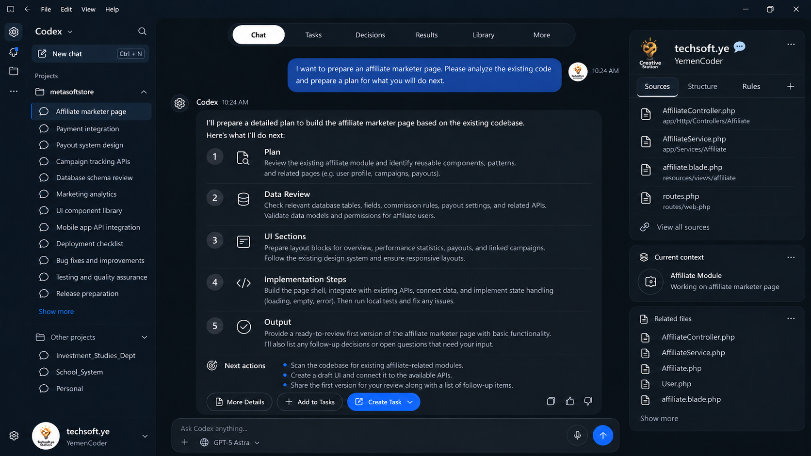
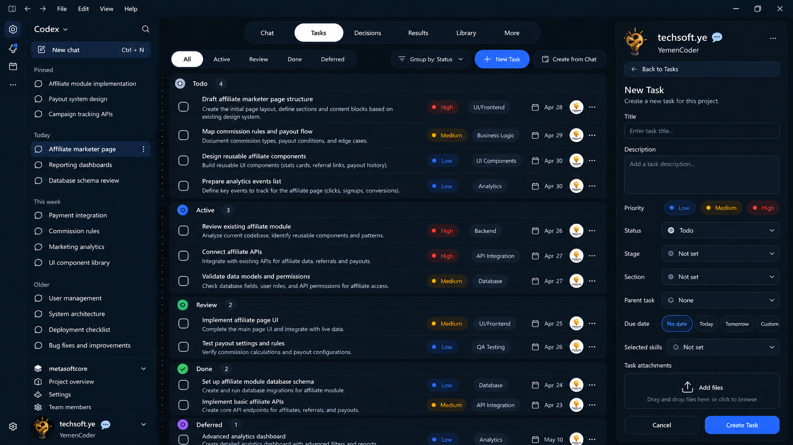
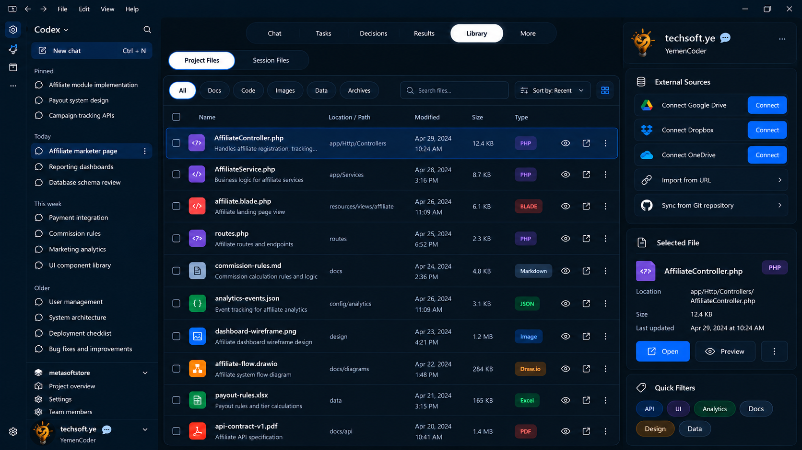

# Codex Studio — مساحة عمل هندسية متمحورة حول المشروع لتطوير البرمجيات بالوكلاء

**Codex Studio — A Project-Centric Engineering Workspace for Agentic Software Development**

**RFC لتصور المنتج الكامل — مسودة مراجعة مكتملة، الإصدار 1.1**

**الجهة المقدمة:** TechSoft  
**تاريخ إعداد المسودة الأصلية:** 2026-10-18  
**الحالة:** مقترح مستقل؛ ليس منتج OpenAI رسميًا أو التزام إصدار.  
**اللغة:** ترجمة عربية كاملة ومتكافئة للنسخة الإنجليزية المرجعية.

تضم الوثيقة 15 فصلًا و5 ملاحق مكتملة. تصف ألفاظ الإلزام سلوك Studio المقترح. ادعاءات القدرات القائمة مؤرخة وموثقة. يسجل الفصل 14 القرارات الخارجية المفتوحة، ولا تعني نقص محتوى الفصول.

[المصطلحات واتفاقات الترجمة](../review/03-terminology.md) · [تقرير المراجعة](../review/06-review-report.md) · [دليل الحزمة](../README.md)

## المحتويات

- [01. الملخص التنفيذي](#ch-01)
- [02. واقع المنتجات الحالية وخط أساس القدرات](#ch-02)
- [03. المشكلة العملية في العمل الهندسي](#ch-03)
- [04. مبررات المنتج والرؤية والتموضع](#ch-04)
- [05. بنية مساحة العمل المتمحورة حول المشروع وتجربة المستخدم](#ch-05)
- [06. المهام وتخطيط التطوير](#ch-06)
- [07. القرارات الهندسية وقواعد المشروع](#ch-07)
- [08. نتائج التنفيذ والأدلة](#ch-08)
- [09. مكتبة المشروع والموارد](#ch-09)
- [10. السياق والذاكرة وتنسيق الوكلاء](#ch-10)
- [11. التكامل التقني والثقة](#ch-11)
- [12. استراتيجية تقديم المنتج ونطاق MVP](#ch-12)
- [13. التحقق والقيمة المتوقعة](#ch-13)
- [14. المخاطر والمفاضلات والأسئلة المفتوحة](#ch-14)
- [15. المقترح الموجه إلى OpenAI والخطوات التالية](#ch-15)
- [الملحق A. معرض تصاميم الواجهة وتجربة المستخدم](#app-a)
- [الملحق B. مصفوفة القدرات القائمة والمقترحة](#app-b)
- [الملحق C. سيناريو المطور المتكامل](#app-c)
- [الملحق D. نموذج البيانات المفاهيمي](#app-d)
- [الملحق E. المراجع والأدلة](#app-e)

<a id="ch-01"></a>
# 01. الملخص التنفيذي

<a id="s-01-1"></a>
## 01.1 المقترح والقرار المطلوب

تقترح TechSoft منتج **Codex Studio — A Project-Centric Engineering Workspace for Agentic Software Development**، أي «مساحة عمل هندسية متمحورة حول المشروع لتطوير البرمجيات بالوكلاء»، بوصفه منتجًا مكتبيًا متخصصًا للمطورين. يعيد استخدام قدرات التنفيذ المدعومة في Codex، ويضيف علاقات مستمرة بين محادثات المشروع والعمل المطلوب والقرارات الهندسية والقواعد المنطبقة ومحاولات التنفيذ والنتائج المراجعة والملفات. هذا تصور مستقل مقدم للمراجعة الهندسية، وليس إعلانًا من OpenAI أو التزامًا بالتنفيذ.

القرار المطلوب هو تقييم مسار محدود ومتكامل: اختيار العمل من محادثة، وحفظ مصدر طلبه، واعتماد خيار مؤثر عند الحاجة، والتنفيذ بالضوابط القائمة، وفحص أدلة مرتبطة بإصدار محدد، ثم الاستئناف لاحقًا بالتوجيهات الحالية. اعتماد هذا RFC لا يجيز استقصاء التصميم إلا إذا صرحت الجهة المعتمدة بذلك؛ ولا يجيز النشر التشغيلي أو الوصول الخارجي.

<a id="s-01-2"></a>
## 01.2 المشكلة وحدود الأدلة

تصف مسودات TechSoft المقدمة صعوبة إعادة بناء ما طُلب واعتُمد ونُفذ وتُحقق منه عبر المحادثات المستمرة. هذه ملاحظات نوعية لصاحب المقترح. لا يتضمن الأرشيف دراسة استخدام أو قياسات منتج أو مقارنة مضبوطة تثبت تكرار المشكلة أو حجمها. وصف صفحة المسوق بالعمولة في الملحق C سيناريو توضيحي، وليس تجربة Studio منفذة.

تدعم الأدوات الحالية بالفعل قدرًا مهمًا من عمل المشاريع. يقر الفصل 02 والملحق B بالقدرات الموثقة. الفرضية هي أن العلاقات الصريحة وأبعاد الحالة المستقلة يمكن أن تقلل أخطاء إعادة بناء السياق والمراجعة مقارنة بإعداد حالي منظم. وقد تُرفض هذه الفرضية: ربما تستغرق صيانة السجلات وقتًا أكبر مما توفره، وربما يعالج المنتج الحالي بعض الاحتياجات بصورة كافية.

<a id="s-01-3"></a>
## 01.3 ما يضيفه المنتج

تبقى العروض الستة **Chat / Tasks / Decisions / Results / Library / More**. تستعلم هذه العروض عن سجلات مشتركة للمشروع. يغير مرشح المحادثة ما يظهر دون إنشاء نسخ خاصة من المهام المشتركة. ترتبط النتيجة بمحاولة محددة ولقطة للكود؛ وتحدد مراجعتها بدقة ما قبله المطور. يحتفظ القرار المعتمد بالإصدار الذي زُود به التنفيذ السابق. وتعرض Library ملفات المشروع والجلسات مع معلومات منشأ مستقرة.

يفصل التصميم أربعة أسئلة: هل اكتملت المهمة؟ هل انتهت محاولة التنفيذ؟ ما الفحوص التي أُجريت فعلًا؟ وهل قبل إنسان النتيجة؟ هذه الفروق متطلبات تشغيلية في الوثيقة كلها، وتمنع تحول الجملة الأخيرة للوكيل أو نجاح خروج أمر إلى سجل قبول ضمني.

<a id="s-01-4"></a>
## 01.4 اتجاه المنتج والنطاق الأولي

المنتج المكتبي المستقل للمطورين هو الاتجاه الأساسي. يتيح التخصص نمو مسارات الهندسة وهوية واضحة، لكنه لا يثبت سرعة أعلى أو استهلاك ذاكرة أقل أو تكلفة تطوير أدنى. تظل المساحة المتخصصة داخل التطبيق المكتبي الموحد والتقديم عبر امتداد بديلين للمقارنة في الفصل 12.

النسخة الأولية المقترحة MVP محلية ولمستخدم واحد، وتتمحور حول مشروع واحد ومستودع أساسي واحد لكل تنفيذ. تشمل مداخل التنقل الستة بوظائف محدودة، ومهام يدوية ومستخرجة من المحادثات، وقرارات ذات إصدارات، ومراجع لقواعد المستودع، وإسناد التنفيذ، ومراجعة الأدلة، ومراجع Library المحلية، والاختيار الأساسي للسياق، والاستعادة بعد إعادة التشغيل، والتصدير. المصادر السحابية الاختيارية والمزامنة الآلية بين الأجهزة وحوكمة الفرق المتقدمة وجدولة العمل المتوازي المتقدمة مرشحة لمراحل لاحقة. وتبقى Prompt Templates خارج النطاق.

<a id="s-01-5"></a>
## 01.5 معيار المراجعة

هذه **مسودة مراجعة مكتملة**، وليست مواصفة إصدار أو دليلًا على القيمة. تعبّر MUST وSHOULD وMAY عن متطلبات مقترحة: MUST، «يجب»، لازم للسلوك الموصوف؛ SHOULD، «ينبغي»، يسمح بمفاضلة موثقة؛ MAY، «يجوز»، اختياري. تستخدم معرّفات المتطلبات الثابتة الصيغة `R-CC-NN`، وحالات التقييم `V-NN`، والأسئلة المفتوحة `Q-NN`. الإنجليزية هي النص المرجعي، وتحمل العربية المعنى والمعرّفات نفسها.

تبدأ المراجعة بنموذج الحالات وحدود الثقة، ثم جدوى التكامل، ثم قيمة المنتج للمستخدم. أهم المسائل غير المحسومة هي ضمانات استعادة بيئة التنفيذ، والمصادقة والتوزيع المتوافقان، وسياسة الاحتفاظ بالأدلة، وتكلفة الصيانة الإضافية للاستقلال. يحدد الفصل 14 أثر كل مسألة والدور المسؤول وبوابة القرار. لا تدعي الوثيقة تحسنًا مقاسًا أو ميزانية أو موعد تسليم أو تأييدًا من OpenAI.

<a id="s-01-6"></a>
## 01.6 الإصدار 1.1: مشاريع منسقة وفرق معلومة المسؤولية

يشمل تصور المنتج الكامل الآن Project Group اختيارية فوق مشاريع مستقلة الإعداد، يمثلها Backend وFlutter وNext.js في MetaStore. تشمل القدرات اللاحقة المشروطة ملفات البيئات وتتبع الاعتماديات والعقود وChange Sets المنسقة والأدلة المدمجة. يستخدم الفريق الهجين من البشر والوكلاء أدوارًا محددة وإسناد عمل مستقلًا وتفويضًا معلوم المصدر وقبولًا بشريًا.

يضيف أفق 2026–2036 التفاعل الصوتي والمرئي الاختياري وموائمات تطوير الروبوتات أو الكم حيث تبررها الأدلة. تحفظ الإضافات التبويبات الستة ونموذج المهمة المرجعي وأبعاد الحالة المستقلة وMVP المحلية المحدودة. وهي مواصفات لمراجعة لاحقة، لا ادعاءات بقدرات Studio قائمة أو إذنًا لتعديل مستودعات المستخدم. راجع الأقسام 02.6 و11.8–11.9 و12.5–12.6.

<!-- related-start -->
**الأقسام المرتبطة:** [02. واقع المنتجات الحالية وخط أساس القدرات](#ch-02) · [04. مبررات المنتج والرؤية والتموضع](#ch-04) · [12. استراتيجية تقديم المنتج ونطاق MVP](#ch-12) · [13. التحقق والقيمة المتوقعة](#ch-13) · [14. المخاطر والمفاضلات والأسئلة المفتوحة](#ch-14)
<!-- related-end -->

---

<a id="ch-02"></a>
# 02. واقع المنتجات الحالية وخط أساس القدرات

<a id="s-02-1"></a>
## 02.1 منهج التحقق

جرى التحقق من خط الأساس عبر الوثائق الرسمية بتاريخ **2026-10-18**. يحدد الملحق E الروابط النهائية والادعاءات المدعومة وحدود الاستدلال؛ ويربط الملحق B كل قدرة بإضافة Studio المقترحة. يثبت التوثيق وصفًا عامًا في تاريخ التحقق، وليس التوفر لجميع الحسابات أو تكاملًا مختبرًا على هذا الجهاز. لا تستخدم الوثيقة مسوداتها أو تصاميمها أو أسماء ملفاتها دليلًا على سلوك منتج مطروح.

تُستخدم ثلاثة تصنيفات ثابتة: **Existing — قائم** يعني أن مصدرًا رسميًا مفتوحًا يدعمه؛ **Proposed — مقترح** يعني سلوكًا تحدده هذه الوثيقة؛ **Requires Validation — يتطلب تحققًا** يعني أن الأدلة المتاحة لا تثبت السلوك أو الضمان المطلوب. قد يجمع صف واحد التصنيفات الثلاثة. ولا يُعد عدم العثور على توثيق دليلًا على غياب ميزة.

<a id="s-02-2"></a>
## 02.2 الأسس القائمة

تعرض وثائق التطبيق المكتبي خياري ChatGPT وCodex، مع Chat وWork داخل ChatGPT. يمكن للمشاريع تنظيم العمل المترابط، وتربط المشاريع المحلية العمل بالمجلدات. يستهدف Work مخرجات أوسع ويتداخل في الملفات والنتائج القابلة للمراجعة. هذه أسس قائمة وليست ابتكارات Studio. [E-01](https://learn.chatgpt.com/docs/app)، [E-02](https://learn.chatgpt.com/docs/projects)، [E-11](https://learn.chatgpt.com/docs/get-started-with-work).

توثق صفحات رسمية مستقلة Worktrees ومراجعة الكود والمهام المجدولة. يجب تقييم هذه المسارات قبل إضافة ضوابط منافسة. ويظل تاريخ الاستحقاق في مهمة Studio بيانات للتخطيط، دون أن ينشئ جدول تشغيل تلقائيًا. [E-07](https://learn.chatgpt.com/docs/environments/git-worktrees)، [E-08](https://learn.chatgpt.com/docs/code-review)، [E-09](https://learn.chatgpt.com/docs/automations).

يملك Codex أيضًا ذاكرة محلية، واكتشافًا للتعليمات عبر `AGENTS.md`، وتحميل المهارات، ومسارات للوكلاء الفرعيين. إضافة Studio هي الربط المقترح بالنطاق والاعتماد والإصدار والأدلة حول المواد ذات الصلة. ولا يجوز له الادعاء بأنه يقدم الذاكرة أو ملفات التعليمات أو التفويض لأول مرة. [E-03](https://learn.chatgpt.com/docs/customization/memories)، [E-04](https://learn.chatgpt.com/docs/agent-configuration/agents-md)، [E-05](https://learn.chatgpt.com/docs/build-skills)، [E-10](https://learn.chatgpt.com/docs/agent-configuration/subagents).

<a id="s-02-3"></a>
## 02.3 خط أساس التكامل

توثق App Server واجهة عميل تتضمن threads وturns وitems وأحداثًا متدفقة وموافقات. وتفرق إرشادات التكامل العامة بين App Server وCodex SDK والتنفيذ غير التفاعلي. تدعم هذه المصادر استقصاء إعادة الاستخدام، لكنها لا تثبت كيانات Studio المقترحة أو عقد الاستعادة أو الإذن بإعادة استخدام كل مكون مكتبي خاص. [E-06](https://learn.chatgpt.com/docs/app-server)، [E-12](https://developers.openai.com/blog/codex-as-a-platform).

يقترح الفصل 11 موائمًا فوق بيئة التنفيذ المدعومة. عقده تصميم خاص بـStudio. إرجاع موصل لمعرّف محادثة لا يثبت أن Studio يستطيع قراءة جميع المحادثات السابقة، ومسار الملف المحلي لا يثبت الوصول بين الأجهزة. يجب أن يكتشف الموائم القدرات الفعلية وأن يوضح تقييد الوظائف عند غيابها.

<a id="s-02-4"></a>
## 02.4 التداخل ومصدر السلطة

**الجدول 02-1 — تقييم حدود المنتجات**

| السطح | المسؤولية القائمة أو الخارجية | مقترح Studio | الحد الذي يحتاج مراجعة |
|---|---|---|---|
| بيئة تنفيذ Codex | تنفيذ الوكيل والضوابط المهيأة | إسناد التنفيذ إلى المهمة وإصدارات السياق | الأحداث المتاحة وتسوية حالة العمل المتوقف |
| التطبيق المكتبي الحالي | تجربة المشاريع والمحادثات | سجلات هندسية مترابطة عبر العروض الستة | التكرار وتكلفة التنقل |
| ChatGPT Work | مسارات المخرجات العامة | القبول الهندسي وأدلة الكود | المكونات المشتركة واختلاف احتياجات المنتج |
| IDE ومسار Git | التحرير وحالة الكود وعمليات المستودع | فتح الدليل المحدد والمسارات الحالية بصورة مميزة | التسليم الآمن وحفظ التغييرات غير المثبتة |
| متتبع القضايا الحالي | مرجعية العمل التي اختارها الفريق | مرجع اختياري لقضية خارجية | لا مزامنة ثنائية الاتجاه للحالة في MVP |

يوزع الجدول المسؤولية المقترحة، ولا يدعي افتقار متتبعات القضايا الخارجية إلى مفاهيم مماثلة. أُضيفت مقارنة وثائق محدودة في الإصدار 1.1؛ ولم تُجر تجربة مقارنة للمنتجات أو تدقيق لعقود المزودين. إذا استخدم المشروع متتبعًا قائمًا، يجب توضيح ما إذا كان السجل مملوكًا لـStudio أو مرجعًا خارجيًا. لا يجوز لروابط MVP تحديث الحالة الخارجية بصمت.

<a id="s-02-5"></a>
## 02.5 ما لم يُتحقق منه

لا يثبت خط الأساس العام الحالي النقل الكامل للجلسات إلى Studio مستقل، أو إعادة بث كل حدث فائت، أو إطلاقًا ذريًا يشمل تخزين Studio وبيئة التنفيذ، أو تطابق الواجهات بين جميع المضيفين، أو الوصول إلى الاستدلال الخاص. كما لا يثبت الإذن أو ضمانات الدعم أو شروط الترخيص أو تكلفة التوزيع المستقل. هذه موضوعات استقصاء صريحة وليست ادعاءات بغياب المزايا.

**R-02-01 — تتبع الادعاءات.** يجب ربط كل ادعاء بقدرة حالية بمصدر رسمي وتاريخ تحقق. معيار القبول: يستطيع المراجع تتبع كل صف لخط الأساس في الملحق B إلى الملحق E؛ وتبقى الضمانات غير المدعومة ضمن Requires Validation. لا يتحول سلوك مقترح إلى Existing لمجرد ظهوره في تصميم مقنع.

<a id="s-02-6"></a>
## 02.6 أسس قائمة للمظلة والعمل الجماعي

يوثق Codex مشاريع محلية متعددة المجلدات، مع تمييز المجلد الأساسي الموضح في القسم 10.7. [E-02](https://learn.chatgpt.com/docs/projects). وتوثق Codex Cloud بيئات قابلة لإعادة الاستخدام تضم مستودعات وأدوات. [E-17](https://learn.chatgpt.com/docs/cloud). هذا تداخل قائم، وليس ادعاء جدة لـStudio.

خارج Codex، توفر VS Code مساحات متعددة الجذور؛ وتنظم GitLab Groups المشاريع المترابطة والصلاحيات؛ وتصف dev containers بيئات تطوير قابلة لإعادة الإنشاء. [E-14](https://code.visualstudio.com/docs/editing/workspaces/multi-root-workspaces)، [E-15](https://docs.gitlab.com/user/group/)، [E-16](https://docs.github.com/en/codespaces/setting-up-your-project-for-codespaces/adding-a-dev-container-configuration/introduction-to-dev-containers). يحل تجميع المجلدات وحوكمة المشاريع وإعداد البيئة أجزاء مختلفة من المشكلة. ولا يثبت أي منها منفردًا توافق عقد Backend مع إصدارَي عميلين.

توثق ChatGPT Teams وTeam Tasks عملًا مشتركًا وتنفيذًا بهوية خدمة؛ وتوثق أدوار المساحة واتحاد هوية الأحمال حدود وصول منفصلة. [E-19](https://learn.chatgpt.com/docs/enterprise/teams)، [E-18](https://learn.chatgpt.com/docs/enterprise/roles-and-workspace-permissions)، [E-20](https://developers.openai.com/api/docs/guides/workload-identity-federation/federation-rules). تدعم هذه الأسس استقصاء جدوى عمل البشر والوكلاء المحكوم، ولا تثبت مصفوفة Studio الدقيقة أو توفرًا متماثلًا في كل حساب.

الإضافة المقترحة هي ربط المشاريع المستقلة الإعداد والعقود ذات الإصدارات والتفويض معلوم المسؤولية وأدلة القبول المدمج. يظل بناء هذا الربط أو دمجه أو تركه سؤال منتج مقارنًا. الاستثمار القائم مؤشر حاجة، وليس طلبًا مقاسًا لمنتج مكتبي إضافي.

<!-- related-start -->
**الأقسام المرتبطة:** [الملحق B. مصفوفة القدرات القائمة والمقترحة](#app-b) · [الملحق E. المراجع والأدلة](#app-e)
<!-- related-end -->

---

<a id="ch-03"></a>
# 03. المشكلة العملية في العمل الهندسي

<a id="s-03-1"></a>
## 03.1 الملاحظة المتاحة

الدليل الأولي هو وصف TechSoft المقدم للتخطيط والتنفيذ والمراجعة والاستئناف المتكرر في مشاريع برمجية مستمرة. يصف تشتت المتطلبات والقرارات والمخرجات، لكنه لا يتضمن قياسات زمنية أو نصوص مقابلات أو مجموعة بيانات للحوادث. لذلك يتعامل المقترح مع المشكلة باعتبارها ملموسة ومعقولة، مع بقاء انتشارها وأهميتها التجارية دون قياس.

وحدة العمل المعنية هي ميزة يستمر تطويرها عبر جلسات. قد يجد المطور محادثة ثم يحتاج إلى تحديد ما إذا كان اقتراح ما قد اعتُمد، وهل استبدله تصحيح لاحق، وهل تشير الأدلة إلى الكود الحالي. تختلف إعادة البناء هذه عن استرجاع النص وحده.

<a id="s-03-2"></a>
## 03.2 سجل المشكلات

**الجدول 03-1 — الملاحظات والتفسيرات والنتائج القابلة للاختبار**

| المعرّف | الملاحظة النوعية في المسودات المقدمة | التفسير الذي يُختبر | إخفاق قابل للملاحظة في التقييم |
|---|---|---|---|
| P-01 | البدائل والخيارات المقبولة تشترك في سجل النقاش | استعادة حالة الاعتماد مكلفة | يختار المشارك خيارًا مستبدلًا أو غير معتمد |
| P-02 | قد تترك الاستجابة الختامية التحقق غير مكتمل | يختلط تقدم المهمة بتقدم الوكيل | يعلن المشارك Done مع بقاء فحص مطلوب في Not Run |
| P-03 | تحتاج الفروق والسجلات والملخصات إلى ربط يدوي | يصعب تقييم هوية الأدلة | يستخدم المشارك فحصًا ناجحًا لإصدار مختلف |
| P-04 | تُعاد صياغة القيود ذات الصلة عند الاستئناف | تتطلب استعادة السياق عملًا يمكن تجنبه | يهمل المشارك قيدًا معلومًا منطبقًا أو يعيد شرحه |
| P-05 | يتطلب التنظيم نفسه صيانة | قد يضيف المنتج المنظم عبئًا | يتجاوز وقت الصيانة وقت الاستعادة الذي تم توفيره |

هذه تعريفات لإخفاقات التقييم، وليست ادعاءات بحدوثها بنسب مقاسة. ترد معالجاتها المقترحة في الفصول 05–11؛ ويحدد الفصل 13 طريقة المقارنة العادلة.

<a id="s-03-3"></a>
## 03.3 الحلول العملية القائمة

يمكن للمطور حفظ سجلات القرارات ووصف القضايا وقوائم التحقق وتاريخ Git وروابط المحادثات في المستودع وأدواته. يمثل ذلك خط أساس موثوقًا، ويوفر مراجعة صريحة ومعرفة قابلة للنقل؛ ويتمثل الجهد في إبقاء العلاقات ومعلومات الحداثة صحيحة. قد يحافظ فريق متمرس عليها جيدًا إلى درجة لا يضيف معها Studio قيمة كبيرة.

من البدائل أيضًا إبقاء الميزة في محادثة طويلة واحدة. قد يحفظ ذلك التفاصيل، لكنه لا يحدد بمفرده قبولًا مستقلًا للمهمة، أو قرارات ذات إصدارات، أو علاقة الاختبار بلقطة الكود. هذا تمييز في النموذج المفاهيمي، وليس تشخيصًا لتخزين Codex غير المعلن.

لذلك ينبغي أن يقلل Studio أعمال التوثيق اليدوية بالتقاط المنشأ عند حدوث الإجراءات. لا يجوز أن يطلب إعادة كتابة كل رسالة مفيدة أو نسخ الملفات المصدرية يدويًا أو تصنيف كل سؤال قبل المساعدة. إذا تعذر الإسناد الآلي الموثوق، يجب إظهار القيد بدل إخفاء الحاجة إلى الصيانة اليدوية.

<a id="s-03-4"></a>
## 03.4 السيناريو والنطاق

يستخدم الملحق C صفحة المسوق بالعمولة الموجودة في التصاميم. الطلب التوضيحي هو فحص التطبيق القائم والتخطيط للصفحة؛ ويتطلب التنفيذ توجيهًا لاحقًا. يتناول المثال ملخصات العمولات ونشاط الإحالات ومعلومات الصرف، دون إثبات نقطة API أو مخطط بيانات أو رصيد أو نتيجة مالية فعلية.

يفيد السيناريو لأنه يتضمن قرار إعادة استخدام مؤثرًا، وعمل واجهة، ومراجعة أدلة، ثم عودة إلى تحقق لم يكتمل. ولا يبرر إضافة منطق مالي إلى Studio. يبقى التطبيق المضيف مسؤولًا عن بيانات المجال والتفويض.

<a id="s-03-5"></a>
## 03.5 الأدلة اللازمة قبل الاستثمار

يُستقطب مشاركون يعودون فعلًا إلى العمل البرمجي بعد انقطاع، بمن فيهم مطورون لديهم توثيق منظم للمستودع. تُلاحظ الممارسة الحالية قبل تقديم مصطلحات Studio. يُطلب منهم العثور على قيد معتمد، وشرح نتيجة غير مكتملة، وتحديد الإجراء الآمن التالي. تُسجل الأخطاء وجهود الصيانة إضافة إلى السرعة.

**R-03-01 — أمانة أدلة المشكلة.** يجب أن يفصل التقييم بين الصعوبات المبلغ عنها ذاتيًا، وأخطاء المهام المرصودة، والزمن المقاس. معيار القبول: تحدد بيانات الدراسة نوع الدليل، ولا تعرض السيناريو التوضيحي أو قيم التصاميم كأنها نتائج مشاركين. إذا كان المشاركون يستعيدون الحالة بدقة وسرعة بالفعل، يُخفض ادعاء القيمة المرتبط أو يُرفض.

<!-- related-start -->
**الأقسام المرتبطة:** [الملحق C. سيناريو المطور المتكامل](#app-c) · [13. التحقق والقيمة المتوقعة](#ch-13)
<!-- related-end -->

---

<a id="ch-04"></a>
# 04. مبررات المنتج والرؤية والتموضع

<a id="s-04-1"></a>
## 04.1 لماذا منتج متخصص

المقترح الأساسي مساحة مكتبية متخصصة تتناول يوميًا العمل البرمجي: المتطلبات والتغييرات والقيود والفحوص والمراجعة والاستمرار. يتيح استقلال المنتج تطوير هذه المسارات بصورة مترابطة وإظهار مسؤوليتها. يظل المشروع وحدة التنظيم المستمرة، بينما تبقى المحادثة وسيلة فعالة لتوجيه الوكيل.

للاستقلال تكلفة: يجب صيانة التوزيع والتحديثات الأمنية وتجربة الحساب وإمكانية الوصول والدعم وترحيل البيانات وتوافق التكاملات. مشاركة المحرك لا تلغي هذه التكاليف. يقارن الفصل 12 خيارات التقديم دون اعتبار وجود ملف تنفيذي مستقل دليلًا على القيمة.

<a id="s-04-2"></a>
## 04.2 المستخدمون المستهدفون وأعمالهم

**الجدول 04-1 — المستخدمون ذوو الأولوية والأعمال المتوقعة**

| سياق المستخدم | العمل الذي ينبغي دعمه | القيمة القابلة للملاحظة |
|---|---|---|
| مطور فردي يتابع ميزة عبر جلسات | استعادة المهمة الحالية والخيار والفحص المتبقي | إجراء تالٍ صحيح دون إعادة بناء كل النقاش |
| مهندس يراجع تغييرات الوكيل | مقارنة النطاق المطلوب بأدلة الإصدار المحدد | كشف ادعاءات الإنجاز غير المدعومة |
| مسؤول صيانة مستودع قائم | حفظ الأعراف المنطبقة أثناء انتقال العمل بين المحادثات | بقاء التوجيهات قابلة للتتبع إلى مصدرها |
| تجربة فريق لاحقة | تسليم العمل إلى مهندس مخول آخر | إسناد واضح دون افتراض وجود سياسة اعتماد مشتركة |

تخدم MVP السياقات الثلاثة الأولى بمالك بشري محلي واحد. يمكن لفريق مراجعة الوثائق المصدرة، لكن ذلك لا يعني التحرير المتزامن المشترك أو تفويض أدوار الاعتماد أو إدارة سياسات على مستوى المؤسسة. تحتاج هذه الأمور إلى قرارات منتج وأمان إضافية.

<a id="s-04-3"></a>
## 04.3 الأهداف

الهدف الأساسي سلسلة قابلة للفحص من القصد إلى الدليل. يستطيع المستخدم معرفة المطلوب، وسبب اعتماد خيار مؤثر، وما غيرته المحاولة، والفحوص التي تدعمها، وما لم يُحسم. ينبغي أن تحفظ المنظومة هذه الإجابات عبر إعادة التشغيل وتغير شجرة العمل.

الهدف الثاني سهولة التبني. يستطيع المطور مواصلة استخدام المستودع وIDE، وترك تصنيف المهمة دون تعيين، وطرح الأسئلة دون إنشاء سجلات. تضاف البنية عند انتقالات ذات معنى. والهدف الثالث سياق محدود للوكيل: اختيار المواد ذات الصلة مع حفظ التوجيهات المطلوبة وإظهار ما تعذر استرجاعه.

<a id="s-04-4"></a>
## 04.4 الاستبعادات وضبط النطاق

لا يقترح Studio نموذجًا جديدًا أو بديلًا لبيئة تشغيل الوكيل، أو IDE عامًا، أو مدير ملفات شاملًا، أو دفترًا ماليًا، أو منظومة كاملة لإدارة المشاريع المؤسسية، أو عارضًا للاستدلال الخفي. تبقى Prompt Templates وتبويب Execution رئيسي منفصل وحقول إنشاء المهام الإضافية مثل Assignee وRelated To العام وAdd Sub-task مستبعدة.

لتبويب More دور تشغيلي محدود في الفصل 05، وليس التزامًا بإضافة أي أداة تتسع لها قائمة لاحقًا. أمثلة التكامل الاختيارية في الصور لا توسع MVP. متطلبات الوثيقة مقترحات للمراجعة؛ ولا تغير إعدادات الحساب القائمة، أو تجيز مزودين جددًا، أو تنفذ كودًا.

<a id="s-04-5"></a>
## 04.5 مبادئ وآثارها التشغيلية

**R-04-01 — استمرارية المشروع.** يجب أن تحمل جميع السجلات المنظمة هوية Project المالك، أو هوية Group صريحة لسجلات التنسيق المملوكة للمجموعة، وأن يُفحص الوصول عبر المشاريع حتى عند معرفة الرابط. معيار القبول: لا يؤدي فتح سجل من مشروع مختلف إلى تغيير هدف التنفيذ بصمت أو كشف محتوى غير متاح للمستخدم.

**R-04-02 — البنية الاختيارية.** يجب أن تظل المهمة ذات العنوان فقط والمحادثة العادية مدخلين صالحين. معيار القبول: يستطيع المستخدم السؤال دون مهمة، وإنشاء مهمة دون Stage أوSection أوParent Task أوDue Date أوSkills أو مرفقات.

**R-04-03 — إعادة الاستخدام مع وضوح المسؤولية.** ينبغي استخدام تكامل Codex مدعوم مع تحمل Studio مسؤولية اتساق سجلاته ودلالات المراجعة. معيار القبول: تحدد المراجعة المعمارية مالك كل سجل مستمر واستجابة إخفاق؛ ولا تفترض خدمة OpenAI خاصة أو قاعدة بيانات غير موثقة.

<a id="s-04-6"></a>
## 04.6 التميز الذي يحتاج إلى اختبار

التميز المقترح هو اجتماع تتبع المنشأ بالتنقل، واستقلال أبعاد دورة الحياة، والتوجيهات الحالية المعتمدة، ومراجع الأدلة المستمرة. لا يثبت أي منها منفردًا الجدة أو الطلب. ينبغي مقارنة المسار الكامل بإعداد حالي منظم وببديل المساحة المدمجة. النتيجة القوية استمرار صحيح وأسرع مع تكلفة تنظيم مقبولة؛ والنتيجة الضعيفة واجهة أخرى يضطر المستخدمون إلى إبقائها متزامنة يدويًا.

<a id="s-04-7"></a>
## 04.7 مجموعات المشاريع والفرق الهجينة

**مجموعة المشاريع Project Group** مظلة اختيارية على مستوى المنتج تضم مشاريع مستقلة الإعداد. في مثال MetaStore الذي قدمه المستخدم، تنتمي Backend وFlutter وNext.js إلى المنتج نفسه، مع احتفاظ كل منها بمستودعاته واعتمادياته وبيئات تنفيذه وتعليماته ومسؤوليات إصداره. يعتمد المثال على وصف المستخدم؛ ولم يُفحص أي مستودع أو تُشخّص بيئته.

المجموعة ليست نظام ملفات مدمجًا أو مستودعًا موحدًا إلزاميًا أو مخزن صلاحيات مشتركًا أو بيئة تنفيذ. يبقى Project حد ملكية المهام والمحاولات. تحمل سجلات التنسيق المملوكة للمجموعة هويتها وروابط صريحة إلى المشاريع الأعضاء. لا تمنح العضوية في المظلة وصولًا تلقائيًا إلى جميع أعضائها. وتستمر المشاريع المستقلة دون مجموعة.

يشمل التصور الكامل فريقًا هجينًا: يحدد البشر المسؤولية ويعتمدون النتائج المؤثرة؛ وينفذ الوكلاء أو يراجعون ضمن نطاقات تفويض صريحة. اسم المتخصص أو النموذج أو المهارة وصف قدرة، وليس هوية تخويل. يجب التمييز بين نسخة الوكيل الفعلية وهوية الاعتماد المستخدمة والإنسان المسؤول. يُسجل إسناد العمل خارج نموذج New Task المرجعي؛ ولا يُعاد حقل Assignee المستبعد.

الحاجة معقولة لأن منتجات قائمة تستثمر بالفعل في المساحات متعددة المجلدات ومجموعات المشاريع والبيئات القابلة لإعادة الاستخدام؛ لكن ذلك دليل على مشكلة تنسيق معروفة، ولا يثبت أن Studio سيحلها بجدوى اقتصادية. يقر الفصل 02 بهذا التداخل؛ وتحدد الفصول 05 و10 و11 السلوك الإضافي، ويختبر الفصل 13 قيمته الإضافية.

**R-04-04 — حدود المظلة الصريحة.** يجب أن تحفظ Project Group هوية المشاريع الأعضاء واختيار بيئاتها والتخويل. القبول: لا تؤدي إضافة Backend وFlutter إلى مجموعة إلى تغيير مجلدات عملهما أو منح المشاركين وصولًا جديدًا إلى المستودعات. تحدد سجلات التنسيق نطاقها الخاص، ولا تظهر كسجلات مشروع.

<!-- related-start -->
**الأقسام المرتبطة:** [05. بنية مساحة العمل المتمحورة حول المشروع وتجربة المستخدم](#ch-05) · [12. استراتيجية تقديم المنتج ونطاق MVP](#ch-12)
<!-- related-end -->

---

<a id="ch-05"></a>
# 05. بنية مساحة العمل المتمحورة حول المشروع وتجربة المستخدم

<a id="s-05-1"></a>
## 05.1 هوية مساحة العمل والتنقل

تجعل مساحة العمل حالة المشروع قابلة للتنقل دون إجبار كل تبادل على التحول إلى مهمة. مدخلاتها المشروع النشط، والمحادثة الاختيارية، والتبويب المحدد، والسجل المحدد، ومرشحات العرض. يختار المستخدم المشروع صراحة؛ ويمكن للوكيل اقتراح سجلات ذات صلة، لكنه لا يغير هدف التنفيذ بمجرد عرض رابط.

ينظم الجانب الأيسر المشاريع ومحادثاتها. ويحتوي الوسط على **Chat / Tasks / Decisions / Results / Library / More** فقط. تحتفظ اللوحة اليمنى بهوية الحساب ويتغير محتواها العملي مع العرض المحدد. يظهر رأس المشروع المستودع أو المجلد النشط ومرشح المحادثة عند وجوده. لا تملك المحادثة العامة سجلات مشروع ضمنية؛ ويتطلب إلحاقها بمشروع اختيارًا صريحًا وفحص صلاحية.

حالة التنقل منفصلة عن حالة المجال. يُحفظ محليًا آخر تبويب ومرشحات وتحديد وموضع تمرير لكل مشروع. تعيد العودة من نتيجة مرتبطة موضع المهمة السابق. تحمل النتيجة المفتوحة من مهمة مسار رجوع، لا شاشة مهمة مكررة. يؤدي تبديل المشروع إلى إبطال التحديدات التابعة للمشروع السابق؛ ولا ينقل سجلات أو يعيد توجيه تشغيل نشط.

<a id="s-05-2"></a>
## 05.2 سلوك Chat وتحويل النقاش إلى سجلات

يدعم Chat النقاش والفحص والتخطيط وتوجيهات التنفيذ ضمن الصلاحيات القائمة. يستطيع المستخدم إبقاء تعديل صغير داخل المحادثة بالكامل. إنشاء العمل المنظم اختياري. وتختلف آثار الإجراءات المرجعية الثلاثة:

**الجدول 05-1 — إجراءات Chat وآثارها المحفوظة**

| الإجراء | سلوك المستخدم والوكيل | الأثر المحفوظ والتعامل مع الخطأ |
|---|---|---|
| More Details | يطلب المستخدم تفصيلًا ويشرح الوكيل المقترح المحدد | استمرار النقاش دون اعتماد أو تغيير حالة مهمة |
| Add to Tasks | يقترح الوكيل عناصر قابلة للتنفيذ، ويختار المستخدم المسودات ويحررها | حفظ العناصر المختارة ذريًا مع مراجع الرسائل؛ يحتفظ فشل الحفظ بالمسودات |
| Create Task | يفتح المستخدم مسودة واحدة قابلة للتحرير، وقد تُملأ مبدئيًا | تحقق الفصل 06 نفسه؛ لا تنفيذ عند الحفظ |
| Capture decision | يطلب المستخدم استخلاص خيار مؤثر | قرار Proposed مع مرجع المصدر، دون اعتماد آلي |

يحدد مرجع المصدر المحادثة والرسالة، والمقطع المحدد أو إصدار الرسالة حين يكون مدعومًا. إذا لم يوفر السطح معرّف رسالة مستقرًا، يُحفظ مقتطف موسوم صراحة بوقت الالتقاط وقيد المنشأ. لا يُختلق معرّف رسالة من بيئة التنفيذ. تستخدم إعادة الحفظ بعد انتهاء المهلة مفتاح الإجراء نفسه، فلا تنشئ مهام مكررة.

تبدأ اللوحة اليمنى في Chat بـSources، ويظهر سياق المحادثة المناسب أسفلها. يمكن الوصول إلى Rules كخيار ثانوي؛ ولا تعرض Sources محتوى القواعد أثناء تحديدها. يوضح اختيار المصدر هل هو ملف حي أو مخرج محفوظ أو مرجع غير متاح. تبقى الوثيقة المقتبسة معلومات؛ ولا تتحول تعليماتها إلى سياسة مشروع معتمدة.

<a id="s-05-3"></a>
## 05.3 عقود اللوحة اليمنى

**الجدول 05-2 — سلوك اللوحة السياقية**

| التبويب | المحتوى الافتراضي | التحديد أو العرض الفرعي | سلوك العودة |
|---|---|---|---|
| Chat | Sources وسياق محادثة موجز | تفاصيل ملف أو مصدر | العودة لقائمة المصادر دون تحريك المحادثة |
| Tasks | Stages / Sections وCurrent Context موجز | يحل New Task محل المحتوى العملي مع بقاء هوية الحساب | يعيد Back to Tasks مرشح المرحلة والقسم السابق |
| Decisions | Rules محدد وProject Rules تستغل الارتفاع المتاح | منشأ القاعدة أو مصدرها المرجعي | العودة للقواعد دون تصفير تحديد القرار |
| Results | النتيجة المحددة وروابط الأدلة وملخص موجز | تفاصيل فحص أو تغيير أو مخرج | العودة للمحاولة وحالة المراجعة نفسيهما |
| Library | تفاصيل الملف والمصادر الخارجية المدعومة الاختيارية | معاينة أو اختيار مصدر مخول | استعادة نطاق Project Files / Session Files |
| More | إعدادات أو تشخيص مناسب للتحديد | تفاصيل الوظائف المحدودة فقط | استعادة العرض الأصلي والمشروع |

يعرض Current Context في Tasks المشروع النشط والمحادثة ذات الصلة والتنظيم المحدد حين يكون معلومًا. «Affiliate Module» في الصورة مثال؛ ولا يفترض Studio أن كل مشروع يستخدم وحدات. عند عدم تحديد نتيجة أو ملف، تظهر دعوة محايدة للاختيار بدل تفاصيل قديمة لسجل آخر.

<a id="s-05-4"></a>
## 05.4 More وإظهار الحالة التشغيلية

يضم More إعداد المشروع وتاريخ التنفيذ القابل للملاحظة والتشخيص في MVP. تشمل الإعدادات روابط المشروع وإعدادات الأدلة المحلية والتصدير، ولا تنشئ محرك صلاحيات جديدًا. يعرض التشخيص اتصال الموائم وتوافق الإصدار ومسائل الإرسال والاستعادة غير المحسومة ومراجع أحداث منقحة من البيانات الحساسة. يمكن الوصول إلى التاريخ التفصيلي من النتيجة مع حفظ هوية المحاولة.

دخول More للقراءة فقط. يتطلب تغيير ارتباط أو إعداد احتفاظ حفظًا صريحًا مع إظهار أثره. ينتج عن المجلد غير الصالح أو الموائم غير المدعوم أو فشل التصدير خطأ قابل للمعالجة مع الإبقاء على الإعداد الصحيح السابق. ينتج التصدير حزمة محلية فقط. لا يؤدي توسيع سجل التشخيص إلى تشغيل عملية.

تبقى الموافقات الحرجة وإخفاقات التخزين والمحاولات المتوقفة ظاهرة بجانب المهمة أو المحادثة المتأثرة حتى عند إغلاق More. تتناول السجلات الأوامر وأحداث الأدوات والموافقات والمخرجات المتاحة؛ والاستدلال الخاص للنموذج خارج النطاق. لا يوجد تصميم مستقل لـMore ولم يُختلق تصميم له.

<a id="s-05-5"></a>
## 05.5 حالات التفاعل وإمكانية الوصول

تميز كل قائمة بين التحميل، والمشروع الفارغ، وعدم تطابق المرشحات، والمصدر غير المتاح، ورفض الوصول، والبيانات المتقادمة، وتعارض الحفظ. تقدم القائمة الفارغة بسبب المرشح خيار مسح المرشحات؛ ولا تدعو إلى إنشاء مشروع مكرر. تظهر الكتابات المعلقة حالتي الحفظ والتأكيد. يترك الفشل مسودة قابلة للاستعادة ولا يدعي النجاح.

يجب أن يتكيف تخطيط سطح المكتب حين لا تتسع المساحة للوحة اليمنى والوسط معًا: تُستخدم لوحة قابلة للإغلاق أو عرض فرعي بكامل العرض مع حفظ التنقل والتركيز. يجب الوصول بلوحة المفاتيح إلى التبويبات والقوائم والنماذج والأدلة والرجوع. يعود التركيز إلى عنصر الاستدعاء. تُعرض الحالة بالنص والإشارة البصرية معًا، لا باللون وحده. تُعلن حالات التحميل والتحقق للتقنيات المساعدة. تحافظ الواجهتان الإنجليزية والعربية على وضوح المسارات والكود والأوقات والمعرّفات؛ وتبقى السلاسل التقنية من اليسار إلى اليمين داخل تخطيط RTL. لا يُدعى توافق معياري لإمكانية الوصول قبل اختبار التنفيذ.

<a id="s-05-6"></a>
## 05.6 معايير القبول

**الجدول 05-3 — متطلبات مساحة العمل**

| المعرّف | المتطلب المقترح واختبار قبوله |
|---|---|
| R-05-01 | يجب حفظ هوية المشروع عند تبديل التبويبات. يبدأ تشغيل ثم يُبدل المشروع، ويُتحقق من بقاء التشغيل مرتبطًا بمشروعه الأصلي. |
| R-05-02 | يجب أن يكون تحويل النقاش إلى مهام قابلًا للتحرير وغير منفذ. يُعاد الحفظ بعد مهلة مصطنعة؛ وينتج الحفظ المنطقي الواحد مجموعة مهام واحدة. |
| R-05-03 | يجب أن تتبع اللوحات الجدول 05-2. يعيد فتح New Task وإغلاقه مرشح المهام السابق وتركيز لوحة المفاتيح. |
| R-05-04 | يجب تمييز السجل المحجوب والمفقود والمخفي بالمرشح دون عرض محتوى سجل آخر. |
| R-05-05 | يجب إتاحة كل إجراء أساسي بلوحة المفاتيح وفهمه دون لون؛ ويُختبر بالإنجليزية والعربية مع تكبير النص. |
| R-05-06 | يجب أن يعرض More التشخيص دون بدء عمل؛ وتبقى الموافقات المانعة ظاهرة عند مصدرها أيضًا. |

توضح الأشكال A-01 إلى A-06 الهيكل الموروث، ويسجل الملحق A اختلافاته. تملك الفصول 06–09 تفاعلات السجلات المفردة؛ ويملك الفصل 11 الحفظ وفرض الصلاحيات.

<a id="s-05-7"></a>
## 05.7 تنقل المجموعة ووضوح البيئة

يضيف توسع المجموعات محددًا أعلى تنقل المشاريع القائم، دون تبويب رئيسي سابع. يعرض فتح MetaStore المشاريع الأعضاء المصرح بها ونظرة عامة مرشحة بالصلاحيات. تبقى Chat / Tasks / Decisions / Results / Library / More كما هي. يمكن لمحادثة على مستوى المجموعة تخطيط العمل، لكن التنفيذ الذي يغير الحالة يتطلب اختيار Project وEnvironment Profile محددين. يوضح تأكيد التشغيل كليهما؛ ولا يكفي اختيار المجموعة.

يمكن لـTasks وResults عرض قراءة مجمعة مع تسمية المشروع الأصلي. تشمل الأعداد السجلات المتاحة فقط، ولا تكشف أسماء مشاريع محجوبة أو أعدادها أو ملخصات نتائجها. يفتح كل عنصر مشروعه المالك مع مسار للعودة. ينشئ تخطيط المجموعة Change Set تربط مهام محلية للمشاريع؛ ولا يجعل المهمة الواحدة مملوكة لثلاثة مشاريع. تبقى روابط Parent Task العابرة للمشاريع غير صالحة.

يضم More إعداد العضوية والاعتماديات وملفات تعريف البيئات للمسؤولين المخولين. يعيد اختيار مشروع عضو لوحته اليمنى السياقية. لا توجد لوحة مشروع محدد في نظرة المجموعة العامة؛ وتظهر دعوة صريحة للاختيار. تبقى الرسومات الستة مرجع المشروع الواحد؛ ومحدد المجموعة وضوابط الوصول الجديدة مواصفات نصية غير مرسومة.

يتطلب إنشاء المجموعة اسمًا ومراجع مشاريع مخولة. تتحقق إضافة عضو من سلطة المالك وتسجل إصدار العضوية. يحفظ حذف العضوية أو أرشفتها الروابط التاريخية، ويمنع إرسال عمل جديد إليه عبر المجموعة، ويوضح أثره في Change Sets؛ ولا يحذف المشروع أو يوقف عملية نشطة بصمت. تُرفض العضوية المكررة، وتقارن التعديلات المتزامنة الإصدار. يظهر المشروع غير المتاح بحالة تناسب صلاحية الاطلاع.

**R-05-07 — تنقل المجموعة دون تنفيذ ضمني.** يجب أن تحفظ عروض المجموعة تسميات المشروع الأصلي وأعدادًا مرشحة بالصلاحيات. القبول: بعد الانتقال بين Backend وFlutter والتشغيل، يُستهدف فقط المشروع وملف البيئة المؤكدان صراحةً، ولا تتسرب السجلات المحجوبة عبر البحث أو الأعداد أو المعاينات.

<!-- related-start -->
**الأقسام المرتبطة:** [06. المهام وتخطيط التطوير](#ch-06) · [07. القرارات الهندسية وقواعد المشروع](#ch-07) · [08. نتائج التنفيذ والأدلة](#ch-08) · [09. مكتبة المشروع والموارد](#ch-09) · [الملحق A. معرض تصاميم الواجهة وتجربة المستخدم](#app-a)
<!-- related-end -->

---

<a id="ch-06"></a>
# 06. المهام وتخطيط التطوير

<a id="s-06-1"></a>
## 06.1 الغرض وعقد الإنشاء

تسجل Task العمل المطلوب بصورة مستقلة عن عدد محاولات الوكيل. تتبع مشروعًا واحدًا، وقد تنشأ من محادثة، وترتبط بعدة قرارات منطبقة، ولها محاولات ونتائج متعددة. إنشاء المهمة لا يعتمد تنفيذها. يستطيع المستخدم إنشاءها يدويًا أو مراجعة مسودة مستخلصة من Chat.

يفتح New Task في اللوحة اليمنى مع **Back to Tasks**، مع حفظ القائمة الوسطى. لا يحذف Cancel التعديلات غير المحفوظة إلا بعد اختيار المستخدم تجاهلها؛ ويحفظ Back مسودة محلية قابلة للاستعادة. يتحقق الحفظ من السجل وروابطه كاملة. تظهر المهمة في المجموعة المناسبة؛ وإذا أخفتها المرشحات الحالية، يظهر رابط وتفسير واضح بدل تغيير المرشحات بصمت.

<a id="s-06-2"></a>
## 06.2 مدخلات النموذج والتحقق

**الجدول 06-1 — نموذج الإنشاء المرجعي**

| الحقل | الافتراضي والمدخل المسموح | التحقق والأثر |
|---|---|---|
| Title | نص مطلوب غير فارغ | إزالة الفراغ المحيط ورفض العنوان الفارغ وعرضه كنص |
| Description | اختياري | المتطلبات والقيود ومعايير القبول؛ حفظ التنسيق بأمان |
| Priority | Medium؛ Low / Medium / High | أولوية تخطيط، وليست صلاحية أو جدولة آلية |
| Status | Todo؛ قائمة منسدلة | Todo / Active / Review / Done / Deferred؛ يسري شرط الإتمام حتى عند الإنشاء |
| Stage | Not set | مرحلة من المشروع أو قيمة فارغة |
| Section | Not set | قسم ضمن Stage المحددة؛ يمسح تغيير Stage القسم غير المتوافق بصورة ظاهرة |
| Parent Task | None | من المشروع نفسه وليس المهمة أو أحد أحفادها؛ الآباء المؤرشفون غير متاحين للروابط الجديدة |
| Due Date | No date؛ Today / Tomorrow / Custom | تاريخ تقويمي مع منطقة العرض الزمنية للمشروع؛ دون تشغيل غير مراقب |
| Selected Skills | Not set | هويات مهارات متاحة اختيارية؛ يُنبه لفقد الاختيار أو تغيره قبل التنفيذ |
| Task Attachments | لا شيء | رفع ملف أو اختيار مرجع من Library؛ فحص الوصول والإتاحة |

لا يوجد حقل مستقل لـAssignee أوRelated To عام أوAdd Sub-task. تُنشأ المهمة التابعة باختيار Parent Task. تنشأ علاقات القرار ورسالة المصدر والنتيجة عبر إجراءات سياقية، ولا تصبح حقول إنشاء إضافية إلزامية. تتبع حدود طول المدخلات والمرفقات قيود التخزين وبيئة التنفيذ المختارين، وتظهر قبل الإرسال؛ ولا تختلق الوثيقة حدودًا دون اختيار المنصة.

الوصف اختياري عند الإنشاء. قبل التنفيذ، يجب على المستخدم أو الوكيل توضيح أي غموض مؤثر في النتيجة المطلوبة. يمكن أن تبقى معايير القبول منظمة داخل الوصف ولها إصدار مع المهمة؛ ولا يلزم عنصر نموذج رئيسي إضافي. اختيار المهارة تفضيل لتحميلها حين تنطبق، لا ضمان لتثبيتها. وترك الحقل غير معين يحفظ الاكتشاف المعتاد.

<a id="s-06-3"></a>
## 06.3 دورة حياة مستقلة

**الجدول 06-2 — حالات المهمة وانتقالاتها**

| الحالة الحالية | الحدث والشرط | الحالة التالية أو السجل |
|---|---|---|
| Todo | بدء صريح مع صلاحية السياق والتفويض | Active؛ نية تنفيذ أو حدث عمل يدوي |
| Todo | يؤجل المستخدم العمل | Deferred؛ سبب اختياري |
| Active | تقديم العمل للتقييم، حتى مع تحقق غير مكتمل | Review؛ نتيجة مرتبطة أو تقديم يدوي |
| Active | تفشل المحاولة | تبقى Active ما لم يختَر المستخدم Review أوDeferred؛ الفشل للمحاولة |
| Review | يطلب المراجع تصحيحًا | Active؛ حفظ الملاحظات غير المحسومة |
| Review | يقبل المراجع وفق إصدار المهمة وسياسة الإتمام | Done؛ سجل إتمام بمراجع النتائج المقبولة |
| أي حالة غير Done | تأجيل مقصود مع إقرار التعامل مع التشغيل النشط | Deferred؛ تُقاطع المحاولة منفصلًا أو يُترك تشغيلها صراحة |
| Deferred | يستأنف المستخدم التخطيط أو العمل | Todo أوActive باختيار صريح |
| Done | عمل جديد أو دليل مبطل يستدعي إعادة الفتح | Todo أوActive؛ يظل القبول السابق تاريخيًا |

يوفر شريط المهام مرشحات **All / Todo / Active / Review / Done / Deferred**. All مرشح قائمة وليس حالة. قد يقدم اكتمال turn في بيئة التنفيذ نتيجة ويقترح Review، لكنه لا يعتمد Done. ولا تعني Deferred توقف الوكيل. يجب إظهار أي محاولة مستمرة، وتتم المقاطعة بضابط بيئة التنفيذ بصورة منفصلة.

يبقى العمل اليدوي ممكنًا. يستطيع المستخدم تعيين Done دون تشغيل وكيل فقط عبر سجل إتمام يدوي صريح يذكر الفاعل والسبب وإصدار المهمة والدليل أو غيابه والاستثناءات المسموحة. ولا يختلق تشغيلًا أو اختبارات. يستدعي إنشاء مهمة بحالة Done الشرط نفسه. يجب وسم الإتمام اليدوي غير المتحقق منه؛ ولا يجوز عرضه كتنفيذ مثبت.

<a id="s-06-4"></a>
## 06.4 التنظيم والتدرج

تصف Stage مرحلة، وتجمع Section العمل داخلها، وتعبر Parent Task عن التجزئة. وتجيب الحالة عن التقدم. هذه أبعاد مستقلة. قد تمتد المهمة الأب عبر مراحل، ولا ترث التابعة الحالة أو الموعد أو المهارات تلقائيًا. قد يقترح اختيار الأب تصنيفًا، لكن المستخدم يؤكده.

يرشح اختيار المرحلة الأقسام المتاحة والقائمة. تبقى المهام غير المصنفة متاحة بخيار صريح وفي All. تغير إعادة التسمية اسم المرحلة دون هويتها. تتطلب إزالة مرحلة أو قسم إعادة تعيين مراجع المهام المتأثرة أو مسحها ضمن معاملة واحدة، دون حذف المهام. تبقى المهام المؤرشفة قابلة للإشارة من النتائج التاريخية وتُستبعد من قوائم التخطيط العادية.

لا يصبح الأب Done إلا إذا عالج نطاق إتمامه الحالي المهام التابعة غير المنجزة: بإتمامها، أو إزالة علاقة غير صحيحة، أو تسجيل قبول صريح لتأجيلها مع السبب. اكتمال التابعة لا يعتمد الأب تلقائيًا. يجب أن يفحص منع الدورات سلسلة الأسلاف كاملة، بما فيها التحديثات المتزامنة.

<a id="s-06-5"></a>
## 06.5 التنفيذ وإدارة التغيير

يلتقط بدء العمل إصدار المهمة ومعاييرها والسياق المختار. ينشئ تعديل المهمة أثناء المحاولة إصدارًا جديدًا، ويشير إلى تغير سياق المحاولة. يمكن للمستخدم السماح بإتمامها بالنطاق المسجل، أو توجيهها صراحة، أو مقاطعتها وبدء محاولة أخرى. يظل بيان السياق الأصلي محفوظًا؛ ويضيف التوجيه تعديلًا مؤرخًا.

تبدأ إعادة المحاولة محاولة جديدة بحالة المستودع الحالية وفحوص تفويض جديدة. لا تجيزها التواريخ أو الأولويات. تعرض تفاصيل المهمة تاريخ المحاولات والنتيجة المحددة المقبولة، لا آخر رسالة تبدو ناجحة. تستخدم التعديلات البشرية المتزامنة فحص الإصدار المتوقع؛ ويعرض التعارض الإصدارين ويحفظ المسودة غير المحفوظة.

<a id="s-06-6"></a>
## 06.6 معايير القبول

**الجدول 06-3 — متطلبات المهام**

| المعرّف | المتطلب المقترح واختبار قبوله |
|---|---|
| R-06-01 | يجب حفظ المهمة بعنوان فقط؛ وتطابق الافتراضيات والقيم الجدول 06-1. |
| R-06-02 | يجب فحص اتساق Section/Stage وParent Task عند الحفظ؛ ولا تنشئ التعديلات المتزامنة دورة أسلاف. |
| R-06-03 | لا يجوز لاكتمال بيئة التنفيذ تعيين Done؛ ويترك فشل المحاولة حالة مهمة مستقلة المعنى. |
| R-06-04 | يجب أن تحدد Done قبولًا مراجعًا أو إتمامًا يدويًا صريحًا؛ ولا تتحول الفحوص المفقودة إلى نجاح مختلق. |
| R-06-05 | يجب حفظ إصدار النطاق الذي استخدمته المحاولة السابقة وإظهار الاختلاف عند تعديل المهمة. |
| R-06-06 | لا يجوز للتأجيل أو تغيير التدرج أو الموعد بدء التنفيذ أو إيقافه أو حذفه أو اعتماده بصمت. |

يراجع الشكل A-02 للقائمة وA-03 للنموذج. يحدد الفصل 08 الأدلة والقبول، والملحق D العلاقات وقواعد الاتساق المتزامن.

<a id="s-06-7"></a>
## 06.7 العمل العابر للمشاريع والمسؤولية

في توسع المجموعات، تعبّر Change Set عن نتيجة على مستوى المنتج عبر روابط إلى مهام محلية للمشاريع. تكون اعتماديات مثل «نشر عقد API متفق عليه قبل دمج العميل» روابط ذات نوع، وليست علاقة أب وابن بين المشاريع. يحدد كل اعتماد المنتج والمستهلك وإصدار العقد أو الدليل المطلوب وقاعدة استيفائه. يظهر الاعتماد المعلق كمانع إرسال، ولا يضيف حالة جديدة للمهمة.

تقدم تفاصيل المهمة إجراءً مستقلًا للمسؤولية بعد الإنشاء. تحدد WorkAssignment الإنسان المسؤول والمنفذ المقترح ونطاق المراجع، ووقت انتهاء عند الحاجة. لا يوسع قبول الإسناد الصلاحيات؛ ويظل الإرسال محتاجًا إلى DelegationGrant صالحة. يحفظ تغيير الإسناد التاريخ ويتعامل صراحةً مع أي محاولة نشطة، دون نقل بيانات اعتمادها أو هويتها.

**R-06-07 — مهام محلية وإسناد محدود.** يجب أن تحتفظ المهمة بمشروع مالك واحد عند ربطها بـChange Set. القبول: لا يسمح إسناد مهمة Backend إلى متخصص Flutter يفتقر إلى صلاحية Backend ببدء كتابة فيه؛ ولا يعاد إسناد محاولة قائمة إلى هوية أخرى عند تغيير المسؤولية.

<!-- related-start -->
**الأقسام المرتبطة:** [08. نتائج التنفيذ والأدلة](#ch-08) · [الملحق D. نموذج البيانات المفاهيمي](#app-d) · [الملحق A. معرض تصاميم الواجهة وتجربة المستخدم](#app-a)
<!-- related-end -->

---

<a id="ch-07"></a>
# 07. القرارات الهندسية وقواعد المشروع

<a id="s-07-1"></a>
## 07.1 غرض القرار وحقوله

يحفظ Decision خيارًا تقنيًا أو وظيفيًا مؤثرًا وسبب اعتماده. مدخلاته سؤال، ونهج مختار، ومبررات، ونطاق، وبدائل حين تفيد، ومراجع داعمة، ومحادثة أصلية أو مؤلف يدوي. قد ينطبق على عدة مهام. القرارات اختيارية للعمل البسيط؛ ولا تحتاج المهمة إلى خيار معماري مختلق لتصبح صالحة.

يدعم السجل المركزي **All / Proposed / Approved / Superseded** والبحث وNew Decision. تعرض الصفوف العنوان والحالة ومؤشرًا موجزًا للنطاق أو المصدر. وتكشف التفاصيل المبررات والبدائل وهوية المعتمد ووقت الاعتماد وتاريخ الإصدارات والعمل المتأثر. يمكن للوكيل صياغة القرار من Chat، لكن على المراجع فحص الخيار والنطاق الفعليين.

<a id="s-07-2"></a>
## 07.2 الاعتماد والاستبدال

**الجدول 07-1 — دورة حياة القرار**

| الحالة أو الإجراء | التحقق | الأثر المستمر |
|---|---|---|
| إنشاء Proposed | تحديد السؤال والخيار المقترح والمشروع | مسودة ذات إصدارات ومؤلف ومصدر |
| تعديل Proposed | تطابق الإصدار المتوقع | مراجعة جديدة وحفظ المسودة السابقة في التاريخ |
| اعتماد | سلطة بشرية ومبرر ونطاق محدد ومراجعة المصادر والتعارضات المعروفة | إصدار معتمد غير قابل للتعديل مع الفاعل والوقت |
| اقتراح بديل | تحديد القرار المعتمد وسبب تغييره | قرار Proposed جديد؛ يبقى الأصل نافذًا |
| اعتماد البديل | صحة تداخل النطاق والخلف وعدم وجود دورة استبدال | اعتماد الخلف وتعيين السابق Superseded ذريًا |
| سحب المسودة | إجراء مستخدم صريح | أرشفة Proposed مع السبب دون حالة عرض جديدة |

لا يُستنتج الاعتماد من تفاعل إيجابي أو ملخص وكيل أو رسالة تناقش خيارًا فقط. يمكن لإجراء اعتماد مقصود أن يشير إلى تعليمات مستخدم صريحة، لكنه يحدد إصدار القرار بدقة. لا يكرر النقر الثاني أو إعادة الطلب أثر الاعتماد.

لا تُحرر الصياغة المعتمدة في موضعها. يصبح التعديل الجوهري خلفًا مقترحًا. وتحفظ التصحيحات البسيطة أثر المراجعة أيضًا، وتتطلب تأكيدًا إن أمكن أن تغير المعنى. تظل القرارات المستبدلة قابلة للفحص وترتبط بخلفها. يقدم محلل السياق القرارات الحالية المعتمدة للعمل الجديد، والإصدارات التاريخية لتفسير النتائج القديمة.

إذا تبين أن القرار غير آمن أو غير صالح قبل جاهزية البديل، يُسجل تعليق صريح لانطباقه ويُحجب التنفيذ الجديد المعتمد عليه لحين المراجعة. هذا قيد تشغيلي بسبب واضح، وليس حالة قرار رابعة خفية. يظل الاعتماد التاريخي ظاهرًا، ولا يجيز التعليق نهجًا مختلفًا.

عند تغيير جزء من النطاق، يعيد خلف مقترح واحد صياغة النطاق الناتج كاملًا، ويحدد الأجزاء الثابتة والمتغيرة. يبقى الإصدار المعتمد السابق دليلًا تاريخيًا؛ ويحكم الخلف وحده العمل الجديد بعد الاستبدال الذري. يجب أن تُظهر معاملة المراجعة نقل التوجيه الذي بقي صالحًا قبل الاعتماد.

<a id="s-07-3"></a>
## 07.3 القواعد والمصادر المرجعية

Rule توجيه منطبق؛ وDecision خيار له مبررات. «إعادة استخدام API العمولات الحالي لهذه الصفحة» قرار؛ و«عدم تغيير عقد الاستجابة دون مراجعة» قاعدة. يحفظ الربط بينهما سبب وجود التوجيه دون الخلط بين المفهومين.

تحدد اللوحة اليمنى في Decisions خيار Rules، وتمنح Project Rules المساحة العملية تحت هوية الحساب. تعرض القواعد المستمدة من المستودع الملف المرجعي والنطاق والإصدار أو البصمة والمقطع المعني. اللوحة عرض مشتق؛ ويؤدي تعديل التوجيه إلى تغيير قابل للمراجعة في الملف المرجعي، لا إلى نسخة جانبية مستقلة.

يتضمن اكتشاف التعليمات العام توجيهات عامة وتوجيهات مشروع وتجاوزات محددة النطاق. يجب حفظ أسبقية بيئة التنفيذ الفعلية بدل ابتكار ترتيب ملفات خاص بـStudio. [E-04](https://learn.chatgpt.com/docs/agent-configuration/agents-md). يسجل عرض القواعد المقترح ما يستطيع التحقق منه ويوسم الاكتشاف الناقص، ولا يدعي الاطلاع على تعليمات النظام الخفية.

إذا استُخدمت قاعدة مؤلفة داخل Studio، فلها سجل مرجعي صريح وإصدار معتمد ونطاق وقرار مصدر. يُوسم إدراجها كتوجيه مشروع ولا تتجاوز سلطة بيئة التنفيذ أو السياسة المدارة. يتطلب تحويل قرار إلى قاعدة إجراءً صريحًا مراجعًا. تفضل MVP مصادر المستودع القائمة وتتجنب منظومة موازية لكتابة السياسات.

<a id="s-07-4"></a>
## 07.4 حل التعارض

**الجدول 07-2 — أنواع التعارض والاستجابة**

| التعارض | الاستجابة المقترحة | حد السلطة |
|---|---|---|
| قيد بيئة التنفيذ أو الإدارة مقابل عملية مطلوبة | حجب العملية وشرح القيد المنطبق | القرار لا يمنح صلاحية مفقودة |
| قاعدة مستودع مقابل قرار مقترح جديد | عرض المصدرين وبقاء المقترح غير ملزم | يحسم الإنسان التوجيه المرجعي قبل التنفيذ |
| قراران معتمدان حاليان بنطاق متداخل غير متوافق | إظهار الغموض وحجب العمل الجديد المتأثر | لا اختصار «آخر وقت يفوز» |
| تغير ملف المصدر بعد لقطة السياق | إظهار تغير المصدر والمحاولات المتأثرة | يبقى السياق القديم تاريخيًا ويعاد الحل للعمل الجديد |
| مرفق أقل ثقة يأمر بتجاهل القواعد | اعتباره بيانات مصدر والتنبيه إلى حقن تعليمات محتمل | محتوى الملف لا يصبح تعليمة أعلى سلطة |
| تعذر الجزم بالتعارض الدلالي | عرض التعارض المحتمل ومقاطعه وطلب حسمه حين يكون مؤثرًا | لا ادعاء بكشف آلي كامل للتناقضات |

يجمع الكشف بين فحوص بيانات حتمية ومقارنة دلالية استشارية. يمكن فرض فحوص الحالة والإصدار والنطاق ووجود الملف آليًا. أما عدم توافق اللغة الطبيعية فقابل للخطأ ولا يعرض كبرهان. إذا أمكن أن يؤثر تعارض محتمل في الأمان أو التفويض أو النطاق المقبول، يحسمه المستخدم قبل الإجراء المعني.

<a id="s-07-5"></a>
## 07.5 التغييرات أثناء التنفيذ

يؤدي اعتماد البديل إلى عرض المهام والمحاولات النشطة التي تشير إلى الإصدار المستبدل. لا تعاد كتابة النتائج التاريخية. تتلقى المحاولات المتأثرة تنبيهًا ظاهرًا بالتغير. عند الحد التالي الذي يمكن التحكم فيه، تتطلب القيود المؤثرة المتغيرة توجيهًا أو إيقافًا؛ وإذا تعذر فرض وقفة عبر بيئة التنفيذ، يظهر القيد ويُمنع إرسال عمل إضافي من Studio.

تقارن مراجعة النتيجة لقطة القرار المستخدمة وقت التنفيذ بالتوجيه الحالي المنطبق. يجب تبرير القبول في ظل خيار مستبدل صراحة، أو تصحيح العمل. لا يجوز وسم النتيجة بأنها حالية لمجرد اعتماد القرار الأصلي عند بدايتها.

<a id="s-07-6"></a>
## 07.6 معايير القبول

**الجدول 07-3 — متطلبات الحوكمة**

| المعرّف | المتطلب المقترح واختبار قبوله |
|---|---|
| R-07-01 | تبقى قرارات الوكيل Proposed حتى يعتمد إنسان مخول إصدارًا محددًا. |
| R-07-02 | يجب حفظ التاريخ وتحديث علاقة الخلف ذريًا عند الاستبدال؛ وتُرفض دورات الاستبدال. |
| R-07-03 | يجب إظهار مصدر قواعد المستودع ونطاقها؛ ولا ينفصل تعديل اللوحة بصمت عن الملف المرجعي. |
| R-07-04 | يجب أن تحجب التعارضات المؤثرة غير المحسومة التنفيذ الجديد المتأثر وتعرض مصادر التعارض. |
| R-07-05 | يجب حفظ سياق التشغيل السابق عند تغير القرار، وإظهار أثره في العمل الجاري والمراجعة. |
| R-07-06 | لا يُعد اعتماد القرار تفويضًا للعملية أو قبولًا للنتيجة. |

الشكل A-04 هو المرجع البصري. يطبق الفصل 10 القرارات على اختيار السياق، ويفرض الفصل 11 حد التفويض المنفصل.

<a id="s-07-7"></a>
## 07.7 توجيهات مشتركة عبر مجموعة المشاريع

يجوز أن تملك المجموعة قرارًا مشتركًا للمنتج، مثل تغيير عقد API. يسمي نطاق انطباقه المشاريع الأعضاء صراحةً ويثبت إصدارًا معتمدًا. يسجل كل مشروع متأثر إقراره بالعقد وأدلة تنفيذه ومراجعته. لا يعد اعتماد المجموعة اعتمادًا لكل تغيير في المستودعات.

لا تتجاوز توجيهات المجموعة تعليمات المستودع أو السياسة المدارة بصمت. إذا رفض عضو عقدًا مقترحًا أو كانت قيوده متعارضة، يظهر التعارض للإنسان المسؤول؛ ولا يُحل بالعضوية أو بأحدث وقت. يحتاج ربط القرار المشترك بسياق المشروع إلى صلاحية وصول وفحص انطباق. ولا تمحو إزالة العضوية الإصدار الذي حكم العمل التاريخي.

**R-07-07 — انطباق القرار المشترك صراحةً.** يجب أن يحدد قرار المجموعة المشاريع المتأثرة ويحفظ إقراراتها ذات الإصدارات. القبول: لا يجعل اعتماد Backend وحده تكامل Flutter مقبولًا، ولا يعفيه من تعليماته الحاكمة.

<!-- related-start -->
**الأقسام المرتبطة:** [10. السياق والذاكرة وتنسيق الوكلاء](#ch-10) · [11. التكامل التقني والثقة](#ch-11) · [الملحق D. نموذج البيانات المفاهيمي](#app-d) · [الملحق A. معرض تصاميم الواجهة وتجربة المستخدم](#app-a)
<!-- related-end -->

---

<a id="ch-08"></a>
# 08. نتائج التنفيذ والأدلة

<a id="s-08-1"></a>
## 08.1 الغرض وأبعاد الحالة المستقلة

تجيب Results عما حدث خلال محاولة التنفيذ وعن الأدلة التي تدعم الحصيلة المبلغ عنها. تصف Task العمل المطلوب؛ وتسجل Execution Attempt نشاط بيئة التنفيذ؛ وتلخص Result المحاولة؛ ويسجل Check التحقق؛ وتسجل Review القبول البشري. أما File فهو مادة داعمة وليس النتيجة نفسها.

**الجدول 08-1 — أبعاد الحالة**

| البعد | القيم المقترحة | المعنى |
|---|---|---|
| المهمة | Todo / Active / Review / Done / Deferred | التخطيط والإتمام المقبول |
| دورة المحاولة | Queued / Starting / Running / WaitingApproval / Interrupted / Finished / Failed / Unknown | نشاط التنفيذ مستقلًا عن جودة العمل |
| حصيلة النتيجة | Completed / Partial / Failed؛ غير معينة قبل اتضاحها | الإنجاز المبلغ عنه مقابل نطاق المهمة المحفوظ |
| الفحص | Passed / Failed / Not Run / Inconclusive | دليل من فحص محدد على لقطة محددة |
| مراجعة النتيجة | Pending Review / Accepted / Changes Requested | حكم بشري على إصدار نتيجة محدد |

تعني Unknown تعذر إثبات حالة بيئة التنفيذ حاليًا؛ وليست نجاحًا أو فشلًا مؤكدًا. وتعني Interrupted تأكد المقاطعة. وتعني Finished انتهاء التنفيذ طبيعيًا، لا اجتياز المهمة. تنتج بيئة الاختبار غير المتاحة Not Run؛ أما الفحص الذي جرى ولم ينتج دليلًا صالحًا كافيًا فحالته Inconclusive. تمثل مجموعة الاختبارات المختلطة بفحوص منفصلة أو بمجموعة جزئية صريحة، لا بإشارة نجاح واحدة مضللة.

تبقى المرشحات **All / Completed / Partial / Failed / Pending Review**. يختار Pending Review بُعد مراجعة منفصلًا، وقد يتداخل مع جميع الحصائل. تظل المحاولة المجهولة أو غير المنتهية قابلة للاكتشاف في All بحصيلة غير معينة. ويجب أن تحدد الملخصات أبعاد العد، وألا تجمع فئات متداخلة في مجموع واحد.

<a id="s-08-2"></a>
## 08.2 محتوى النتيجة والتقاط الأدلة

تحدد النتيجة المشروع والمهمة وإصدارها والمحاولة ومراجع بيئة التنفيذ ذات الصلة والبيئة وملاحظات البداية والنهاية حين تُعرف وبيان السياق وملخص العمل والملفات المتغيرة والفحوص والملاحظات غير المحسومة والمخرجات المرتبطة. الحصيلة تقييم منسوب إلى مصدره، وليست قراءة مباشرة لثقة الوكيل.

يجب أن تشمل هوية الكود commit أو أساسًا ثابتًا مكافئًا ولقطة التغيير الفعلية. في شجرة العمل ذات التغييرات غير المثبتة، تُلتقط الحالة السابقة والرقعة الناتجة أو بصمات المخرجات. اسم الفرع وحده غير كافٍ. تحتاج الملفات غير المتتبعة والثنائية إلى إدراج أو استبعاد صريح. إذا تعذر الالتقاط الآمن، توسم الأدلة بأنها غير مكتملة ويُمنع ادعاء الإتمام المتحقق منه.

يُشتق عدد الملفات المتغيرة من مجموعة التغيير المحفوظة. وتُشتق أعداد الاختبارات من محلل أو مخرجات أداة معلومة المصدر. إذا لم تقدم الأداة سوى حالة الخروج، تعرض هذه الحقيقة ولا تُختلق أعداد. يتضمن سجل الأمر وصفه ومجلد العمل ومعرّف البيئة وإصدار الأداة المعني عند توفره والأوقات وحالة الخروج ومرجع المخرجات المتاح. تُنقح الأسرار مع الإشارة إلى وقوع التنقيح.

**الجدول 08-2 — هوية الدليل وحدوده**

| الدليل | الارتباط الأدنى | القيد المعروض |
|---|---|---|
| فرق الكود | إصدار الأساس والرقعة المحفوظة ومجموعة الملفات | التغييرات السابقة أو الملفات غير المتتبعة المستبعدة أو الثنائيات غير المدعومة |
| تقرير اختبار | معرّف الأمر أو الفحص واللقطة والبيئة ووقت الرصد | Failed / Not Run / Inconclusive وقيود التحليل |
| لقطة شاشة أو تقرير مولد | إصدار الملف أو بصمته والمنشأ وسياق الالتقاط | هل هو توضيح أم رصد من تنفيذ |
| ملخص الوكيل | محاولة التأليف والمراجع الداعمة | تفسير مبلغ عنه وليس دليل اختبار مستقلًا |
| رابط فحص خارجي | هوية المزود والسجل الخارجي والإصدار عند توفره | محتوى غير متاح أو وصول حالي غير قابل للتحقق |

<a id="s-08-3"></a>
## 08.3 مسار المراجعة

يحدد المستخدم نتيجة؛ وتعرض اللوحة اليمنى النتيجة نفسها وروابط أدلتها. يفتح **Review Changes** مجموعة التغييرات المحفوظة افتراضيًا، مع تمييزها عن نسخة العمل الحالية. يعيد **Open Task** النطاق والمعايير المطلوبة. ويفتح **Re-run** نية تنفيذ جديدة بعد فحص السياق والآثار الجانبية والمستودع والتفويض الحالي.

تُراجع النتيجة مقابل إصدار المهمة ومعايير قبولها المحفوظة. يمكن قبولها أو طلب تغييرات أو إبقاؤها معلقة. يسجل طلب التغيير ملاحظات محددة، ولا ينقل المهمة إلى Active إلا عبر انتقال المهمة المقابل. تظل النتيجة Accepted حكمًا تاريخيًا ثابتًا حتى لو جعلها كود لاحق غير منطبقة على الشجرة الحالية.

يمكن أن يشير إتمام المهمة إلى عدة نتائج مقبولة حين لا تغطي محاولة واحدة النطاق كله. يجب أن يحدد سجل الإتمام النتيجة أو الدليل اليدوي الذي يدعم كل معيار. آخر تشغيل وحده ليس اختصارًا كافيًا. قد يغلق قبول نتيجة فحص فقط مهمة تحليل؛ ولا يثبت تنفيذ مهمة مختلفة.

<a id="s-08-4"></a>
## 08.4 التحقق الناقص والاستثناءات

يحجب الفحص المطلوب بحالة Not Run أوFailed أوInconclusive **الإتمام المتحقق منه**. إذا قبل الإنسان المسؤول حصيلة أضيق عمدًا أو أعفى معيارًا ضمن سلطته، يُسجل الاستثناء والسبب والفاعل والمعيار المتأثر والمتابعة. تبقى عبارة «مقبول مع استثناء في التحقق» ظاهرة على النتيجة والمهمة؛ ولا يتحول فحص ناقص إلى Passed.

لا يمكن تجاوز متطلبات السياسة الإلزامية بزر في Studio. إذا فرض المستودع أو المؤسسة فحص إصدار، يمكن قبول النتيجة لمراجعة تطوير محدودة، لكن لا تدعي جاهزية الإصدار. إغلاق المهمة ومنح إذن النشر التشغيلي عمليتان منفصلتان.

إذا أُعيد الفحص بعد تغيير الكود، يرتبط باللقطة الجديدة وغالبًا بمحاولة جديدة. إذا أُضيف دليل دون تغيير الكود، يُنشأ إصدار نتيجة جديد؛ ويظل القبول السابق مرتبطًا بالقديم حتى إعادة المراجعة. تصحيح الملخصات لا يغير مخرجات الأوامر الأصلية.

<a id="s-08-5"></a>
## 08.5 إعادة المحاولة والمقاطعة والاستعادة

Re-run ليس إعادة تشغيل للأوامر حرفيًا. ينشئ محاولة مرتبطة بسابقتها ويتضمن الملاحظات المفتوحة والتوجيه الحالي. قبل تكرار عملية ذات آثار خارجية، يُحدد هل حدثت العملية السابقة. يجب تسوية الإرسال غير المؤكد أو انتهاء المهلة قبل بدء آخر.

تحفظ المحاولة المتوقفة تغييراتها الجزئية وأدلتها المتاحة. يمكن للمستخدم الفحص أو المتابعة حيث تدعم البيئة أو بدء تصحيح. لا يعيد Studio ضبط worktree بصمت. يؤدي التعطل قبل إنهاء النتيجة إلى سجل غير مكتمل يمكن تسويته من الأحداث المتاحة؛ ولا ينفذ تحديث عرض Results عملًا.

<a id="s-08-6"></a>
## 08.6 معايير القبول

**الجدول 08-3 — متطلبات الأدلة**

| المعرّف | المتطلب المقترح واختبار قبوله |
|---|---|
| R-08-01 | يجب استقلال أبعاد الحالة الخمسة. تبقى محاولة Finished مع فحص مطلوب Not Run غير متحقق منها وPending Review. |
| R-08-02 | يجب فتح اللقطة المسجلة أو شرح تعذرها؛ ولا يستبدل Review Changes بها ملف اليوم. |
| R-08-03 | تُشتق الأعداد وحالات الفحوص من الأدلة؛ ولا يملأ نجاح البناء فحوص قبول غير مرتبطة بحالة Passed. |
| R-08-04 | تنشئ Re-run محاولة جديدة قابلة للإسناد وتحفظ الأدلة السابقة؛ وتتطلب الآثار المجهولة تسوية. |
| R-08-05 | يرتبط القبول بالفاعل وإصدار النتيجة الدقيق ومعايير المهمة؛ وتظهر الاستثناءات ولا تتجاوز السياسة المفروضة. |
| R-08-06 | تحفظ إضافة الأدلة أو تصحيح الملخص تاريخ المراجعة، ويُطلب قبول جديد عند تغير موضوعه. |

يحمل الشكل A-05 أعدادًا توضيحية فقط. يحدد الفصل 11 استقبال الأحداث والاستعادة، ويطبق الملحق C الفروق في مثال متصل.

<a id="s-08-7"></a>
## 08.7 عقد انتقالات محاولة التنفيذ

**الجدول 08-4 — انتقالات محاولة التنفيذ**

| من | الحدث | إلى والشرط |
|---|---|---|
| Queued | إرسال صريح بعد فحص السياق والصلاحيات | Starting؛ نية مستمرة محفوظة |
| Starting | تقر البيئة بعمل نشط | Running؛ حفظ هوية البيئة |
| Starting | رفض إطلاق صريح | Failed؛ حفظ الرفض وأي آثار جانبية معلومة |
| Starting أوRunning | فقد الاتصال أو غموض الإقرار | Unknown؛ حفظ آخر رصد مؤكد |
| Running | تطلب البيئة موافقة عملية | WaitingApproval؛ إظهار هوية الطلب ونطاقه |
| WaitingApproval | موافقة صالحة ومتابعة البيئة | Running؛ لا تُستنتج المتابعة من نقرة الواجهة وحدها |
| WaitingApproval | رفض أو انتهاء أو إلغاء | اتباع النتيجة المرصودة: Running مع رفض الإجراء، أوInterrupted أوFailed؛ دون اختلاق نهاية |
| Running | حدث انتهاء طبيعي | Finished؛ تبقى الحصيلة والمراجعة منفصلتين |
| Running | فشل أو مقاطعة مؤكدة | Failed أوInterrupted؛ حفظ الأدلة الجزئية |
| Unknown | تجد التسوية المدعومة حالة حالية أو نهائية | الحالة المرصودة المقابلة؛ دون إرسال جديد آلي |
| Interrupted | متابعة صريحة مدعومة | Running مع تعديل سياق، أو محاولة جديدة مرتبطة إذا تعذر إثبات الاستمرار |
| Finished أوFailed | يطلب المستخدم Re-run | محاولة Queued جديدة؛ تبقى الأصلية نهائية |

**R-08-07 — انتقالات قابلة للرصد.** تتبع حالة المحاولة أحداثًا مؤكدة أو رصدًا موسومًا بعدم اليقين. لا يثبت فقد الاتصال Finished، ولا يترجم رفض الموافقة إلى إلغاء مفترض دون دليل من البيئة.

<a id="s-08-8"></a>
## 08.8 أدلة تكامل المجموعة

تحتفظ كل مهمة عضو بنتائجها وتاريخ قبولها. يشير تقييم تكامل Change Set إلى هذه النتائج وإلى Integration Manifest ثابت؛ وليس File، ولا يمثله عدد شارات مهام خضراء. تسجل المنصات المفقودة والعقود المتقادمة وفحوص الأعضاء الفاشلة صراحةً.

يتطلب قبول نتيجة المجموعة حكمًا بشريًا مخولًا على الأدلة المدمجة. تبقى نتيجة العضو المقبولة تاريخية إذا أبطل تغير العقد توافقها لاحقًا؛ ويتقادم تقييم التكامل ويحتاج أدلة ومراجعة مجددتين. لا يمنح قبول التكامل سلطة نشر. يحدد القسمان 10.8 وD.8 علاقات التنسيق؛ وتحدد V-14/V-15 حالات الإخفاق الجزئي.

<!-- related-start -->
**الأقسام المرتبطة:** [06. المهام وتخطيط التطوير](#ch-06) · [09. مكتبة المشروع والموارد](#ch-09) · [11. التكامل التقني والثقة](#ch-11) · [الملحق C. سيناريو المطور المتكامل](#app-c) · [الملحق D. نموذج البيانات المفاهيمي](#app-d) · [الملحق A. معرض تصاميم الواجهة وتجربة المستخدم](#app-a)
<!-- related-end -->

---

<a id="ch-09"></a>
# 09. مكتبة المشروع والموارد

<a id="s-09-1"></a>
## 09.1 الغرض والعروض والتصنيفات

توفر Library الوصول إلى المواد المستخدمة أو الناتجة في عمل المشروع مع حفظ منشئها وإصدارها. عرضاها الرئيسيان **Project Files / Session Files**. تضم Project Files مراجع مرتبطة بالمشروع ومسارات مستودع مختارة ومخرجات تُصان باستمرار. وتضم Session Files مرفقات ومخرجات مولدة مرتبطة بمحادثة محددة. وهي ليست متصفحًا لجميع سجلات جلسات بيئة التنفيذ الخام.

قد يظهر إصدار ملف واحد في العرضين بواسطة الروابط. تبقى Inputs وOutputs وResources تصنيفات داخل Library. يمكن أن يكون التقرير المولد Output ووثيقة، ثم يصبح Input لمهمة أخرى عند إعادة استخدامه. يتبع التصنيف العلاقة أو الاستخدام، لا وسمًا دائمًا حصريًا على البايتات.

تبقى مرشحات النوع **All / Docs / Code / Images / Data / Archives**. يبحث النظام في البيانات الوصفية الظاهرة، وفي المحتوى المفهرس فقط حين يكون ذلك مدعومًا ومخولًا صراحة. يستخدم الفرز حقولًا مسماة مثل وقت التعديل أو اسم الملف. لا يغير العرض الاختياري كقائمة أو شبكة التحديد أو الصلاحيات. ولا يلزم اتصال سحابي.

<a id="s-09-2"></a>
## 09.2 هوية الملف والمنشأ

**الجدول 09-1 — أنواع المراجع**

| النوع | الهوية والإصدار | السلوك المتوقع |
|---|---|---|
| ملف مستودع حي | ارتباط جذر المشروع والمسار النسبي؛ الإصدار أو البصمة الحالية عند القراءة | يظهر فتح المصدر الحي محتواه الحالي مع مؤشر واضح |
| مرفق مرفوع | هوية مخرج مستقرة واسم أصلي وبصمة محتوى ووقت الالتقاط | إصدار محفوظ ثابت؛ الاستبدال ينشئ إصدارًا جديدًا |
| مخرج مولد | منشأ المحاولة أو المحادثة وهوية الملف وبصمته | يرتبط من Results؛ ولا يُفهم كاختبار مقاس إذا كان توضيحيًا |
| مرجع خارجي | نطاق المزود والحساب ومعرّف خارجي وإصدار عند توفره | تتبع الإتاحة التفويض؛ وسلوك التخزين المؤقت صريح |
| ملف دليل تاريخي | الإصدار أو البصمة الدقيقة وعلاقة الدليل | لا يُفتح إصدار أحدث بالاسم نفسه بصمت |

اسم الملف تسمية وليس هوية. قد تحوي جلستان ملفين مختلفين بالاسم نفسه. تعرض القائمة معلومات مصدر وجلسة كافية لتمييزهما. إزالة تكرار البايتات المتطابقة تحسين تخزين اختياري ضمن حد مخول، ولا يجوز أن تكشف امتلاك مشروع آخر لملف.

<a id="s-09-3"></a>
## 09.3 الإدخال والتحديد والمعاينة

يمكن للمستخدم رفع ملف أو اختيار مرجع مخول قائم أو ربط مخرج مولد بالمشروع. قد يقترح الوكيل الربط، لكنه لا يعرض تلقائيًا كل ملف شخصي أو مولد للمهام المستقبلية. مراحل الإدخال: محدد، وقيد التحقق، ومتاح، أو فاشل. يفحص التحقق سلامة حل المسار ونوع المحتوى وحدود الحجم التي يحددها التنفيذ وإمكان القراءة عند اللزوم والصلاحيات.

تعرض اللوحة اليمنى بيانات الملف المحدد وموقعه ومنشأه وإتاحته والعمل المرتبط وإجرائي **Open / Preview**. تستخدم المعاينة عارضًا آمنًا مناسبًا للنوع. توفر الصيغ غير المدعومة مسار فتح أو تنزيل صريحًا دون تنفيذ محتوى مضمن. تُعرض الأرشيفات دون فكها تلقائيًا. ينتج عن المسار غير الصحيح أو رفض الوصول أو تلف الملف أو عدم دعم المعاينة رسالة محددة مع بقاء المرجع.

إزالة الارتباط من مهمة أو جلسة لا تحذف الملف. حذف مخرج مملوك إجراء مستقل يظهر روابط الأدلة المتأثرة وآثار الاحتفاظ. ويظل حذف ملف حي من المستودع عملية صريحة تحت صلاحيات بيئة التنفيذ، لا أثرًا جانبيًا لمسح صف في Library.

<a id="s-09-4"></a>
## 09.4 الإتاحة ودورة الحياة

الإتاحة مستقلة عن التصنيف: Available أوMissing أوAccess Denied أوOffline أوVersion Unavailable. قد يبقى المرجع الخارجي سجلًا تاريخيًا ظاهرًا بعد إلغاء التفويض مع تعذر محتواه. لا تفترض الواجهة أن وجود نسخة مؤقتة يجيز استمرار استخدامها.

لا يغير نقل جذر المستودع الارتباط إلا بعد التحقق من الهوية والاحتواء. إذا أشار المسار النسبي نفسه إلى بايتات مختلفة، تبقى الروابط التاريخية مع إصدارها المسجل. تتقدم قواعد احتفاظ أدلة Results على التنظيف المريح. إذا فرضت السياسة الإزالة، يبقى سجل دال يوضح ما فقد إتاحته وسببه؛ ولا يُحتفظ بمحتوى محظور بحجة قابلية التدقيق.

يحترم فهرس البحث الوصول والحذف. لا تظل وثيقة محذوفة أو ملغاة الصلاحية قابلة للاسترجاع من فهرس قديم. إعادة بناء الفهرس عملية مشتقة لا تغير السجلات المرجعية أو حالة الاعتماد.

<a id="s-09-5"></a>
## 09.5 المصادر الخارجية الاختيارية

يسمي التصميم الموروث Google Drive وDropbox وOneDrive وImport from URL وSync from Git repository. هذه أمثلة تصميمية. لا تتحقق الوثيقة من توافقها مع Studio مستقل ولا تعد بها في MVP. يجب تقييم التفويض والنطاقات والإلغاء والوصول إلى الإصدارات وحدود المعدل والاحتفاظ لكل مزود منفردًا.

يحدد مسار الاتصال المستقبلي حساب المزود ونطاق الموارد المختار وربط المشروع ووصول الوكيل المقصود. ربط الحساب لا يمنح كل المشاريع جميع محتوياته. استيراد URL استرجاع محتوى وليس إذنًا بتنفيذ تعليمات الصفحة. ولا تعني «Sync from Git repository» سحبًا تلقائيًا أو تغيير فرع أو كتابة فوق الملفات عند عرض Library. تحتاج هذه السلوكيات إلى تصميم تكامل مستقل معتمد.

<a id="s-09-6"></a>
## 09.6 معايير القبول

**الجدول 09-2 — متطلبات المكتبة**

| المعرّف | المتطلب المقترح واختبار قبوله |
|---|---|
| R-09-01 | يبقى Project Files وSession Files العرضين الرئيسيين؛ ولا تستبدلهما تصنيفات الاستخدام أو مرشحات النوع. |
| R-09-02 | يحتفظ الملف المشترك بين روابط المشروع والجلسة بهوية منطقية واحدة مع تمييز الإصدارات. |
| R-09-03 | تفتح المراجع الحية والتاريخية إصداراتها المعلنة؛ ولا يتحول دليل تاريخي مفقود بصمت إلى المسار الحي. |
| R-09-04 | تتحقق المعاينة والإدخال من الوصول والتعامل الآمن؛ ولا تشغل الملفات المعطوبة محتوى تنفيذيًا. |
| R-09-05 | لا تحذف إزالة الارتباط البايتات؛ ويتطلب حذف دليل محفوظ إجراءً صريحًا يراعي السياسة وسجل إتاحة. |
| R-09-06 | يكون الوصول الخارجي محدد النطاق وقابلًا للإلغاء؛ ولا يوحي المزود غير المتاح بتكامل يعمل. |

يوضح الشكل A-06 التنقل. يملك الفصل 08 تفسير الأدلة، والفصل 11 التخزين والاحتواء والاحتفاظ والتصدير.

<a id="s-09-7"></a>
## 09.7 العقود المشتركة والأدلة متعددة الوسائط

المرجع المشترك للمجموعة هو FileAssociation مفحوصة الصلاحية تظهر داخل Project Files للعضو؛ وليس قسمًا رئيسيًا ثالثًا في Library. تبقى مرفقات الجلسة ضمن Session Files، وتبقى Input/Output/Resource تصنيفات استخدام. تحفظ عقود API المشتركة المشروع المنتج والإصدار أو البصمة الثابتة وروابط المستهلكين والإتاحة. تبطل تغيرات العضوية الوصول والمعاينات المخزنة.

ينتج التفاعل الصوتي أو المرئي الاختياري SourceReferences بموافقة المستخدم: نص مفرغ أو إطار ونطاق زمني، والمنشأ ووقت الالتقاط وتفسير النموذج وخيار الاحتفاظ. ينفصل التفسير عن الوسائط الملتقطة. قد تحتوي صور الشاشة أسرارًا؛ لذا يحدد نطاق الالتقاط وتُنقح الصادرات مع حفظ علامة حذف صريحة. يبقى جمع الصوت والفيديو متوقفًا ما لم يستدعه المستخدم ويدعمه التكامل المختار. ولا يخول النص المفرغ كتابة في المستودع لمجرد اقتباس كلمة «موافق».

**R-09-07 — منشأ مشترك ومتعدد الوسائط.** يجب أن تحفظ العقود المشتركة والسياقات المشتقة من الوسائط مصدرها وإصدارها ونطاق الوصول. القبول: يمنع السحب الاسترجاع اللاحق، ويبقى التفريغ غير المؤكد موسومًا بذلك، ويرتبط الادعاء المرئي بالإطار الملتقط أو يصرح بغيابه.

<!-- related-start -->
**الأقسام المرتبطة:** [08. نتائج التنفيذ والأدلة](#ch-08) · [11. التكامل التقني والثقة](#ch-11) · [الملحق D. نموذج البيانات المفاهيمي](#app-d) · [الملحق A. معرض تصاميم الواجهة وتجربة المستخدم](#app-a)
<!-- related-end -->

---

<a id="ch-10"></a>
# 10. السياق والذاكرة وتنسيق الوكلاء

<a id="s-10-1"></a>
## 10.1 المعرفة المستمرة والثقة

معرفة المشروع المستمرة مجموعة سجلات مترابطة ذات إصدارات تبقى بعد المحادثة. تشمل المهام والقرارات المعتمدة ومراجع مصادر القواعد والنتائج المقبولة والملاحظات المفتوحة وروابط الملفات. وليست نص محادثة متزايدًا يُحقن في كل طلب. الملخصات وسائل مشتقة؛ ويجب أن تظل مراجعها وحداثتها قابلة للفحص.

توفر ذاكرة Codex القائمة وسيلة استدعاء بضوابط منفصلة، ولا تستبدل التوجيهات المطلوبة المحفوظة في المستودع. [E-03](https://learn.chatgpt.com/docs/customization/memories). يقترح Studio الرجوع إليها عبر وصول مدعوم فقط، مع تمييز التذكر عن سجلات المشروع المرجعية. لا يصبح اقتراح متذكر قرارًا Approved بمجرد استرجاعه.

لسياق التنفيذ النشط أربعة نطاقات: ارتباط المشروع، وقصد المحادثة، وإصدار المهمة، ولقطة المحاولة. قد تشترك عدة محادثات في سجلات المشروع، لكن التفويض يسري عند الاسترجاع. البحث عبر المشاريع خارج MVP. يغير اختيار محادثة أخرى السياق المعروض، لا هوية محاولة تعمل بالفعل.

<a id="s-10-2"></a>
## 10.2 تجميع السياق الانتقائي

يتلقى محلل السياق المقترح هوية المشروع والمهمة وهدف التنفيذ الحالي وتعليمات المستخدم الصريحة ومسارات التأثير المعروفة والمهارات المختارة ومراجع الملفات والملاحظات المفتوحة. وينتج بيانًا مع محتوى أو مراجع مختارة. إنه مكون للتطبيق، وليس وصفًا مزعومًا لتجميع OpenAI الداخلي للموجهات.

**الجدول 10-1 — تسلسل محلل السياق المقترح**

| الخطوة | الإجراء | الإخفاق أو القيد |
|---|---|---|
| 1. تحديد الحد | حل المشروع والجذر المخولين وإصدار المهمة وقدرات البيئة ومصادر التعليمات الحالية | يمنع فقد الارتباط أو رفض الوصول إرسال العمل |
| 2. تحميل التوجيه المطلوب | حفظ التعليمات الإلزامية التي اكتشفتها البيئة والقيود المدارة | تُوسم التوجيهات الفعلية غير المعروفة؛ ويحجب الغموض المؤثر العمل |
| 3. اختيار السياق المعتمد | العثور على القرارات الحالية المنطبقة وروابط المهمة الصريحة | لا تختار السجلات المستبدلة أو المعلقة أو المتعارضة كمرجع حاكم بصمت |
| 4. إضافة المواد اللازمة | الملفات ذات الصلة ومراجع المهارات والنتيجة السابقة المقبولة والملاحظات المفتوحة | يمنع فقد المصدر المطلوب؛ ويُفصح عن فقد الاختياري |
| 5. توزيع السعة والتلخيص | حجز مساحة للمواد المطلوبة وتلخيص التاريخ الاختياري مع منشئه | إذا لم تتسع المواد المطلوبة يُضيق النطاق أو يتوقف؛ ولا تُقتطع بصمت |
| 6. تثبيت البيان | تسجيل الهويات والإصدارات والبصمات ونطاقات المصادر وأسباب الإدراج والاستبعاد وإصدار المحلل | يُحفظ قبل الإرسال؛ ويمنع فشل الحفظ الإطلاق |
| 7. إعادة التحقق | فحص الإصدارات الحرجة والصلاحيات قبل البدء مباشرة | يؤدي التغير إلى إعادة بناء السياق أو طلب قرار |

يسجل البيان المواد المقدمة، لا برهانًا على اتباع النموذج لها. يجب التمييز بين محتوى كامل ومقتطف وملخص ومرجع فقط ومادة غير متاحة. تُوسم تقديرات الرموز، عند توفرها، بكونها تقديرات وبمنهجها. ولا تدعي الواجهة توفير الرموز لمجرد إخفاء لوحة.

<a id="s-10-3"></a>
## 10.3 قواعد الاختيار وحدود التعارض

روابط المهمة الصريحة مؤشرات قوية للصلة، لكنها لا تثبت الانطباق الحالي. قد يكون القرار المرتبط مستبدلًا أو خارج النطاق أو معلقًا. تسبق فحوص النطاق والحالة التشابه الدلالي. تُفضل التوجيهات المعتمدة على الاقتراح غير المعتمد للسلوك الحاكم؛ وهذا اختيار سجلات مشروع، لا بديل لهرم التعليمات الأعلى في بيئة التنفيذ.

يمكن للمستخدم فحص المصادر المختارة وإزالة المواد الاختيارية. لا تُلغى التعليمات المطلوبة لمجرد ملاءمة سعة السياق. تبقى المرفقات والصفحات الخارجية غير الموثوقة ضمن البيانات؛ ولا تمنح وصولًا أو تغير سياسة أو تعتمد قرارًا أو تأمر بتجاهل المصدر المرجعي.

يُفحص التقادم بإصدارات المصادر وبصماتها، لا بالعمر وحده. قد يبقى عقد قديم ثابت صالحًا، بينما يبطل عقد تغير حديثًا نتيجة. عند اتساع المسارات أثناء التنفيذ قد تتغير التوجيهات المنطبقة. ينبغي حل النطاق الإضافي قبل إرسال إجراء جديد أو التوجيه عند حد مدعوم. إذا لم توفر البيئة هذا الاطلاع، يُفصح عن القيد ويُضيق مسار النموذج الأولي.

<a id="s-10-4"></a>
## 10.4 التخزين المؤقت والذاكرة والإبطال

تشمل مفاتيح التخزين المؤقت هوية المشروع والصلاحيات وإصدار المهمة والمصادر والمحلل. يبطل تغير القرار أو الملف أو نطاق الوصول أو معيار المهمة الاختيارات التابعة. تحتفظ الملخصات المؤقتة بروابط مصادرها ولا تحل محلها كمرجعية. قد يزيد غياب نسخة مؤقتة زمن الاستجابة، لكنه لا يطلق فحصًا واسعًا غير مخول.

يبطل الحذف وإلغاء التفويض الفهارس والمواد المؤقتة. تبقى المساهمة في الذاكرة المحلية تحت آلية البيئة أو الحساب؛ ولا يؤدي حفظ مهمة Studio ضمنيًا إلى مشاركة ذاكرة عامة. تحتاج MVP روابط صريحة واسترجاعًا محدودًا فقط. الفهرسة المتجهية أو ترتيب الصلة المتعلم تحسين لاحق اختياري يجب أن يتفوق على هذا الأساس الأبسط.

<a id="s-10-5"></a>
## 10.5 تنسيق التنفيذ والتسليم

يرسل Studio العمل إلى Codex وينسب النشاط العائد. مسارات الوكلاء الفرعيين القائمة موثقة، لكن سجلات تنسيق Studio مقترحة. [E-10](https://learn.chatgpt.com/docs/agent-configuration/subagents). تسلسل MVP المحاولات المعدلة لهدف تنفيذ واحد. ويمكن فصل مراجعة للقراءة فقط حين تكون لقطة مصدرها وصلاحياتها واضحتين.

يتطلب العمل المتوازي اللاحق نطاقًا معلنًا وهدف مستودع أوworktree ومعرّفات مهمة ومحاولة وبيانات سياق ونسبًا للمساهمات. تعزل Worktrees تغييرات الملفات، لكنها لا تثبت توافق التغييرات المستقلة دلاليًا. تحتاج المجموعة المدمجة محاولة تكامل ولقطة وفحوصًا ومراجعة خاصة بها.

يتضمن التسليم النتيجة المطلوبة وإصدار المهمة الحالي وإصدارات القرارات ومراجع القواعد ولقطة الكود والأدلة السابقة المقبولة والملاحظات المفتوحة والإجراء التالي المسموح والمعلومات الناقصة. يستبعد بيانات الاعتماد والنصوص غير اللازمة. يقر الوكيل المستقبل بالهدف والسياق المتاحين؛ ويُظهر المخرج غير المتاح قبل الاعتماد عليه.

لا ينشئ التنسيق سلطة جديدة. تفويض الوكيل الأب لا يجيز اتصال مزود أو كتابة إنتاجية. قد يقترح العامل نتيجة أو قرارًا، لكن الإنسان المسؤول وحده يعتمد القرار أو يقبل النتيجة وفق السياسة المنطبقة.

<a id="s-10-6"></a>
## 10.6 الانقطاع وتغير السياق والقبول

يجمد فشل الاتصال الحالة المحلية المرصودة بوصفها غير مؤكدة حتى التسوية. غياب الأحداث ليس دليلًا على الخمول. يضيف تغير القاعدة أثناء التشغيل حدث أثر، ولا يعيد كتابة البيان الأصلي. قد تضيف المتابعة المدعومة تعديل توجيه مع حفظ هوية المحتوى السابقة. تبدأ محاولة جديدة حين تلزم إعادة محاولة منفصلة وواضحة الإسناد.

**الجدول 10-2 — متطلبات السياق**

| المعرّف | المتطلب المقترح واختبار قبوله |
|---|---|
| R-10-01 | يجب أن تملك كل محاولة مرسلة بيانًا محفوظًا يحدد المهمة وإصدارات المصادر وأنماط الإدراج. |
| R-10-02 | تحفظ سعة السياق التوجيه المطلوب؛ وتُحجب أو تُضيق المجموعة المطلوبة الكبيرة بصورة ظاهرة. |
| R-10-03 | لا تحكم المواد المستبدلة أو المعلقة أو غير المتاحة عملًا جديدًا بصمت؛ وتُختبر الروابط القديمة والوصول الملغى. |
| R-10-04 | تنتج التغييرات أثناء التنفيذ سجلات تغير أو توجيه دون تعديل البيان الأصلي. |
| R-10-05 | تحفظ المساهمات المتزامنة نسبها منفصلة؛ ويتطلب نجاح التكامل دليل اللقطة المدمجة. |
| R-10-06 | لا يرفع الاسترجاع سلطة المحتوى؛ ولا تعتمد تعليمة محقونة في ملف قرارًا أو تمنح وصولًا. |

يحدد الفصل 11 الإرسال المستمر والاستعادة، والملحق D علاقات البيانات والتسليم. يقيس الفصل 13 الصحة والتكلفة، بما فيها إسقاط قيود من السياق.

<a id="s-10-7"></a>
## 10.7 ملفات تعريف بيئات مستقلة

يجوز لكل Project تعريف عدة Environment Profiles ذات إصدارات. يصف الملف هدف تنفيذ؛ ولا يحتوي بيانات اعتماد أو ينشئ بيئة بمجرد عرضه. يسجل المضيف والمنصة وجذور المستودعات ومجلد العمل وقيود سلسلة الأدوات وأوامر الإعداد والفحص المدعومة ومراجع الإعداد والأسرار وسياسة الشبكة وأهداف الاختبار المطلوبة. تحفظ الأسرار لدى المزود أو خدمة بيانات الاعتماد المخولة.

**الجدول 10-3 — مثال ملفات بيئة MetaStore**

| المشروع | متطلبات البيئة التي يجب اكتشافها | حدود الدليل |
|---|---|---|
| Backend | بيئة PHP والاعتماديات وبيانات اختبار قاعدة البيانات واعتماديات الصفوف والخدمات وإصدار عقد API | تخص فحوص Backend الخدمة وبيانات الاختبار المسجلتين |
| Flutter | أدوات Flutter/Dart والمنصة المستهدفة وتوفر المحاكي أو الجهاز وإعداد عنوان API | تنفصل أدلة التحليل واختبارات الوحدة وAndroid وiOS |
| Next.js | إصدارات Node ومدير الحزم وإعداد البناء والتشغيل وعنوان Backend وبيئة المتصفح | نجاح البناء لا يثبت سلوك المتصفح أو التوافق بين العملاء |

هذه فئات ملفات تعريف وليست إصدارات مكتشفة في جهاز المستخدم. يمكن أن تتجاور ملفات Windows المحلية والحاويات والبيئات البعيدة والسحابية. لا تثبت حاوية Linux توفر مضيف قادر على iOS؛ وتحتاج أدلة المنصة أو الجهاز إلى الهدف المناسب. ربط dev container اختياري ولا يلغي قيود المنصات الأصلية.

دورة ملف البيئة Draft ثم Ready بعد تحقق محدود؛ وتؤدي تغيرات الأدوات أو الإعداد إلى Stale، وعدم الوصول إلى Unavailable. لا يُنفذ التحقق نفسه إلا بتخويل. يثبت الإرسال الإصدار الدقيق ويسجل هوية البيئة المرصودة. يبقي الإخفاق الهدف المختار ظاهرًا؛ ولا يحدث انتقال صامت إلى مضيف آخر أو عنوان إنتاج. لا يعيد إصدار جديد للبيئة كتابة الأدلة القديمة.

يستخدم Codex المجلد الأساسي لعمليات Git الافتراضية واكتشاف التعليمات؛ ولا توفر المجلدات الثانوية توجيهات مشاريعها تلقائيًا. [E-02](https://learn.chatgpt.com/docs/projects). يجب أن يثبت الموائم المقترح التوجيهات الخاصة بكل عضو عند حدود مدعومة، أو يقسم العمل إلى محاولات منفصلة. لا تكفي إضافة كل المجلدات إلى موجه واحد.

**R-10-07 — هوية البيئة.** يجب أن تثبت كل محاولة منسقة عبر المجموعة Project واحدًا وإصدار Environment Profile والهدف المرصود. القبول: يحجب غياب هدف Flutter الفحص المعتمد عليه، ولا يعيد توجيهه إلى بيئة Backend.

<a id="s-10-8"></a>
## 10.8 حزم التغيير العابرة للمشاريع والاستعادة

تربط Change Set النتيجة المطلوبة ومهام الأعضاء وروابط الاعتماد وإصدارات العقود والمساهمات وIntegration Manifest. لا تتضمن نسخة عمل مشتركة واحدة قابلة للتغيير. يقترح المنسق خطة مرتبة؛ ويجب أن يقدم المنتجون المطلوبون مخرجات عقود مراجعة قبل اعتماد المستهلكين عليها. تحتاج دورات الاعتماد إلى دفعة مراجعَة صراحةً أو خطة معدلة؛ ولا يحلها المجدول بالتخمين.

يثبت Integration Manifest إصدار كل مستودع وحالة تغييراته غير المحفوظة وإصدار عقد API أو المخطط وملف البيئة وCheckRecord ذي الصلة. لا تثبت اختبارات فروع تتحرك بصورة منفصلة حالة منتج واحدة متوافقة. تنتمي محاولة التكامل إلى Project منسق وملف تكامل مختارين صراحةً، مع منح الوصول والقراءة اللازمة لأدلة الأعضاء؛ ويحمل بيانها جميع اللقطات المرجعية.

مراحل Change Set هي Planned / Executing / Awaiting Integration / Awaiting Review / Accepted / Held. تنفصل دورة التنسيق هذه عن حالات Task وAttempt. تحتاج Accepted إلى IntegrationAssessment ذي إصدار لمجموعة الإصدارات المدمجة، وإلى IntegrationReview غير قابلة للتعديل من إنسان مخول؛ ويحتاج تغيير التقييم إلى مراجعة جديدة. تبقى الاستثناءات المسموحة صريحة ولا تعني إنجازًا متحققًا منه. يجعل إخفاق عضو أو تغير عقد الروابط اللاحقة المتأثرة غير مستوفاة وتقييم التكامل متقادمًا. يجوز استمرار العمل غير المتأثر ضمن منحه.

لا توجد معاملة Git ذرية موزعة بين المستودعات. إذا نجح Backend وفشل Flutter، تحفظ النتيجتان ويُحجب قبول المجموعة. قد تنفذ الاستعادة عقدًا وسيطًا متوافقًا، أو تعكس تغييرًا مملوكًا بتخويل، أو تنشئ محاولة تصحيح. لا تعاد تهيئة تغييرات غير مرتبطة ولا تتكرر آثار مجهولة. تستخدم إعادة محاولة المستهلك محاولة جديدة وبيانًا جديدًا عند تغير المدخلات.

**R-10-08 — التوافق المدمج.** يجب أن يرتبط قبول المجموعة بـIntegration Manifest لإصدارات الأعضاء المطلوبة. القبول: لا ينتج نجاح Backend مع Flutter بحالة Not Run نتيجة تكامل متحققًا منها؛ ويبطل تغير العقد اللاحق التقييم المعتمد عليه فقط مع حفظ التاريخ.

<!-- related-start -->
**الأقسام المرتبطة:** [07. القرارات الهندسية وقواعد المشروع](#ch-07) · [11. التكامل التقني والثقة](#ch-11) · [13. التحقق والقيمة المتوقعة](#ch-13) · [الملحق D. نموذج البيانات المفاهيمي](#app-d)
<!-- related-end -->

---

<a id="ch-11"></a>
# 11. التكامل التقني والثقة

<a id="s-11-1"></a>
## 11.1 البنية والمسؤولية

يقترح هذا الفصل بنية مفاهيمية لـStudio. لا يختار إطارًا أو محرك قاعدة بيانات أو خدمة OpenAI داخلية أو مخططًا خاصًا. السؤال الهندسي هو قدرة طبقة صغيرة لسجلات المشروع على ربط التنفيذ المدعوم بأدلة قابلة للمراجعة بصورة موثوقة.

**الجدول 11-1 — مسؤوليات المكونات**

| المكون | ما يملكه | ما لا يملكه |
|---|---|---|
| هيكل التطبيق المكتبي | التنقل والنماذج والعروض المتاحة وقصد المستخدم | فرض سياسة بيئة التنفيذ |
| خدمة المشروع | المهام والقرارات والعلاقات والمراجعات والإصدارات | حقيقة Git أو سلطة المتتبع الخارجي |
| محلل السياق | الاختيار المحدد وبيانات السياق الثابتة | الموجهات الخفية أو امتثال النموذج |
| موائم التنفيذ | التفاوض على القدرات وربط الإرسال وتوحيد الأحداث | دورة وكيل جديدة أو تجاوز السياسة |
| خدمة الأدلة | اللقطات والفحوص ومراجع المخرجات | ادعاءات تغطية اختبار غير مدعومة |
| المخزن المحلي المستمر | تحديثات ذرية وأحداث تدقيق وإصدارات مخطط | بيانات اعتماد المزود ضمن التصدير |
| موائمات المصادر | قراءات مخولة وبيانات الإصدار | وصول آلي لكل حساب متصل |
| بيئة تنفيذ Codex | التنفيذ المدعوم والضوابط المهيأة | دلالات قبول مهمة Studio |

**الشكل 11-1 — حدود التكامل المقترحة، مخطط نصي**

```text
المطور -> هيكل التطبيق -> خدمة المشروع <-> المخزن المحلي
                              |
                         محلل السياق
                              |
                         موائم التنفيذ <-> Codex -> الأدوات
                              |
                         خدمة الأدلة <-> Git / المخرجات
```

تدل الأسهم على التفاعل، لا معاملة تخزين مشتركة. تمد موائمات المصادر محلل السياق وخدمة الأدلة بالمراجع المخولة. تبقى بيئة التنفيذ حد تنفيذ العمليات، وتفرض خدمة Studio عمليات سجلاتها وعزل المشاريع.

<a id="s-11-2"></a>
## 11.2 عقد الموائم وربط بيئة التنفيذ

مرشح التكامل عميل محلي مدعوم لـApp Server. توفر وثائقه العامة مفاهيم thread/turn/item وتوليد مخططات خاصة بالإصدار. وتصف نقل WebSocket بأنه تجريبي وغير مدعوم للإنتاج؛ لذلك تُقيّم ملاءمة النقل ولا تُفترض. [E-06](https://learn.chatgpt.com/docs/app-server). يبقى SDK أو التنفيذ غير التفاعلي بديلًا للأعمال المحدودة. [E-12](https://developers.openai.com/blog/codex-as-a-platform).

يتيح الموائم مفاهيميًا تحديد البيئة وإصدارها وقدراتها، وإنشاء مرجع محادثة مخول، وإرسال turn، ورصد الأحداث، والرد على طلب موافقة محدد، والمقاطعة، والاستعلام عن الحالة حيث تدعم، وقراءة مراجع الأدلة المتاحة. هذه عمليات Studio تُربط بواجهات عامة متحقق منها في استقصاء لاحق، وليست أسماء نقاط OpenAI مختلقة.

قد تشير محادثة Studio إلى thread في البيئة؛ وقد تمتد مهمة عبر محادثات ومحاولات؛ وقد تحوي محاولة عدة turns. يتضمن كل مرجع هوية المضيف والبيئة لمنع التصادم بين الأجهزة. يحفظ الموائم مراجع الأحداث الخام وإصدار توحيدها. تغيب الحقول غير المدعومة مع السبب ولا تُخمن.

<a id="s-11-3"></a>
## 11.3 الإطلاق المستمر ومعالجة الأحداث

قبل الإرسال تُحفظ نية تنفيذ تضم مفتاح إجراء والمشروع والمهمة وإصدارها ولقطة الهدف وبيان السياق والفاعل والنطاق المخول. تُضبط المحاولة Starting ثم تُستدعى البيئة. عند الإقرار تُحفظ معرّفاتها وتنتقل الحالة وفق الرصد. لا تُفترض معاملة ذرية موزعة بين المخزن المحلي والبيئة.

إذا تعطل البرنامج بعد الإرسال وقبل الإقرار، تبقى النية غير مؤكدة. عند إعادة التشغيل يُستعلم عن الحالة المدعومة أو مرجع ارتباط معروف. إذا تعذر تحديد هل بدأ التنفيذ، توسم Unknown وتحتاج تسوية صريحة. لا يعاد الإرسال تلقائيًا. يمنع مفتاح Studio تكرار الإرسال محليًا، لكنه لا يضمن وقوع الآثار البعيدة مرة واحدة فقط دون ضمان من البيئة.

تُحفظ الأحداث قبل تحديث العروض المشتقة. تُزال التكرارات بهوية حدث موثوقة حين تتاح. وإلا يستخدم الموائم أسلوبًا محافظًا خاصًا به ويحفظ التكرارات المشتبهة للفحص؛ فبصمة النص المتطابق وحدها قد تدمج أحداثًا متكررة مشروعة. لا تعيد الأحداث غير المرتبة محاولة نهائية إلى Running دون متابعة صريحة. وتوسم فجوات الأحداث كنقص في الأدلة.

تُنهى النتيجة من التنفيذ المرصود والأدلة المحفوظة ثم تُقدم للمراجعة. الإنهاء غير مكرر الأثر لكل محاولة وإصدار نتيجة. ينشئ الدليل اللاحق مراجعة إصدار. يلتقط سجل التدقيق الفاعل والعملية وإصدار الموضوع والوقت والمصدر ومعرّف الارتباط. يفيد الأثر المحلي، لكنه ليس شهادة محصنة ضد العبث من مستخدم يسيطر على الجهاز.

<a id="s-11-4"></a>
## 11.4 التخزين والاتساق والترحيل

تحتاج MVP المحلية بيانات وصفية بمعاملات ومحتوى أدلة ثابتًا أو ملفات مستمرة مكافئة. تبقى السجلات الكبيرة خارج استعلامات السجلات المتكررة وترتبط بهوية وسياسة احتفاظ. تُفضل مراجع المصادر على نسخ المستودع كله؛ ويكون التقاط الدليل الدقيق مقصودًا ومحددًا.

تستخدم التحديثات التحكم المتفائل بالتزامن: مقارنة الإصدار المتوقع، والتحقق من العلاقات والصلاحيات، ثم حفظ التغيير وحدث التدقيق معًا. يعيد التعارض الإصدار الحالي ويحفظ مسودة المستخدم. إصدارات القرارات المعتمدة وبيانات السياق والأدلة المسجلة وموضوعات المراجعات المقبولة ثابتة. ويمكن إعادة بناء عروض الحالة الحالية.

إصدار مخطط التخزين صريح. قبل أن تغير ترقية التطبيق السجلات، تؤخذ نسخة محلية قابلة للاستعادة وتُفحص المساحة، ويُرحّل التخزين ذريًا أو بمراحل قابلة للاستئناف مع سجل عمليات. يجب استئناف الترحيل المتوقف أو استعادة نسخة متوافقة معلومة. إذا فتح تطبيق أقدم مخططًا أحدث يعمل للقراءة فقط أو يرفض مع إرشادات استعادة؛ ولا يخفض الإصدار بصمت.

يشمل التصدير سجلات مقروءة ومعرّفات مستقرة وبيانات علاقات وأدلة مخولة ببصماتها، ويستبعد بيانات الاعتماد والبايتات الخارجية غير المخولة. يتحقق الاستيراد، إن نُفذ لاحقًا، من المخطط والهويات والصلاحيات والتصادمات. تضمن MVP المقترحة التصدير والاستعادة من النسخة الاحتياطية، لا استيرادًا عامًا من جهات ثالثة.

<a id="s-11-5"></a>
## 11.5 الصلاحيات والموافقة وحماية البيانات

**الجدول 11-2 — قرارات السلطة المنفصلة**

| العملية | السلطة المطلوبة | الدليل المسجل |
|---|---|---|
| اعتماد خيار هندسي | الإنسان المسؤول عن المشروع | إصدار القرار والنطاق والفاعل والوقت |
| تنفيذ عملية | سياسة البيئة والإدارة الحالية ونطاق المهمة الذي أجازه المستخدم | مرجع الطلب أو الموافقة المحدد حيث ينطبق |
| قبول نتيجة | المراجع المسؤول | إصدارات النتيجة والمهمة والمعايير والاستثناءات |
| الوصول إلى مادة خارجية | منح المزود ووصول المشروع | هوية المزود والنطاق وحالة الإلغاء |
| تغيير قاعدة مستودع | تعديل ملف مخول ومراجعة | فرق المصدر وإصداره، لا تغيير اللوحة فقط |

العزل والموافقة آليتان موثقتان منفصلتان. [E-13](https://learn.chatgpt.com/docs/agent-approvals-security). لا يخفي Studio طلب موافقة ولا يختلق الرضا من شارة قرار. يرتبط الرد بطلب البيئة وهدفه وحالته الحالية. لا يعاد استعمال طلب قديم بعد الإلغاء أو الانتهاء أو التغير الجوهري؛ ويترك غياب الرد التفاعلي العملية معلقة أو مرفوضة وفق سلوك البيئة.

تشمل التهديدات تخمين معرّفات مشاريع أخرى، والخروج من المسار عبر الروابط الرمزية، وتعليمات مصادر خبيثة، ومعاينات غير آمنة، وتسريب بيانات اعتماد في السجلات، وإعادة موافقة قديمة، وأدلة مضللة. يُفرض التفويض عند كل عملية خدمة، وتُحل الأهداف إلى مسارات معيارية داخل الجذور المسموحة، وتُعزل المعاينات، وتُفصل البيانات عن التعليمات، وتُنقح الأسرار قبل الفهرسة والتصدير. تحفظ الأسرار في مخزن اعتماد مناسب؛ ولا يحتفظ مخزن السجلات إلا بمعرّفات آمنة.

تعتمد حماية التخزين المحلي والتشفير أثناء السكون ومدة الاحتفاظ على المنصة ومتطلبات المؤسسة. هي قرارات قبل التجربة وليست خصائص مفترضة. قد يستلزم حذف المستخدم إزالة الأدلة؛ فيُحفظ سجل دال مشروع وحالة إتاحة، لا بايتات محظورة. ويبين التصدير والنسخ الاحتياطي ما استُبعد.

<a id="s-11-6"></a>
## 11.6 عقد الإخفاق والاستعادة

**الجدول 11-3 — معالجة الإخفاق**

| الإخفاق | الحالة المطلوبة للمستخدم | الاستعادة والاختصار الممنوع |
|---|---|---|
| انقطاع البيئة أثناء العمل | رصد Unknown وآخر حدث مؤكد | التسوية؛ لا افتراض نجاح أو إعادة إطلاق |
| امتلاء القرص قبل حفظ النية | حجب الإطلاق وحفظ المسودة | توفير مساحة أو مخزن معتمد؛ لا الإرسال أولًا |
| فشل القرص أثناء التنفيذ | تراجع حفظ الأدلة مع ظهور العملية النشطة | طلب مقاطعة آمنة حيث تدعم ثم التسوية والاستعادة؛ لا ادعاء دوام الأدلة |
| انتهاء الاعتماد أو إلغاء المصدر | رفض الوصول أو عدم الإتاحة | تفويض صريح جديد أو المتابعة دون المادة الاختيارية فقط |
| شجرة عمل معدلة أو جذر منقول | اختلاف هدف وتغييرات سابقة محفوظة | تأكيد الهدف أو العزل؛ دون reset/clean |
| تدفق أحداث جزئي | أدلة نتيجة غير مكتملة | استعلام الحالة المدعومة وحفظ الفجوات وطلب المراجعة |
| حذف مخرج بسياسة | الإصدار غير متاح مع سجل دال | يبقى القبول التاريخي ويُقيد التحقق الحالي |
| تعديل سجل متزامن | تعارض إصدار | مراجعة ودمج مقصود؛ لا آخر كتابة تفوز بصمت للاعتمادات |
| عدم توافق التطبيق أو المخطط | قراءة فقط أو موائم محجوب | تصدير أو استعادة أو تحديث متوافق؛ لا استخراج حالة غير موثقة |

تخزين MVP محلي، وخدمة المشروع هي الكاتب الوحيد حتى مع تعدد النوافذ. تُؤجل المزامنة بين الأجهزة. تحتاج لاحقًا ربط الهويات وحل التعارض ونقلًا مشفرًا ونشر الحذف وسلطة صريحة للسجلات المعتمدة؛ ولا يكفي نسخ قاعدة البيانات المحلية.

<a id="s-11-7"></a>
## 11.7 بوابات قبول التكامل

**الجدول 11-4 — المتطلبات التقنية**

| المعرّف | المتطلب المقترح واختبار قبوله |
|---|---|
| R-11-01 | لكل كيان مستمر ومرجع خارجي مالك معلن وحد مشروع. |
| R-11-02 | لا يعاد الإطلاق غير المؤكد آليًا؛ يُحقن تعطل قبل الإقرار وبعده لإثبات غياب إرسال ثانٍ دون تسوية. |
| R-11-03 | تحفظ الأحداث المكررة وغير المرتبة الاتساق والفجوات القابلة للتدقيق؛ وتُختبر مقابل عقد موائم محدد الإصدار. |
| R-11-04 | تبقى الموافقة وصلاحية العملية وقبول النتيجة منفصلة؛ وتُرفض إعادة الموافقة القديمة. |
| R-11-05 | تتطلب ترقيات التخزين والاحتفاظ بالأدلة استعادة مختبرة ودلالات إتاحة صريحة. |
| R-11-06 | يحفظ التصدير العلاقات والبصمات المخولة ويستبعد الأسرار والمحتوى غير المسموح. |
| R-11-07 | يفشل الوصول عبر المشاريع والخروج من المسار عند حد الخدمة، لا بمجرد الإخفاء في الواجهة. |
| R-11-08 | تعطل القدرات غير المدعومة المسار التابع أو تقيده بوضوح؛ دون اعتماد على قاعدة بيانات خاصة. |

هذه بوابات اختبار مقترحة لنموذج أولي لاحق. لم يُنفذ موائم أو كود تطبيق أو ترحيل أو اختبار منتج أثناء كتابة RFC.

<a id="s-11-8"></a>
## 11.8 أدوار الفريق الهجين والصلاحيات الفعلية

يضيف توسع الفرق سجلات Principal موثقة الهوية، وRoleBindings محددة النطاق، وWorkAssignments، وDelegationGrants محدودة الزمن. Principal هو إنسان أو هوية خدمة؛ وAgentInstance فاعل تنفيذ يعمل بهوية معلنة وإنسان مسؤول. ليست أسماء النماذج وملفات المهارات هويات تخويل. يحتاج التحرير المشترك إلى خدمة مرجعية وتكامل هوية؛ ولا يعد مخزن المالك المحلي الواحد خادم تخويل آمنًا للمشاركة.

**الجدول 11-5 — مصفوفة الأدوار والإجراءات المقترحة لتوسع الفرق**

| الدور | القراءة والاقتراح | التنفيذ والتغيير | الاعتماد الهندسي | إدارة الوصول والإصدار |
|---|---|---|---|---|
| مسؤول المجموعة — إنسان | بيانات المجموعة المخولة | إعداد المجموعة | لا سلطة ضمنية لاعتماد القرارات أو النتائج | إدارة الروابط المحددة؛ دون حق إصدار ضمني |
| القائد التقني — إنسان | العقود والخطط المخولة | عمليات مستودع ممنوحة بصورة مستقلة فقط | اعتماد قرارات النطاق؛ وقبول التكامل إذا مُنح | دون تحكم ضمني في العضوية أو الإنتاج |
| مسؤول صيانة المشروع — إنسان | مشروعه المخول والعقود المرتبطة | تطوير محدد النطاق | تقديم الأدلة؛ والاعتماد النهائي بمنحة مستقلة فقط | لا حق موروث عبر المشاريع أو في الإنتاج |
| المراجع — إنسان | الأدلة المسندة ولقطات المصادر المطلوبة | مراجعة للقراءة افتراضيًا | قبول أو طلب تغييرات ضمن نطاق المراجعة الممنوح | دون حق ضمني في التنفيذ أو الإصدار |
| مسؤول الإصدار — إنسان | أدلة إصدار مقبولة ومخولة | هدف نشر معتمد بصورة مستقلة | مسؤولية بوابة الإصدار، دون اعتماد اختبارات بأثر رجعي | نشر عبر ضوابط المزود؛ خارج MVP |
| الوكيل المنسق | خطط وحالات مخولة | يفوض جزءًا من منحته الصريحة فقط | يقترح قرارات وتقييم تكامل | لا يمنح أدوارًا أو يعتمد إصدارًا |
| الوكيل المتخصص | المهمة ونطاق المصادر المطلوب المخولان | تغييرات وفحوص محددة بمنحة صالحة | يقدم Result؛ ولا يعتمد نتيجته أو نتيجة غيره | لا إدارة أدوار أو سلطة إصدار |
| وكيل المراجعة | الأدلة الملتقطة المخولة | مراجعة استشارية وللقراءة | ملاحظات وتوصية فقط | لا قبول بشري أو رفع صلاحيات |

أسماء الأدوار أمثلة للمنتج المقترح، وليست أدوار Codex قائمة. تجيب مصفوفة المسؤولية عمّن يملك العمل؛ ويحدد التخويل الإجراء المسموح والمورد والبيئة. يجوز أن يحمل الإنسان عدة أدوار، لكن سياسة المراجعة المستقلة عند تفعيلها تتطلب هوية موثقة تختلف عن المؤلف. لا يحقق تشغيل نموذج آخر أو إنشاء وكيل ثانٍ استقلال المراجعة.

يتطلب الوصول الفعلي سماح كل طبقة منطبقة: السياسة المؤسسية والدور المحدد والمنحة الحالية وsandbox بيئة التنفيذ ووصول المستودع أو المزود وقيود البيئة. داخل سياسة Studio يتقدم المنع الصريح؛ وتبقى طريقة جمع الصلاحيات الخاصة بالمزود خاضعة لقواعده. لا تنشئ عضوية المجموعة منحة شاملة للمستودعات. تفصل وثائق OpenAI الحالية هذه الطبقات، ولا تثبت مصفوفة Studio هذه. [E-18](https://learn.chatgpt.com/docs/enterprise/roles-and-workspace-permissions).

تسجل المنحة المصدر والمستفيد والإنسان المسؤول ونطاق المشروع أو المجموعة وقائمة الموارد والإجراءات المسموحة والبيئة والغرض والصلاحية وإصدار السياسة وسقف تكلفة أو تشغيل اختياريًا. لا يجوز للتفويض إلا تضييق سلطة المصدر الفعلية. يجري التحقق عند الإرسال واسترجاع المصادر وحدود الإجراءات المؤثرة المدعومة. يمنع السحب إجراءات جديدة ويبطل الوصول المخزن؛ أما مقاطعة العمليات القائمة فتعتمد قدرات البيئة والمزود. تُسجل مدة الاعتماد المتبقية وتُسوى الآثار المعلقة دون وعد بسحب فوري. توضح ضوابط الاتحاد العامة هوية خدمة محدودة، ولا تضمن توافق Studio. [E-20](https://developers.openai.com/api/docs/guides/workload-identity-federation/federation-rules).

**R-11-09 — الهوية وأقل صلاحية.** يجب أن يحدد كل تنفيذ مفوض نسخة الوكيل والهوية الموثقة والإنسان المسؤول والمنحة. القبول: لا يمنح المنسق وكيلًا فرعيًا وصولًا يفتقر إليه.

**R-11-10 — فصل الإسناد والاعتماد.** يجب ألا يمنح الإسناد وصولًا أو يتجاوز مراجعة مستقلة. القبول: لا تنتج توصية وكيل المراجعة قبولًا بشريًا بحالة Accepted؛ وتفشل هوية المؤلف نفسها في بوابة مراجعة مستقلة مفعلة.

**R-11-11 — السحب والتدقيق.** يجب أن تمنع المنحة المنتهية أو المسحوبة إجراءات مخولة جديدة، مع توضيح حدود بيانات الاعتماد المصدرة والعمل الجاري. يسجل التدقيق الفاعل والهوية والمفوض وإصدار السياسة والمنحة والهدف ونتيجة القرار دون أسرار.

<a id="s-11-9"></a>
## 11.9 حدود التفاعل الصوتي والمرئي والتنفيذ المتخصص

تغذي الواجهة الصوتية أو المرئية مسار المهام والقرارات والإجراءات نفسه. يجب أن تعرض تفسيرًا قابلًا للمراجعة وهدف المشروع والبيئة ونطاق الإجراء. يحتاج التفريغ منخفض الثقة أو الإشارة الغامضة مثل «انشر ذلك» أو غموض المتحدث أو لقطة الشاشة القديمة إلى توضيح قبل الإجراء المؤثر. هوية الصوت وحدها ليست مصادقة. يرتبط التأكيد الصريح المدعوم من مستخدم موثق بالإجراء الدقيق؛ ولا يعد التسجيل الصوتي أو التوجيه المضمّن موافقة قابلة لإعادة الاستخدام.

يمكن لتطوير الروبوتات لاحقًا استخدام المحاكاة والسجلات وموائمات أدلة خاصة بالأجهزة. يبقى Studio مساحة تطوير؛ وليس متحكمًا معتمدًا للزمن الحقيقي أو نظام أمان ماديًا. لا يثبت نجاح المحاكاة سلامة التشغيل المادي. تحتاج اختبارات العتاد إلى بيئة معتمدة بصورة مستقلة ومشغّل مسؤول.

يمكن لتطوير البرمجيات الكمومية لاحقًا إتاحة محاكي أو موائم مهام مزود عبر مفاهيم المشروع والبيئة والنتيجة القائمة. يسجل إصدار الدائرة أو البرنامج وإعدادات الترجمة وهوية الخلفية وتمييز المحاكي عن العتاد ومعرف المهمة وعدد التكرارات shots عند انطباقه وتخويل التكلفة ومنشأ النتيجة. تتبع مهمة المزود المنتظرة أو المنتهية بمهلة قواعد Unknown والتسوية؛ ولا يعاد إرسال مهمة قد تكون مدفوعة عميًا. ترجمة خوارزمية ليست دليلًا على أفضلية كمومية عملية.

**R-11-12 — سلطة مستقلة عن الوسيط.** يجب أن تخضع مدخلات الصوت والصورة للصلاحيات المحددة وتأكيد الإجراء الدقيق مثل النص. القبول: لا يخول توجيه ظاهر في صورة أو تفريغ غير مؤكد أو موافقة معاد تشغيلها عملية كتابة.

**R-11-13 — حدود الأدلة المتخصصة.** يجب أن تميز موائمات المجالات المحاكاة وتنفيذ الجهاز المادي وتنفيذ المزود الكمومي. القبول: لا يوسم تقرير المحاكي كتحقق عتاد، ولا يخول طلب بحث وحده تكلفة مزود أو تحريك جهاز.

<!-- related-start -->
**الأقسام المرتبطة:** [10. السياق والذاكرة وتنسيق الوكلاء](#ch-10) · [12. استراتيجية تقديم المنتج ونطاق MVP](#ch-12) · [14. المخاطر والمفاضلات والأسئلة المفتوحة](#ch-14) · [الملحق D. نموذج البيانات المفاهيمي](#app-d) · [الملحق E. المراجع والأدلة](#app-e)
<!-- related-end -->

---

<a id="ch-12"></a>
# 12. استراتيجية تقديم المنتج ونطاق MVP

<a id="s-12-1"></a>
## 12.1 بدائل التقديم

يبقى الاتجاه الأساسي منتج Codex Studio مكتبيًا مستقلًا يستخدم قدرات Codex المشتركة حيث تدعم. يجب فصل استقلال المنتج للمستخدم عن مقدار التنفيذ القابل للمشاركة. قد يشترك ملف تنفيذي مستقل في مكونات البيئة، وقد تحتاج المساحة المدمجة منطق حالة واستعادة جديدًا مهمًا.

**الجدول 12-1 — مفاضلات تقديم المنتج**

| الخيار | الفوائد التي تُختبر | التكاليف والقيود | شرط القرار المناسب |
|---|---|---|---|
| منتج مكتبي مستقل — الأساسي | تنقل هندسي مركز وتهيئة وأولويات إصدار مستقلة | مسؤولية التثبيت والتحديث والمصادقة والتوافق والدعم والإتاحة والترحيل | تبرر قيمة المسار المترابط تكلفة دورة الحياة الإضافية |
| مساحة متخصصة داخل التطبيق الموحد | قد تخفض البنية المشتركة للتوزيع والحساب والواجهة التكرار | تعقيد التنقل وترابط الإصدارات وحدود الحالة وأولويات المنتجات المتنافسة | قيمة مماثلة مع صيانة كلية أقل بوضوح |
| امتداد أو تطبيق مرافق للأدوات الحالية | قد تختبر مساحة تكامل صغيرة الطلب بسرعة | أحداث وتنقل محدودان وحالة منقسمة واستعادة غير متسقة وتوثيق إضافي | يكفي للتحقق دون الادعاء بتقديم المنتج الكامل |
| استمرار المسار الحالي | لا صيانة منتج جديد | صيانة العلاقات بالأدوات والتوثيق القائمين | لا تبرر المنفعة الإضافية المقاسة Studio |

لا يُقرر ترتيب للتكلفة دون استقصاء. قد تفرض البنية المشتركة تكاليف ترابط، وقد يصبح الامتداد مكلفًا إن اعتمد واجهات غير مستقرة.

<a id="s-12-2"></a>
## 12.2 حدود MVP

**الجدول 12-2 — MVP / لاحقًا / مستبعد**

| المجال | MVP | لاحقًا بشرط الأدلة | المستبعد من التصور |
|---|---|---|---|
| نطاق المشروع | مشروع محلي لمستخدم واحد ومستودع أساسي لكل محاولة | Project Groups ببيئات مستقلة، ثم سلطة الفريق الهجين | استبدال جميع أنظمة إدارة العمل |
| التنقل | ستة تبويبات ولوحات سياقية | تحسين التخطيط حسب الدراسة | تبويب Execution سابع |
| المهام | النموذج المرجعي والدورة والمنشأ والتنظيم الاختياري | ربط المتتبع الخارجي بعد تحديد السلطة | حقول Assignee وRelated To العام وAdd Sub-task |
| القرارات والقواعد | Proposed/Approved/Superseded وتاريخ إصدارات وقواعد مصدرية | مسارات اعتماد مشتركة أوسع | اعتماد الوكيل الآلي |
| النتائج | ربط المحاولة والفحوص والأدلة والقبول والإعادة | تكامل فحوص المزودين | كشف الاستدلال الخاص |
| المكتبة | مراجع محلية ومرفقات ومخرجات وعرضا المشروع والجلسة | مصادر سحابية مختارة بتفويض محدد | إدخال جميع الحسابات آليًا |
| السياق | روابط صريحة واختيار محدود ببيان | ترتيب متقدم وتنسيق متوازٍ | حقن التاريخ دون حد |
| التشغيل | استعادة ونسخ احتياطي وتصدير وتشخيص | مزامنة بين الأجهزة بعد تصميم التعارض والأمان | تنفيذ خلفي صامت بسبب الموعد |
| إعادة الاستخدام | موائم بيئة تنفيذ واحد متحقق منه | مضيفون وتكاملات مدعومة إضافية | إعادة بناء محرك الوكيل |
| الموجهات | المحادثة القائمة | لا توسع ملتزم به | Prompt Templates |

المسار الرأسي المتكامل وحدة قبول MVP. هيكل بستة تبويبات فارغة ليس MVP. وفي المقابل ليست الموصلات المتقدمة شرطًا لاختبار الاستمرارية والمراجعة محليًا.

<a id="s-12-3"></a>
## 12.3 بوابات التقديم المرحلي

**الجدول 12-3 — خارطة مشروطة**

| المرحلة | المخرج | دليل الخروج | شرط الإيقاف أو المراجعة |
|---|---|---|---|
| G0 — التصميم والجدوى | نموذج حالات مراجع وجرد تكامل مدعوم وقرارات خصوصية واحتفاظ | حسم Q-01 إلى Q-04 بما يكفي لنموذج محدود | غياب ضبط مطلوب دون اعتماد غير آمن |
| G1 — نموذج رأسي محلي | سلسلة محادثة ثم مهمة ثم محاولة ثم نتيجة مقبولة ومكتبة واستعادة | اجتياز متطلبات نطاق MVP بما فيها التعطل وتقادم الأدلة | إرسال مكرر أو إسناد أدلة غير موثوق |
| G2 — تجربة قيمة مقارنة | دراسة متوازنة الترتيب من الفصل 13 | سلامة الصحة ونتائج زمن وجهد قابلة لاتخاذ قرار | تنقل أسرع ودقة قيود أو مراجعة أسوأ |
| G3 — تقييم التقديم | تكلفة دورة حياة ودعم المستقل مقابل المدمج | اتفاق مسؤوليات الحساب والتحديث والترحيل والإتاحة | صيانة إضافية أكبر من القيمة المبررة |
| G4 — توسع محدود | إضافة واحدة مدعومة بالأدلة في كل مرة | فحوص أمان واستعادة وقيمة خاصة بالتكامل | نمو النطاق دون تحسن نتائج المستخدم |

لا تُقدر مدد أو أعداد موظفين أو ميزانيات. تحتاج G0 مساهمة هندسية من جهة التنفيذ المحتملة؛ ولا تفترض الوثيقة سلطة على خارطة OpenAI الداخلية أو فرقها.

<a id="s-12-4"></a>
## 12.4 الصيانة والتبني

يجب احتساب تغير مخططات الموائم وانحدارات البيئة وحزم المنصات وتوافق المصادقة وترحيل الحالة وتخزين الأدلة وصلاحيات الموصلات والتوطين وإمكانية الوصول والاستجابة للحوادث. يُقاس جهد مواكبة تحديث بيئة التنفيذ واستعادة نسخة احتياطية، لا تطوير الواجهة الأولي فقط.

يبدأ التبني بفتح مستودع وإنشاء عمل مفيد دون استيراد قائمة أعمال كاملة. يبقى الكود والتعليمات مرجعيين. يمكن ربط قضية دون نسخ حالتها آليًا. يتيح التصدير الخروج من المنتج إذا لم يُحتفظ به، وتبقى السجلات التاريخية مقروءة بعد إيقاف التجربة.

**R-12-01 — تقديم محدود متكامل.** يجب أن تثبت G1 مسارًا كاملًا يشمل الإخفاق والاستعادة وتمثل كل خلية MVP في الجدول 12-2. لا يكفي تصميم جذاب أو تشغيل ناجح منعزل.

**R-12-02 — توسع مشروط بالأدلة.** يجب تحديد حاجة المستخدم المثبتة ونموذج السلطة ومالك الصيانة لأي تكامل أو مزامنة أو تنسيق متوازٍ جديد قبل اعتماد تنفيذه.

<a id="s-12-5"></a>
## 12.5 تسلسل التوسع وانطباق المتطلبات

يجعل الإصدار 1.1 مجموعات المشاريع والفرق الهجينة جزءًا صريحًا من التصور الكامل. تبقى MVP المحلية أول وحدة متكاملة للتعلم. تنطبق المتطلبات المضافة للمجموعات والفرق والوسائط والمجالات عند تنفيذ التوسع المعني؛ ولا تصبح شروطًا خفية لـG1. يجب أن تعلن مراجعة كل إصدار نطاقه المنفذ ومتطلباته المنطبقة.

**الجدول 12-4 — بوابات التوسع بعد المسار المحلي**

| التوسع | السلوك المقدم | البوابة المطلوبة | ما لا يُفترض |
|---|---|---|---|
| عرض المجموعة | روابط أعضاء مخولة وبيئات مستقلة ومراجع عقود مشتركة | R-04-04 وR-05-07 وR-09-07 وR-10-07؛ V-13 | ملفات أو اعتماد مشترك أو تشغيل آلي |
| تغيير منسق للمنتج | مهام محلية واعتماديات وChange Sets وأدلة مدمجة | R-06-07 وR-07-07 وR-10-08؛ V-14/V-15 | تغييرات أو إصدارات ذرية عبر المستودعات |
| تجربة الفريق الهجين | أدوار موثقة ومنح وبشر مسؤولون ومراجعة مستقلة | R-11-09 إلى R-11-11؛ V-16؛ خدمة مشتركة مرجعية وQ-05/Q-11 | صلاحية من اسم مهارة أو إسناد |
| مسار متعدد الوسائط | سياق صوتي ومرئي اختياري وتفسير قابل للمراجعة ومنشأ | R-09-07 وR-11-12؛ V-17؛ Q-12 | إذن من صوت مسموع عرضًا أو نص شاشة |
| موائمات المجالات | مسار مبرر واحد للروبوتات والمحاكاة أو الكم | R-11-13؛ V-18؛ جدوى المزود والمنصة | محرك روبوت جديد أو عتاد كمومي أو متحكم معتمد |

يمكن تقييم عرض المجموعة قبل التحرير الجماعي، والتنسيق المعتمد على الاعتماديات قبل التنفيذ المتوازي الواسع. لا يُعد بموعد إصدار أو تقديم كل التوسعات معًا. تشمل التكاليف الإضافية تغير البيئات واختبار العقود وإدارة الهوية واستضافة الخدمة والبحث المرشح بالصلاحيات والاستجابة للحوادث وتوافق الموصلات.

<a id="s-12-6"></a>
## 12.6 أفق تقني لعشر سنوات: المؤشرات وآثارها في المنتج

الأفق التالي رؤية بحثية للفترة 2026–2036، وليس جدول تقديم Studio. يعني «اتجاه قوي» وجود أسس تقنية ملموسة متعددة؛ ولا يقيس التبني أو يضمن المنفعة التجارية. قد تظهر لغات جديدة، لكن المصادر لا تبرر اختيار لغة مستقبلية شاملة الآن.

**الجدول 12-5 — أفق مستند إلى الأدلة**

| الاتجاه والدليل القائم | التقييم | الأثر في Studio |
|---|---|---|
| تفاعل صوتي ومرئي فوري؛ E-21 | اتجاه قوي؛ القدرات موثقة بالفعل | وسائط اختيارية عبر مسار السلطة والأدلة نفسه مع بديل نصي |
| نماذج الرؤية واللغة والفعل والاستدلال المحلي للروبوت؛ E-22 | اتجاه تقني نشط؛ الاعتمادية العامة تحتاج اختبارًا | أدلة محاكاة وأجهزة قابلة للتوسع دون تحريك مادي آلي |
| ربط Rust بالروبوتات ولغة Mojo الموجهة للعتاد؛ E-25/E-26 | نشاط منظومات ملموس؛ الهيمنة المستقبلية غير مثبتة | ملفات بيئة محايدة للغات والأدوات بدل الرهان على لغة واحدة |
| تنسيق Lingua Franca ونمذجة بيئة Scenic؛ E-23/E-24 | تجريدات متخصصة مدعومة بالبحث | دعم مخرجات التوقيت والمحاكاة والتحقق بموائمات اختيارية |
| Q# وOpenQASM/Qiskit وQrisp/Jasp؛ E-27/E-28/E-29 | أدوات البرمجة الكمومية قائمة بالفعل | حفظ منشأ المحاكي والعتاد وسجلات المهام الهجينة |
| أنظمة كمومية مصححة للأخطاء ضمن خارطة IBM؛ E-30 | أهداف هندسية مشروطة، لا منافع منجزة أو مواعيد مضمونة | تأجيل التزامات المزود حتى توفر دليل المسار العملي والاستحقاق والتكلفة |
| مجموعات مشاريع وبيئات قابلة لإعادة الاستخدام وهويات خدمة محكومة؛ E-14–E-20 | أسس قائمة تشير إلى حاجة للتنسيق | أولوية لاستمرارية قابلة للقياس وتفويض معلوم المسؤولية |

تبقى C/C++ وPython أسسًا ذات صلة؛ ويمكن لمساحة محايدة للغات استيعاب Rust وDart وTypeScript ولغات ناشئة ولغات كمومية متخصصة دون ادعاء تساوي نضج أدواتها. يجب أن تصرح إضافات المجالات بقدرات التصحيح والاختبار والأحداث غير المدعومة. يُدمج القائم حين يفيد؛ ولا يبرر ظهور لغة أو نموذج وحده توسيع Studio.

**R-12-03 — خارطة مقيدة بالأدلة.** يجب أن يميز كل بند مستقبلي القدرة القائمة ودعم Studio المقترح والتوقع غير المؤكد. القبول: لا يتحول موعد مزود مستهدف إلى التزام Studio، ولا يصبح موائم روبوتات أو كم اختياري اعتمادًا لـMVP.

<!-- related-start -->
**الأقسام المرتبطة:** [04. مبررات المنتج والرؤية والتموضع](#ch-04) · [11. التكامل التقني والثقة](#ch-11) · [13. التحقق والقيمة المتوقعة](#ch-13) · [14. المخاطر والمفاضلات والأسئلة المفتوحة](#ch-14)
<!-- related-end -->

---

<a id="ch-13"></a>
# 13. التحقق والقيمة المتوقعة

<a id="s-13-1"></a>
## 13.1 الفرضيات وتصميم الدراسة

يتوقع المقترح استمرارية ومراجعة أفضل، لا مكاسب إنتاجية مثبتة. يجب مقارنة Studio بمسار حالي موثوق: Codex الحالي وIDE وأدوات Git للمشارك وتعليمات المستودع ومتتبع أو ملاحظات منظمة. تُحفظ مساواة المصادر والنطاق وإعداد النموذج وبيئة التنفيذ حيث أمكن وصلاحيات الوصول.

تُستخدم دراسة داخل المشاركين بترتيب متوازن ومهام متكافئة: يبدأ نصفهم بـStudio والنصف الآخر بخط الأساس. لا يحل الشخص المهمة المطابقة مرتين، لأن تذكر الإجابة يحرف قياس الاستئناف والعثور على القرار. تشمل الدراسة ميزة ممتدة عبر جلسات مع انقطاع وتعديلًا بسيطًا لكشف عبء التنظيم. يُستخدم سيناريو العمولة كمرشح إلى جانب مستودع أو مجال آخر لتقليل أفضلية تصميم خاص بالسيناريو.

يُستقطب مطورون يعودون باستمرار إلى عمل مستمر، بخبرات وعادات تنظيم متنوعة. يُحدد حجم العينة بعد تجربة استكشافية تقدر التباين وأقل أثر يستحق التصرف. لا تُدعى قوة إحصائية من عدد اعتباطي للمشاركين. تُسجل مسبقًا المقاييس الأساسية النهائية والاستبعادات وعتبات القرار قبل الدراسة التأكيدية.

<a id="s-13-2"></a>
## 13.2 المقاييس التشغيلية

**الجدول 13-1 — الفرضيات ومصفوفة القياس**

| المعرّف | الفرضية أو المقياس | التعريف التشغيلي | معيار الحكم |
|---|---|---|---|
| H-01 | استئناف صحيح أسرع | الزمن من فتح المشروع المعين حتى تحديد الإجراء التالي الصحيح المخول وبدئه | تحسن زمني مقترن دون تراجع الصحة؛ يحدد أقل فرق مفيد قبل الدراسة التأكيدية |
| H-02 | استرجاع قرار أفضل | مرات اختيار القرار الحالي المنطبق الصحيح مقسومة على جميع المحاولات | دقة لا تقل عن الأساس؛ وتُبلغ أخطاء اختيار المستبدل منفصلة |
| H-03 | تتبع أدلة أفضل | سلاسل المهمة → المحاولة → اللقطة → الفحص الصحيحة من جميع المحاولات، وزمنها | تحسين الإتمام أو الزمن دون استخدام دليل إصدار خاطئ |
| H-04 | حكم مراجعة أفضل | كشف فحوص ناقصة أو فاشلة مزروعة ومعدل القبول الخاطئ | لا قبول خاطئ لإتمام متحقق منه في الحالات الحرجة المزروعة |
| H-05 | تكرار وإعادة عمل أقل | مرات إعادة شرح القيود وتصحيحات سببها إغفال قيد معتمد | انخفاض الأحداث دون زيادة القيود المهملة |
| H-06 | تكلفة تنظيم مقبولة | وقت إنشاء السجلات وتصحيحها وحل الروابط وتنظيم المواد | تفوق منفعة الاستعادة والمراجعة عبء الصيانة المقاس للعمل المستهدف |
| H-07 | كفاءة السياق | الرموز أو البايتات المقدمة وتكلفة التنفيذ الكلية حيث ترصد، مع تكلفة المحلل | مقارنة التكلفة مع الصحة؛ ولا ادعاء توفير إن غابت التكلفة أو اختلف النطاق |

تشمل الأزمنة المحاولات الفاشلة وانتهاء المهلة. تُسجل «تعذر الإكمال» كنتيجة ولا تُحذف. تُعرض القيم الوسيطة والتوزيعات والفروق المقترنة وعدم اليقين، ولا تتحول عينات صغيرة إلى ادعاءات سكانية دقيقة. يُعتد بعدد تبديلات الأدوات حين يقطع التبديل العمل؛ وقلة التبديل مع ضعف الوصول إلى الدليل ليست نجاحًا.

<a id="s-13-3"></a>
## 13.3 الرصد والأدلة

تُجمع أحداث تفاعل بالحد الأدنى وبعد الموافقة: معرّف مشارك وجلسة مجهول، وشرط التجربة، وإصدار مادة المهمة، والتنقل بين السجلات، وأوقات الإرسال والمراجعة، وإتاحة المصادر، وحصيلة المهمة، وأخطاء يصنفها الراصد. تُحفظ لقطات الكود والمشكلات المزروعة للتقييم، مع تجنب جمع محتوى خاص أو أسرار دون ضرورة. يُفصل زمن المهمة عن الانقطاعات الخارجية ويُشرح كلاهما.

يحدد معيار مستقل الإجراء التالي الصحيح والقرار الحاكم والفحوص اللازمة والدليل المقبول. يُفضل أن يقيم الإجابة النهائية واختيار القبول مراجع لا يعرف الواجهة المستخدمة. تُحفظ اختلافات التقييم وتسويتها بدل تعديل الدرجة بصمت لتلائم الفرضية.

يُوثق إعداد الأساس والتكلفة الإضافية لـStudio. إذا اختلف النموذج أو البيئة أو المستودع أو صعوبة المهمة، تُقسم النتائج إلى فئات أو يُقيد الاستدلال. وفي التكلفة، يُفصل استخدام النموذج عن الفهرسة المحلية والتخزين وصيانة الإنسان والدعم. إذا لم يكشف المزود الرموز أو الفوترة للمسار المختبر، يوسم المقياس غير متاح.

<a id="s-13-4"></a>
## 13.4 حالات التحقق الوظيفية والعدائية

**الجدول 13-2 — حالات التحقق المقترحة**

| المعرّف | الحالة أو الإجراء | الملاحظة المتوقعة | المتطلبات المغطاة |
|---|---|---|---|
| V-01 | حفظ مهمة بعنوان فقط وتبديل اللوحات والعودة | افتراضيات صحيحة وحفظ المسودة والمرشح والتركيز | R-04-02, R-05-03, R-06-01 |
| V-02 | إعادة الحفظ بعد المهلة وتغيير الآباء بالتزامن | لا حفظ منطقي مكرر ولا دورة | R-05-02, R-06-02 |
| V-03 | يقترح الوكيل قرارًا وينهي تشغيلًا | القرار Proposed والمهمة ليست Done تلقائيًا | R-06-03, R-07-01 |
| V-04 | اعتماد بديل أثناء محاولة نشطة | حفظ البيان القديم وإظهار التغير والعمل المتأثر | R-07-02, R-07-05, R-10-04 |
| V-05 | تعذر فحص تكامل مطلوب مع نجاح البناء | ظهور Not Run وحجب الإتمام المتحقق منه | R-08-01, R-08-03, R-08-05 |
| V-06 | تغيير شجرة العمل بعد التقاط الدليل | بقاء الفرق التاريخي دقيقًا وإظهار الاختلاف الحالي | R-08-02, R-09-03 |
| V-07 | تعطل عند الإرسال وأحداث مكررة أو غير مرتبة | لا إعادة إرسال عمياء؛ حالة Unknown أو مسوّاة | R-11-02, R-11-03 |
| V-08 | مصدر ملغى ومرفق خبيث ومسار خارج الحدود | حجب الوصول وعدم ترقية التعليمات أو الصلاحيات | R-09-04, R-10-06, R-11-07 |
| V-09 | سياق مطلوب يتجاوز السعة أو مصادر متعارضة | لا اقتطاع صامت وحجب العمل المتأثر | R-07-04, R-10-02 |
| V-10 | امتلاء قرص وترقية متوقفة واستعادة نسخة | إخفاق واضح وسجلات قابلة للاستعادة وإتاحة أدلة معلنة | R-11-05, R-11-06 |
| V-11 | الإنجليزية والعربية ولوحة المفاتيح وتكبير النص | وظائف متكافئة ومعرّفات مقروءة وتركيز مضبوط | R-05-05 |
| V-12 | دمج مساهمتين معزولتين | فحوص تكامل مرتبطة باللقطة المدمجة | R-10-05 |

تحدد هذه الحالات اختبارات منتج مستقبلية. لم تُنفذ بإعداد الوثيقة.

<a id="s-13-5"></a>
## 13.5 قواعد القرار والإيقاف

تُعتمد بوابات تصميم لا تتسامح مع كشف بيانات مشروع آخر أو فعل غير مخول أو تكرار آثار غير مؤكدة أو فقد تاريخ اعتماد أو ادعاء نجاح فحوص لم تجر. تحجب حالة واحدة قابلة لإعادة الإنتاج التوسع حتى الإصلاح وإعادة الاختبار. عدم رصد حوادث في تجربة لا يثبت انعدام الخطر.

في القيمة، لا يُتقدم إلا إذا أظهرت المقاييس الأساسية تحسنًا يستحق القرار وفق العتبات المسجلة مسبقًا، وظل عبء التنظيم مقبولًا. إذا تحسنت الدقة وساء الزمن تُعرض المفاضلة ويُستهدف من تهمهم الموثوقية. وإذا حقق البديل المدمج نتائج مماثلة بصيانة أقل، يُعاد النظر في التقديم المستقل مع حفظ نتائج المسار الأساسية.

**R-13-01 — تقييم قابل للقياس.** تتضمن كل منفعة مبلغ عنها تعريف المقياس والأساس والعينة وعدم اليقين والحدود. لا تدخل قيم التصاميم أو النتائج الافتراضية ضمن البيانات المرصودة.

**R-13-02 — ضوابط الصحة.** يجب أن تستوفي أي توصية بالتوسع بوابات الأمان وأن تعرض النتائج السلبية أو غير الحاسمة، لا مكاسب السرعة وحدها.

<a id="s-13-6"></a>
## 13.6 التحقق من المجموعات والفرق الهجينة

تُوسع الدراسة بعد بوابة التوسع المعني فقط. تقارن بخط أساس منظم عمدًا يستخدم أدوات المجلدات والمستودعات المتعددة الحالية وإعدادات بيئات منفصلة وضوابط وصول قائمة. لا يقارن Studio بفريق أُضعف تنظيمه اصطناعيًا. تستخدم بيانات Backend/Flutter/Next.js مصطنعة تشبه MetaStore؛ ولا تتضمن الوثيقة نتائج من مستودعات المستخدم الفعلية.

**الجدول 13-3 — فرضيات إضافية قابلة للقياس**

| المعرّف | المقياس | الجمع وشرط النجاح |
|---|---|---|
| H-08 | صحة تحديد الأثر عبر المشاريع | المستهلكون المطلوبون والعقود المتقادمة المحددة صحيحًا / الحالات المزروعة؛ تحسين الدقة أو الزمن دون كشف بيانات غير متاحة |
| H-09 | أخطاء اختيار البيئة وزمن الاستعادة | التشغيل إلى هدف خاطئ / تجارب الإطلاق، وزمن الاستعادة بعد تغير البيئة؛ عدم قبول هدف غير مخول |
| H-10 | سلامة التفويض والمراجعة | محاولات غير مخولة مُنعت وعمل مسموح حُجب خطأ وزمن التسليم؛ دون رفع سلطة أو استقلال مراجعة زائف |
| H-11 | منفعة تعدد الوسائط | مهام مفسرة صحيحًا ومعدل التوضيح وأخطاء تأكيد الإجراء والزمن الكلي مقارنة بالنص؛ تتجاوز المنفعة تكلفة التصحيح |

**الجدول 13-4 — حالات قبول التوسع**

| المعرّف | الحالة والإجراء | الرصد المتوقع | المتطلبات |
|---|---|---|---|
| V-13 | إضافة ثلاثة مشاريع وسحب أحدها وتبديل البيئة المختارة | بيئات مستقلة؛ لا أسماء أو أعداد محجوبة؛ ولا إرسال لهدف خاطئ | R-04-04 وR-05-07 وR-09-07 وR-10-07 |
| V-14 | تغيير عقد API بعد نجاح عميل | تقادم دليل المستهلك المتأثر وحجب القبول المدمج | R-07-07 وR-10-08 |
| V-15 | نجاح Backend وفشل Flutter وانتظار اعتماد Next.js | مهام ومحاولات محلية منفصلة وخطة تصحيح دون reset أو إعادة عمياء | R-06-07 وR-10-08 |
| V-16 | إسناد خارج النطاق وتفويض أوسع وسحب منحة ومراجعة المؤلف نفسه | لا يمنح الإسناد صلاحية؛ يرفض التصعيد؛ تحجب إجراءات جديدة؛ وتفرض استقلالية المراجعة | R-11-09 وR-11-10 وR-11-11 |
| V-17 | هدف صوتي غامض ونص موافقة في صورة ووسائط مسحوبة | تفسير قابل للمراجعة وتأكيد محدود؛ لا تحويل المصدر إلى صلاحية | R-09-07 وR-11-12 |
| V-18 | وسم محاكاة كعتاد وانتهاء مهلة مهمة كمومية بعد إرسالها | رفض الوسم الخاطئ وتسوية المهمة المجهولة قبل إعادة مدفوعة | R-11-13 وR-12-03 |

هذه حالات مقترحة وليست تجارب منفذة. يقاس إعداد البيئات والتنسيق وصيانة السياسات إلى جانب سرعة المهمة. يفشل عرض المجموعة الموسع إذا زاد العمل في بيئة خاطئة حتى لو سرّع التنقل.

<!-- related-start -->
**الأقسام المرتبطة:** [03. المشكلة العملية في العمل الهندسي](#ch-03) · [12. استراتيجية تقديم المنتج ونطاق MVP](#ch-12) · [14. المخاطر والمفاضلات والأسئلة المفتوحة](#ch-14) · [الملحق C. سيناريو المطور المتكامل](#app-c)
<!-- related-end -->

---

<a id="ch-14"></a>
# 14. المخاطر والمفاضلات والأسئلة المفتوحة

<a id="s-14-1"></a>
## 14.1 سجل المخاطر

الشدة أدناه تقييم تصميمي، لا احتمال مقاس. المالكون أدوار مسؤولية مقترحة، وليسوا فرق OpenAI مسماة أو التزامات منها.

**الجدول 14-1 — المخاطر الجوهرية**

| الخطر | الأثر والشدة | المعالجة والدليل اللازم | عدم اليقين المتبقي |
|---|---|---|---|
| RISK-01: تنظيم مكرر | توثيق إضافي وهجر المنتج؛ مرتفع | مسار محدود وبنية اختيارية وقياس H-06 | اختلاف عادات المستخدم وأدواته |
| RISK-02: تغير بيئة التنفيذ | تعطل الإسناد أو الضوابط؛ مرتفع | موائم بإصدارات واختبارات عقد وحالة عدم دعم صريحة | استقرار الواجهة العامة والدعم |
| RISK-03: توجيهات قديمة | تنفيذ خاطئ وفق قرار متقادم؛ مرتفع | سياق بإصدارات وأثر الاستبدال وV-04/V-09 | الكشف الدلالي قابل للخطأ |
| RISK-04: إتمام مضلل | قبول عمل غير متحقق منه كجاهز؛ مرتفع | حالات مستقلة ومراجعة بمعايير وV-05 | قد يقبل الإنسان استثناءً غير مناسب |
| RISK-05: دليل مفقود أو خاطئ | تعذر إعادة المراجعة؛ مرتفع | بصمات واحتفاظ واستعادة وV-06/V-10 | تكلفة التخزين وقيود السياسة |
| RISK-06: خلط الصلاحيات | فعل غير مخول أو كشف بيانات؛ حرج | سلطات منفصلة وموافقات محددة وV-08 | اختلاف فرض الضوابط بين البيئة والمزود |
| RISK-07: تكلفة الاستقلال | صيانة تتجاوز القيمة؛ مرتفع | تقييم G3 يشمل الدعم والتحديث | لا تقدير تكلفة حاليًا |
| RISK-08: تعارض المزامنة | الكتابة الصامتة فوق حالة معتمدة؛ مرتفع | تأجيل المزامنة وتصميم بروتوكول التعارض | هوية الأجهزة ودلالات الحذف |
| RISK-09: تخصص واجهة مفرط | بطء الأعمال الصغيرة أو صعوبة الوصول؛ متوسط | محادثة سريعة ومهمة بعنوان وفحص لوحة مفاتيح ثنائي اللغة | التخطيط يحتاج اختبار مستخدم |
| RISK-10: مبالغة في الأدلة | ادعاء جدة أو تأييد غير مدعوم؛ مرتفع | سجل ادعاءات مؤرخ وخط أساس محدود | تغير الوثائق بعد التحقق |

<a id="s-14-2"></a>
## 14.2 القرارات الخارجية المطلوبة

**الجدول 14-2 — سجل القرارات المفتوحة**

| المعرّف | القرار والدور المسؤول | الأثر والبدائل | البوابة والموقف المؤقت المقترح |
|---|---|---|---|
| Q-01 | موائم البيئة والنقل المدعوم — هندسة التكامل | App Server محلي أوSDK أوتنفيذ غير تفاعلي محدود؛ اختلاف وضوح دورة الحياة | قبل G1؛ عقد عام متحقق منه دون قراءة قاعدة خاصة |
| Q-02 | المصادقة والاستحقاق والتوزيع والاسم — المنتج والمنصة والشؤون القانونية | تطبيق مستقل أو مساحة مدمجة أو مرافق محدود | قبل تجربة خارجية أو توزيع؛ لا افتراض استحقاق أو توفر علامة |
| Q-03 | الاحتفاظ والتشفير والنسخ والحذف — مسؤول الأمان والبيانات | احتفاظ مدار بالمخرجات أو مراجع محلية قليلة؛ اختلاف التدقيق والتكلفة | قبل تجربة بيانات حقيقية؛ استخدام مواد غير حساسة مؤقتًا |
| Q-04 | ضمانات الاستعادة والأحداث — مسؤول تكامل البيئة | تسوية الحالة المدعومة أو حل Unknown يدويًا | قبل تشغيل غير مراقب أو ذي آثار؛ لا إعادة عمياء |
| Q-05 | استثناءات الإتمام وسلطة الفريق — المنتج والأمان | مالك محلي واحد أو مراجعة زميل إلزامية أو أدوار مدارة | مالك واحد في MVP؛ يحجب توسع الفريق حتى تحديد السياسة |
| Q-06 | جدوى صيانة المستقل — المنتج والهندسة | استمرار الاتجاه الأساسي أو تقديم مدمج بعد المقارنة | G3؛ دون وعد زمن أو تكلفة |
| Q-07 | المصادر الخارجية ومرجعية المتتبع — التكامل والمنتج | روابط فقط أو قراءة محددة أو مزامنة ثنائية لاحقة | بعد تجربة القيمة المحلية؛ روابط فقط في MVP |
| Q-08 | عتبات الدراسة والعينة — مسؤول البحث | أقل تحسن مفيد وهامش صحة حسب تباين التجربة | قبل الدراسة التأكيدية؛ لا عتبة نجاح أو نتيجة مختلقة |
| Q-09 | أنظمة التشغيل وإتاحة الوصول — مسؤول سطح المكتب | منصة أولى محدودة أو تكافؤ متزامن | قبل خطة التنفيذ؛ المحتوى ثنائي اللغة لا يثبت تكافؤ المنصات |

لا تترك هذه الأسئلة فصولًا غير مكتوبة. إنها قرارات تحتاج سلطة أو أدلة هندسية أو بيانات مستخدم خارج إعداد الوثيقة. لكل منها سلوك مؤقت محدود يسمح بالمراجعة دون تخمين.

<a id="s-14-3"></a>
## 14.3 الاختصارات المرفوضة

يسهل تنفيذ قاعدة آخر رسالة تفوز لكنها تخلط النقاش بالسلطة. قد يتجنب إدخال كل السياق منطق الاختيار لكنه يزيد المواد المتقادمة والمتعارضة. يسهل ربط الدليل بآخر فرع التخزين لكنه يفقد الحالة التي روجعت. تحسن الإعادة الآلية بعد المهلة الاستجابة ظاهريًا لكنها قد تكرر الآثار الجانبية. لا يُقبل أي منها في المسار الأساسي المقترح.

<a id="s-14-4"></a>
## 14.4 دواعي إعادة التقييم

يُعاد فتح التصور إذا تغيرت قدرات المنتج القائم جوهريًا، أو عجز التكامل المدعوم عن حفظ دلالات الموافقة، أو تجنب المستخدمون صيانة السجلات باستمرار، أو تعذر صيانة التوزيع المستقل بمسؤولية. اكتمال RFC مدخل للقرار، وليس سببًا للمضي رغم الأدلة المخالفة.

**R-14-01 — صراحة القرارات غير المحسومة.** يجب أن يملك كل اعتماد خارجي مؤثر غير محسوم دورًا مسؤولًا وأثرًا وبدائل وبوابة. لا تتعامل خطة التنفيذ مع الموقف المؤقت كموافقة خارجية.

<a id="s-14-5"></a>
## 14.5 مخاطر التوسع وقراراته الخارجية

**الجدول 14-3 — مخاطر إضافية**

| الخطر | الأثر | المعالجة والدليل المتبقي |
|---|---|---|
| RISK-11: بيئة خاطئة أو عقد قديم | تغيير محلي صالح يكسر مستهلكًا أو يستهدف الإنتاج | تثبيت البيئة وإصدارات الاعتماد والبيان المدمج؛ V-13–V-15 |
| RISK-12: خلط الإسناد والسلطة | وصول غير مقصود لوكيل أو إنسان وظهور الاعتماد الذاتي كمراجعة مستقلة | هويات ومنح منفصلة وفرض المنع والسحب وسياسة المراجعة؛ V-16 |
| RISK-13: خارطة تتجاوز الأدلة | توسع بسبب الاتجاهات وتحريك جهاز غير آمن أو تكلفة مزود غير مبررة | موائمات اختيارية وموافقة وسائط صريحة وبوابات نطاق؛ V-17/V-18 |

**الجدول 14-4 — قرارات التوسع**

| المعرّف | القرار والمالك | البدائل والأثر | البوابة والموقف المؤقت |
|---|---|---|---|
| Q-10 | عضوية المجموعة ومرجعية العقد — مالكو المنتج والمعمارية | مجموعة واحدة أو متعددة للمشروع؛ عقود مشتركة أو سجل خارجي مرجعي | قبل نموذج المجموعة؛ عضوية مسطحة صريحة ومراجع بإصدارات دون وصول موروث للكود |
| Q-11 | هوية الفريق والخدمة المشتركة وفرض الضوابط — مالكو الأمان والمنصة | مزود هوية وسياسات قائم أو خلفية مدارة مخصصة | قبل التحرير المشترك؛ يبقى نموذج المالك المحلي ولا يصدر الوكيل صلاحيات لنفسه |
| Q-12 | احتفاظ الوسائط ونطاق مزود المجال — مالكو الخصوصية والمجال | وسائط مؤقتة أو مقتطفات محفوظة؛ محاكاة أو مهام عتاد ومزود معتمدة منفصلًا | قبل تجربة كل موائم؛ التقاط اختياري دون تحريك أو إنفاق ضمني |

تجيب المصفوفة المقترحة عن سؤال التصميم على مستوى المراجعة؛ ويجب أن تعتمد المؤسسة الفعلية روابط الأدوار وسياسة استقلال المراجعة وفرض المزود. تبقى Q-05 مفتوحة لقرار التبني. لا يحسم توقع تقني مستقبلي Q-01/Q-02 ولا يجيز تكاملًا غير مدعوم.

<!-- related-start -->
**الأقسام المرتبطة:** [11. التكامل التقني والثقة](#ch-11) · [12. استراتيجية تقديم المنتج ونطاق MVP](#ch-12) · [13. التحقق والقيمة المتوقعة](#ch-13) · [الملحق E. المراجع والأدلة](#app-e)
<!-- related-end -->

---

<a id="ch-15"></a>
# 15. المقترح الموجه إلى OpenAI والخطوات التالية

<a id="s-15-1"></a>
## 15.1 طلب المراجعة

تطلب TechSoft من مراجعي المنتج والهندسة وتجربة المطورين المعنيين لدى OpenAI تقييم ما إذا كانت مساحة هندسية متخصصة متمحورة حول المشروع تضيف قيمة تكفي لتبرير تنفيذها وصيانتها المستمرة. يتعلق الطلب بالمسار المترابط وحالته الموثوقة، مع التقديم المكتبي المستقل اتجاهًا أساسيًا.

تشمل المواد الداعمة هذه المسودة المكتملة، وستة تصاميم موروثة، وخط أساس موثقًا للقدرات العامة، وسيناريو مطور توضيحيًا، ونموذج بيانات مفاهيميًا، وخطة تحقق قابلة للقياس. لا تشمل نموذج Studio عاملًا أو طلبًا سوقيًا مثبتًا أو مكاسب أداء أو شراكة متفقًا عليها.

<a id="s-15-2"></a>
## 15.2 القرارات المطلوبة من المراجعين

**الجدول 15-1 — أسئلة المراجعة ومخرجاتها**

| مجال المراجعة | السؤال | المخرج المفيد |
|---|---|---|
| المنتج | هل يحل المسار مشكلة استمرار مهمة تتجاوز الأدوات الحالية؟ | مستخدمون ذوو أولوية وحالات قوية وضعيفة وتصحيح التداخل |
| الهندسة | هل توفر الواجهات المدعومة دلالات دورة الحياة والموافقات والأدلة المطلوبة؟ | نتائج جدوى Q-01/Q-04 وقيود الموائم |
| تجربة المطور | هل تُفهم العروض الستة والبنية الاختيارية في العمل اليومي؟ | اعتراضات التفاعل وتصحيح المصطلحات ومشاركون للاختبار |
| الأمان والمنصة | هل يمكن فرض حدود السلطة والاحتفاظ المقترحة؟ | شروط نموذج غير حساس ثم تجربة بيانات حقيقية |
| التقديم | هل تبرر الهوية المستقلة تكاليف دورة الحياة مقارنة بالدمج؟ | تقييم مقارن للمسؤولية والتكلفة دون التزام مفترض |

يمكن رفض إضافات منفردة مع الإبقاء على مشكلة الاستمرارية الأساسية. ينبغي أن تشير الملاحظات إلى معرّف المتطلب أو السؤال المتأثر ودليل الاعتراض وبديل محدد حين يتوفر.

<a id="s-15-3"></a>
## 15.3 الخطوات المقترحة بعد المراجعة

أولًا تُسوّى التصحيحات الواقعية وقرارات النطاق في مراجعة جديدة مرقمة للوثيقة، مع حفظ التكافؤ اللغوي وسجل التغيير. ثانيًا، عند تفويض مستقل، يُجرى استقصاء تكامل محدود مقابل البيئة والإصدار المختارين بمواد غير حساسة. ثالثًا يُبنى النموذج الرأسي المحدود بعد الاتفاق على بوابات السلطة والاستعادة. رابعًا تُجرى الدراسة المقارنة ويُقرر الاستمرار أو الدمج بطريقة أخرى أو الإيقاف.

لا يجيز إعداد الحزمة أيًا من هذه الأعمال اللاحقة. يحتاج النشر والرفع إلى GitHub والمراسلات وربط المزودين وتنفيذ المنتج إلى توجيه مستقل. الحزمة للمراجعة الهندسية الخاصة ثم التحويل الاحترافي إلى Word.

<a id="s-15-4"></a>
## 15.4 اكتمال الوثيقة وقبولها

يكتمل مخرج التوثيق عند وجود الفصول الخمسة عشر والملاحق الخمسة باللغتين، وضبط ادعاءات المصادر، وصحة روابط الصور والمحتوى، واتساق المتطلبات والأمثلة، وتحديد التقرير للقرارات الخارجية المتبقية. يختلف هذا المعيار عن اعتماد المنتج أو جاهزية إصداره.

**R-15-01 — مقترح قابل للمراجعة.** يجب أن يستطيع المراجع تتبع السلوك المقترح إلى متطلبه وقاعدة الاتساق المتعلقة به وحالة التحقق حين تنطبق ومصدره أو صفته التصميمية الصريحة. العرض الجيد وحده لا يبرر اعتماد التنفيذ.

القرار التالي المباشر هو استحقاق التصور مراجعة جدوى G0 ضمن حدود الفصول 11–14. لا يُفترض جواب من OpenAI أو غيرها.

<!-- related-start -->
**الأقسام المرتبطة:** [11. التكامل التقني والثقة](#ch-11) · [12. استراتيجية تقديم المنتج ونطاق MVP](#ch-12) · [13. التحقق والقيمة المتوقعة](#ch-13) · [14. المخاطر والمفاضلات والأسئلة المفتوحة](#ch-14)
<!-- related-end -->

---

<a id="app-a"></a>
# الملحق A. معرض تصاميم الواجهة وتجربة المستخدم

<a id="s-a-1"></a>
## A.1 قراءة التصاميم

أُدرجت صور PNG الست المقدمة دون تعديل، بأبعاد 1672 × 941 بكسل. هي تصاميم مفاهيمية، وليست صور منتج أو أدلة اختبار. هوية الحساب وتسميات النماذج والتواريخ والأعداد والمسارات والحصائل أمثلة توضيحية. تُسجل بصمات الملفات وأسماؤها المصدرية في بيان الأصول. لم يُقدم تصميم مستقل لـMore؛ ويحدد الفصل 05 سلوكه المحدود.

تتقدم القرارات النصية عند الاختلاف. تميز الملاحظات بين المحتوى الظاهر والتفاعل المقترح والتصحيح. لا تعتمد الصور كل قائمة أو حقل أو مزود ظاهر. عند التحويل إلى Word لاحقًا تُحفظ الصور بعرض مقروء مع العناوين المرقمة أدناه، دون قص عناصر تناقشها التعليقات.

<a id="s-a-2"></a>
## A.2 Chat



**الشكل A-01 — Chat داخل المشروع.** المصدر: `01-chat-project-workspace.png`. يرتبط بالفصلين 05 و10؛ R-05-02, R-10-01.

**الظاهر:** محادثات المشروع يسارًا، وطلب تخطيط صفحة المسوق واستجابته في الوسط، وSources محدد يمينًا. تتضمن الاستجابة More Details وAdd to Tasks وCreate Task. يظهر السياق الحالي والملفات المرتبطة تحت المصادر.

**التفاعل:** يفتح اختيار العناصر القابلة للتنفيذ مسودات مهام قابلة للتحرير بمرجع الرسالة. يواصل More Details الشرح. تفتح المصادر ملفاتها المحددة، ويصف Current Context المشروع والمحادثة النشطين، ولا يمنح صلاحية جديدة.

**الاختلافات:** خطوات التنفيذ المقترحة في الاستجابة لا تجيز التنفيذ إذا طلب المستخدم التحليل والخطة فقط. Structure وضوابط اللوحة الإضافية استكشاف بصري وليست وظائف MVP ملتزمًا بها. لا تثبت هوية الحساب القديمة وتسمية النموذج العلامة الحالية أو توفر نموذج.

<a id="s-a-3"></a>
## A.3 قائمة Tasks


**الشكل A-02 — قائمة العمل والتنظيم الاختياري.** المصدر: `02-tasks-stages-sections.png`. يرتبط بالفصل 06؛ R-06-02, R-06-03.

**الظاهر:** مجموعات Todo وActive وReview وDone وDeferred، وأولويات وتواريخ اختيارية وشارات. توفر اللوحة اليمنى Stages/Sections وCurrent context. يتضمن الشريط New Task وCreate from Chat.

**التفاعل:** يضيق اختيار المرحلة الأقسام ونطاق القائمة. يستبدل New Task المحتوى العملي للوحة اليمنى. يفتح الصف المهمة ومحاولاتها. تحدد أدوات الاختيار سجلات، وليست اعتماد إتمام متحقق منه بنقرة واحدة.

**الاختلافات:** يفتقد الشريط Todo رغم وجود مجموعته؛ وتلزمه الوثيقة. يستخدم الجانب الأيسر مجموعات زمنية خلاف هيكل المشروع المرجعي. لا تضيف الصور الرمزية وTeam members حقل Assignee أو إدارة فرق إلى MVP. «Affiliate Module» سياق توضيحي؛ وليست أسماء المراحل وأعدادها افتراضيات عامة ثابتة.

<a id="s-a-4"></a>
## A.4 New Task



**الشكل A-03 — العرض الفرعي New Task.** المصدر: `03-tasks-new-task-form.png`. يرتبط بالفصل 06 والجدول 06-1؛ R-06-01, R-06-04.

**الظاهر:** Back to Tasks وTitle وDescription وPriority وقائمة Status المنسدلة وStage وSection وParent task وDue date وSelected skills والمرفقات وCancel وCreate Task. تبقى القائمة الوسطى ظاهرة.

**التفاعل:** العنوان مطلوب، والحالة الافتراضية Todo والأولوية Medium. المرحلة والقسم والأب والتاريخ والمهارات والمرفقات اختيارية. يمسح تغير المرحلة القسم غير المتوافق، وتُرفض دورات الأبوة. ينشئ الحفظ عملًا دون تنفيذه. يحفظ Back المسودة، ويتجاهلها Cancel صراحة.

**الاختلافات:** لا يثبت اللون وحده اختيار الأولوية بموثوقية؛ وتُعتمد الدلالات النصية والافتراضية. لا يصور النموذج التحقق أو التعديلات غير المحفوظة أو التعارض أو فشل المرفقات أو شرط Done. يحدد الفصل 06 هذه الحالات دون إضافة حقول مستبعدة.

<a id="s-a-5"></a>
## A.5 Decisions وRules


**الشكل A-04 — تاريخ الخيارات والتوجيه المنطبق.** المصدر: `04-decisions-project-rules.png`. يرتبط بالفصل 07؛ R-07-01 إلى R-07-06.

**الظاهر:** مرشحات All وProposed وApproved وSuperseded والبحث وNew Decision وصفوف القرارات ولوحة Rules محددة تضم Project Rules.

**التفاعل:** يكشف فتح القرار النطاق والمبررات والمصدر والتاريخ. يحفظ اعتماد البديل السجل المستبدل. يكشف اختيار القاعدة مصدرها المرجعي ونطاقها المنطبق.

**الاختلافات:** لا تظهر تفاصيل المصدر والإصدار في القائمة المرئية، لكنها إلزامية في الوثيقة. شارة Approved لا تثبت إذن التنفيذ. لا يجيز مثال قرار الصلاحيات Superseded تخفيف ضوابط الوصول الفعلية. ولا توسع خيارات Sources/Structure/Context السلوك الافتراضي المتفق عليه لـRules.

<a id="s-a-6"></a>
## A.6 Results


**الشكل A-05 — حصائل المحاولات ومراجعة الأدلة.** المصدر: `05-results-execution-evidence.png`. يرتبط بالفصل 08؛ R-08-01 إلى R-08-06.

**الظاهر:** مرشحات الحصيلة وPending Review، وبطاقات ذات أعداد ومدد، وإجراءات Review Changes/Open Task/Re-run، وملخص وروابط دليل النتيجة المحددة.

**التفاعل:** يفتح Review Changes الدليل المحفوظ، ويعيد Open Task العمل المطلوب، وينشئ Re-run نية تنفيذ جديدة متحققًا منها. تتبع اللوحة النتيجة المحددة.

**الاختلافات:** يُرسم Pending Review كحصيلة حصرية بينما تفصله الوثيقة. يهمل الملخص Partial، ولا تُستخدم فئاته الظاهرة كمجموع قابل للجمع. «12/12 tests» والمدد قيم تصميمية وليست قياسات. لا توضح الأعداد الجزئية هل فشلت بقية الفحوص أو تخطيت أو تعذرت. ولا تغير عبارة «Landing page» في بطاقة السيناريو إلى متطلب موقع تسويقي معتمد منفصل.

<a id="s-a-7"></a>
## A.7 Library



**الشكل A-06 — اكتشاف الملفات مع منشئها.** المصدر: `06-library-files-external-sources.png`. يرتبط بالفصل 09؛ R-09-01 إلى R-09-06.

**الظاهر:** Project Files/Session Files ومرشحات النوع والبحث والفرز والمسارات والبيانات الوصفية والتحديد وOpen/Preview وExternal Sources. تظهر Google Drive وDropbox وOneDrive مع استيراد URL ومزامنة Git.

**التفاعل:** يكشف الملف مصدره وإصداره وإتاحته؛ وقد تشير روابط المشروع والجلسة إلى البايتات نفسها. يبقى Input/Output/Resource داخل Library.

**الاختلافات:** أزرار المزودين مداخل مستقبلية محتملة وليست تكاملات Studio مثبتة. المسارات والأحجام والتواريخ أمثلة. لا يميز الرسم الإصدارات الحية من المحفوظة أو رفض الوصول أو إلغاءه؛ وتلزمها الوثيقة. مرشحات الموضوعات السريعة أمثلة اختيارية ولا تستبدل تقسيم المشروع والجلسة.

<a id="s-a-8"></a>
## A.8 توسعات الإصدار 1.1 غير المرسومة

تبقى ملفات PNG الستة دون تغيير. تحدد الأقسام 04.7 و05.7 و10.7–10.8 و11.8–11.9 اختيار Project Group وملفات البيئة المستقلة وChange Sets العابرة للمشاريع وإدارة الأدوار والمنح والتأكيد متعدد الوسائط، ولا تعرضها الصور الموروثة. لا تثبت الصور الشخصية وتسميات الفريق نموذج الصلاحية الجديد. يحفظ New Task حقوله المرجعية. ولم يُضف تبويب رئيسي أو Prompt Templates أو تصميم مولد.

ينبغي أن توضح جولة تصميم مرئي لاحقة هدف المجموعة والمشروع والبيئة معًا، وتختبر حالات الفراغ المرشحة بالصلاحيات وانتهاء التفويض وموانع التكامل. هذه توصية لمهمة تصميم تطلب بصورة مستقلة، وليست صورة ناقصة في الحزمة.

<!-- related-start -->
**الأقسام المرتبطة:** [05. بنية مساحة العمل المتمحورة حول المشروع وتجربة المستخدم](#ch-05) · [06. المهام وتخطيط التطوير](#ch-06) · [07. القرارات الهندسية وقواعد المشروع](#ch-07) · [08. نتائج التنفيذ والأدلة](#ch-08) · [09. مكتبة المشروع والموارد](#ch-09)
<!-- related-end -->

---

<a id="app-b"></a>
# الملحق B. مصفوفة القدرات القائمة والمقترحة

<a id="s-b-1"></a>
## B.1 التصنيف والتحقق

فُتحت جميع المصادر الرسمية أدناه في **2026-10-18**. تعني Existing أن القدرة موثقة حينها، لا أنها اختُبرت مستقلًا في المهمة. تحدد Proposed إضافة RFC، وتحدد Requires Validation خاصية منتج أو تكامل لم تثبت. قد تكون للقدرة قاعدة قائمة وإضافة مقترحة. لا يستنتج أي صف الغياب من نقص التوثيق.

**الجدول B-1 — القدرة والدليل والإضافة والتحقق**

| المعرّف والقدرة | خط الأساس الحالي والمصدر | إضافة Studio والفصل | ما يحتاج تحققًا |
|---|---|---|---|
| B-01 أسطح سطح المكتب | Existing: خياري ChatGPT وCodex؛ E-01 | Proposed: منتج هندسي متخصص؛ 04/12 | التوزيع المستقل وحدود المكونات المشتركة |
| B-02 المشاريع والمحادثات | Existing: تنظيم المشاريع وسياق المجلد المحلي؛ E-02 | Proposed: علاقات مهمة وقرار ونتيجة مشتركة؛ 05/D | الاستيراد وربط الهوية بين الأسطح |
| B-03 الذاكرة | Existing: آلية ذاكرة Codex محلية؛ E-03 | Proposed: اختيار يراعي الاعتماد والإصدار والدليل؛ 10 | الوصول المدعوم واكتمال المنشأ |
| B-04 توجيه المستودع | Existing: اكتشاف AGENTS.md والتوجيه المحدد؛ E-04 | Proposed: عرض قواعد مصدرية وأثر التعارض؛ 07 | الاطلاع على التعليمات الفعلية في البيئة المختارة |
| B-05 المهارات | Existing: اكتشاف المهارات وتحميلها؛ E-05 | Proposed: اختيار اختياري للمهمة وإسناد الإصدار؛ 06 | الإتاحة والهوية المستقرة بين المضيفين |
| B-06 تكامل البيئة | Existing: بروتوكول عميل App Server؛ E-06 | Proposed: موائم مهمة ومحاولة ونتيجة؛ 11 | دعم النقل وفجوات الأحداث وتسوية الإطلاق |
| B-07 Worktrees | Existing: مسارات محلية ومعزولة؛ E-07 | Proposed: هدف محاولة صريح ونسب النتيجة المدمجة؛ 10/11 | ضمانات العزل والتسليم لكل هدف |
| B-08 المراجعة | Existing: مراجعة الكود وفحص الفروق؛ E-08 | Proposed: قبول وفق المعايير والأدلة المحفوظة؛ 08 | لقطات ثابتة ومنشأ الفحص بين الأسطح |
| B-09 الجدولة | Existing: مسارات مهام مجدولة؛ E-09 | Proposed: التاريخ للتخطيط فقط؛ 06 | أي جسر جدولة لاحق ونموذج صلاحياته |
| B-10 الوكلاء الفرعيون | Existing: مسارات وكلاء مفوضين؛ E-10 | Proposed: إسناد المساهمة والتسليم؛ 10 | ربط الأحداث والتحقق من التغيير المدمج |
| B-11 ChatGPT Work | Existing: أعمال عامة تنتج مخرجات قابلة للمراجعة؛ E-11 | Proposed: دورة تطوير برمجي متخصصة؛ 04 | مكونات الواجهة المشتركة والقيمة الإضافية |
| B-12 إعادة استخدام البيئة | Existing: إرشادات تكامل وإعادة استخدام عامة؛ E-12 | Proposed: امتلاك حالة المشروع حول البيئة؛ 11 | الدعم والاستحقاق والتزامات الصيانة |
| B-13 ضوابط التنفيذ | Existing: العزل والموافقات؛ E-13 | Proposed: فصل سلطة القرار والعملية والنتيجة؛ 11 | فرض مكافئ في التكامل المختار |
| B-14 دورة المهمة | Requires Validation: لا يثبت الأساس الدورة المطابقة لـStudio | Proposed: Todo/Active/Review/Done/Deferred؛ 06 | التداخل الحالي وربط الترحيل |
| B-15 سجل القرار | Requires Validation: نموذج الاعتماد والإصدار المطابق غير مثبت | Proposed: Proposed/Approved/Superseded وروابط القواعد؛ 07 | التجارب المكافئة القائمة وسلطة المراجعة |
| B-16 نموذج الأدلة | Requires Validation: سلسلة معيار Studio إلى اللقطة غير مثبتة | Proposed: فحوص ومراجعة وإصدارات ثابتة منفصلة؛ 08/D | اكتمال الالتقاط وتكلفة الاحتفاظ |
| B-17 تقسيم المكتبة | Requires Validation: نموذج المشروع والجلسة المطابق غير مثبت | Proposed: روابط ملفات وتصنيفات استخدام؛ 09 | هوية المصدر بين البيئة والمرفقات |
| B-18 الموصلات السحابية | Requires Validation: المزودون المصورون غير متحقق منهم لـStudio | Proposed لاحقًا: مصادر محددة؛ 09/12 | واجهات المزود والتفويض والإلغاء والإصدارات |
| B-19 المزامنة بين الأجهزة | Requires Validation: عقد مزامنة سجلات Studio غير معلوم | Proposed لاحقًا خارج MVP؛ 11/12 | اتساق التعارض والحذف والهوية والاعتماد |
| B-20 الإنتاجية والتكلفة | Requires Validation: لا قياسات لـStudio | Proposed: فرضيات H-01–H-11؛ 13 | دراسة مقارنة واحتساب التكلفة الإضافية كاملة |

<a id="s-b-2"></a>
## B.2 استخدام المصفوفة

لا تدعي الصفوف B-14 إلى B-19 افتقار منتج OpenAI الحالي إلى وظائف مرتبطة. تحدد السلوك الدقيق المطلوب الذي لم تثبت هذه المراجعة المحدودة عقدًا مكافئًا له. قبل تنفيذ وظيفة متداخلة يُفحص السطح المدعوم الحالي ويحدث الصف بدليل مؤرخ.

المصفوفة ليست جدول نقاط تنافسيًا. تستبعد قياسات النماذج ومقارنات الأسعار ووعود المزودين غير المدعومة. تتطلب تغيرات التوثيق بعد تاريخ التحقق مراجعة أدلة جديدة، لا إعادة تفسير صامتة للادعاءات التاريخية. يوفر الملحق E الروابط وحدود المصادر.

<a id="s-b-3"></a>
## B.3 خط أساس المجموعات والفرق والمجالات المستقبلية

**الجدول B-2 — تصنيفات قدرات إضافية**

| المعرّف والقدرة | الأساس القائم | مقترح Studio | ما يتطلب تحققًا |
|---|---|---|---|
| B-21 مظلة المشاريع | E-02/E-14/E-15: عمل متعدد المجلدات وتجميع مشاريع مترابطة | Project Group صريحة تحفظ حدود المشاريع؛ 04/05 | التكامل الدقيق والعروض المرشحة بالوصول والترحيل |
| B-22 بيئات مستقلة | E-16/E-17: بيئات تطوير قابلة للإعداد وإعادة الاستخدام | ملفات بيئة ذات إصدارات لكل Project وأدلة الهدف؛ 10 | دعم المضيف والمنصة والجهاز وإعادة الإنتاج |
| B-23 حوكمة الفريق الهجين | E-18/E-19/E-20: أدوار ومهام مشتركة وهويات خدمة محدودة | مصفوفة Studio للأدوار والإجراءات والإسنادات والمنح؛ 11 | خلفية الهوية وفرض كل إجراء واستقلال المراجعة |
| B-24 قبول عابر للمشاريع | لا تثبت المصادر المراجعة العقد المقترح بدقته | Change Sets وإصدارات اعتماد وIntegration Manifest؛ 10/D | فحوص مدمجة واستعادة جزئية وسلطة |
| B-25 الصوت والرؤية | E-21: تفاعل فوري متعدد الوسائط | مدخلات اختيارية قابلة للمراجعة عبر مسار الموافقة القائم؛ 09/11 | التأخير وأخطاء التفسير والاحتفاظ ودعم البيئة المختارة |
| B-26 الروبوتات وتطور اللغات | E-22–E-26: منظومات نماذج ولغات وأدوات | أدلة محاكاة وأجهزة اختيارية وبيئات محايدة؛ 11/12 | سلامة الجهاز ونضج الأدوات الفعلي وقيمة المجال |
| B-27 التطوير الكمومي | E-27–E-29: أدوات برمجة؛ E-30: أهداف عتاد | سجلات محاكٍ ومزود اختيارية؛ 11/12 | فائدة العتاد وضمانات المهمة والوصول والتكلفة؛ التوقع ليس تقديمًا |

لا تثبت الأسس القائمة جميع دلالات المسار المقترح. ولا يعني اقتراح الدعم غيابه عن كل منتج حالي. هذا التوسع مقارنة وثائق مؤرخة، وليس تدقيقًا شاملًا للمنافسين أو تكامل مزود مختبرًا.

<!-- related-start -->
**الأقسام المرتبطة:** [02. واقع المنتجات الحالية وخط أساس القدرات](#ch-02) · [الملحق E. المراجع والأدلة](#app-e)
<!-- related-end -->

---

<a id="app-c"></a>
# الملحق C. سيناريو المطور المتكامل

<a id="s-c-1"></a>
## C.1 افتراضات السيناريو

هذا **توضيح متكامل لسلوك Studio المقترح**، وليس تقرير تنفيذ فعلي. الأسماء والمعرّفات والإصدارات والحصائل التالية رموز افتراضية لتتبع العلاقات. لا تُثبت نقطة API فعلية أو مخطط قاعدة بيانات أو رصيد مالي أو عدد اختبارات مقاس أو عملية إنتاجية.

يصون المطور تطبيق تجارة قائمًا ويطلب صفحة مسوق بالعمولة تعرض ملخصات العمولات ونشاط الإحالات ومعلومات الصرف. الطلب الأول فحص وتخطيط. يفترض المثال أن الفحص يجد لاحقًا عقد API قابلًا لإعادة الاستخدام وأعراف واجهة قائمة. إذا لم يجد عقدًا مناسبًا، يتغير القرار والخطة قبل التنفيذ.

**الجدول C-1 — سجلات المثال**

| المعرّف | المعنى | العلاقة الأولية |
|---|---|---|
| P-AFF | مشروع المثال | يملك جميع السجلات أدناه |
| C-PLAN / M-01 | محادثة التخطيط والطلب | مصدر ثلاث مهام |
| T-101 | فحص عقد العمولة القائم | مهمة تحليل |
| T-102 | إعداد مكونات الصفحة | Design → Dashboard Components |
| T-103 | ربط الصفحة والتحقق منها | Parent T-102 اختياري فقط إذا كانت التجزئة مقصودة |
| D-07 v1 | إعادة استخدام العقد للصفحة | Proposed ثم Approved صراحة |
| U-01 | حفظ توجيه التفويض والتوطين القائم | مرجع قاعدة من المستودع |
| X-21 / X-22 | محاولة التنفيذ الأولى والتصحيح | كلتاهما لـT-103 |
| S-21 / S-22 | نتيجتا المحاولتين | أدلة وتاريخ مراجعة منفصلان |

<a id="s-c-2"></a>
## C.2 التخطيط والاعتماد

يقول المطور في Chat: «افحص تنفيذ العمولة الحالي وأعد خطة قبل تغيير الكود». يقرأ Codex المصادر المخولة ويحدد الافتراضات. قد تصف الاستجابة خطوات تنفيذ مستقبلية، لكنها تبقى خطة.

يختار المستخدم Add to Tasks ويحرر T-101–T-103، وتحتفظ كل منها بـM-01. المرحلة والقسم اختياريان؛ ويوضع T-102 في Design → Dashboard Components للتوضيح. معيار T-101 تقييم عقد موثق المصادر. معايير T-103 التوضيحية: استخدام العقد المتفق عليه، وحفظ التحكم بالوصول، وعرض التحميل والفراغ والخطأ، والحصول على أدلة التنفيذ والتكامل المناسبة. هذه افتراضات سيناريو وليست حقائق مكتشفة عن المستودع.

لنفترض أن الفحص أكد عقدًا مناسبًا. يصوغ الوكيل D-07 v1 بمبرر إعادة استخدام مصدر بيانات العمولات القائم وتجنب مسار حساب مستقل. يراجع المطور النطاق ويعتمد القرار. تبقى U-01 مرتبطة بتعليمة المستودع المرجعية. لا يجيز اعتماد D-07 تغيير مخطط أو عملية صرف أو نشرًا تشغيليًا.

<a id="s-c-3"></a>
## C.3 التنفيذ والتحقق الناقص

يجيز المطور بعد ذلك تنفيذ T-103 صراحة ضمن النطاق المفحوص. يتحقق Studio من المشروع والجذر وإصدار المهمة وإتاحة المصادر والصلاحيات الحالية. يحفظ CM-21 الذي يضم T-103 v1 وD-07 v1 وإصدار مصدر U-01 والملفات المختارة. تبدأ X-21 بلقطة K-21-base مع حفظ التغييرات السابقة.

للتوضيح، ينتج التنفيذ مجموعة تغييرات محفوظة K-21-result. يجري فحص وحدات مناسب وينجح، بينما يتعذر بدء فحص التكامل لعدم توفر بيئة بيانات الاختبار. هذه حصائل افتراضية دون اختلاق أعداد.

**الجدول C-2 — النتيجة الأولى دون خلط الحالات**

| البعد | قيمة المثال | التفسير |
|---|---|---|
| المحاولة X-21 | Finished | انتهى عمل البيئة طبيعيًا |
| النتيجة S-21 | Partial | بقي تحقق مطلوب غير مكتمل |
| فحص الوحدات | Passed على K-21-result | الدليل للنطاق واللقطة المسجلين فقط |
| فحص التكامل | Not Run؛ البيئة غير متاحة | لا نجاح مستنتج |
| المراجعة | Pending Review | لم يقبل الإنسان النتيجة |
| المهمة T-103 | Review | ينتظر العمل المطلوب التقييم |

يفتح المراجع Review Changes ويفحص K-21-result وسجل الفحص، ويسجل Changes Requested لأن دليل التكامل مطلوب. تعود T-103 إلى Active. يظهر التقرير المولد ضمن Session Files كـOutput، ويمكن ربطه بـProject Files دون تكرار البايتات.

<a id="s-c-4"></a>
## C.4 التصحيح والقبول

بعد توفر بيئة الاختبار يطلب المطور محاولة تصحيح وتحقق. يعد Re-run المحاولة X-22، ولا يعيد كل أوامر X-21. يدرج المحلل الملاحظة المفتوحة ويفحص المصادر الحالية. إذا تغير الكود منذ K-21-result، ترتبط الفحوص باللقطة الجديدة.

للمثال فقط، تكمل X-22 فحص التكامل المطلوب وتنتج S-22 بأدلة كافية للمعايير المتفق عليها. يقبل المراجع إصدار S-22 المحدد. تصبح T-103 قابلة للتعيين Done بسجل إتمام يربط المعايير بـS-22 وبأدلة S-21 المشار إليها صراحة حيث تظل منطبقة. تبقى S-21 بحالتي Partial وChanges Requested في التاريخ؛ ولا يعيد القبول اللاحق كتابتها.

إذا قبل المراجع باستثناء تحقق مخول، يظل ظاهرًا. لا يدعي السيناريو إتمامًا متحققًا منه أو جاهزية إصدار بناء عليه. يحتاج النشر الإنتاجي أو الصرف إلى تفويض منفصل.

<a id="s-c-5"></a>
## C.5 العودة في جلسة لاحقة

تفتح C-RETURN المشروع نفسه لاحقًا. يرى المطور المهام الحالية وD-07 وS-22 المقبولة وأي متابعة مفتوحة. يختار المحلل هذه السجلات ويتحقق من إصدارات مصادرها، ولا يحمل كل النقاش التاريخي افتراضيًا.

لنفترض تغير مصدر العقد. يظهر Studio التغير، ويحفظ CM-21 وS-22 كأدلة تاريخية، ويطلب استقصاءً محددًا قبل الادعاء ببقاء التنفيذ المقبول صالحًا. قد يستبدل قرار جديد D-07، مع بقاء الاعتماد السابق قابلًا للتفسير. تُفتح المهمة مجددًا أو تُنشأ متابعة جديدة حسب تغير النتيجة المقصودة.

<a id="s-c-6"></a>
## C.6 فروع الإخفاق ومسار المراجعة

**الجدول C-3 — المسارات البديلة**

| الحدث | الاستجابة المطلوبة | الأهمية |
|---|---|---|
| لا API مناسب | يبقى القرار Proposed وتراجع الخطة ويُطلب اختيار | لا تفرض الافتراضات مرجعًا زائفًا للحقيقة |
| انقطاع البيئة بعد الإطلاق | رصد Unknown وتسوية X-21 | منع تكرار التغيير أو الأثر |
| تعارض قاعدة مع التنفيذ | حجب الإجراء المتأثر وعرض المصادر | لا يتجاوز القرار سلطة أعلى بصمت |
| إلغاء صلاحية المرفق | وسمه غير متاح واستبعاده أو التوقف إن كان مطلوبًا | النسخة المؤقتة ليست إذنًا دائمًا |
| اختيار Deferred أثناء التشغيل | إظهار المحاولة النشطة وخيار مقاطعة صريح | حالة التخطيط لا توقف عملية |
| فقد الفرق التاريخي | عرض Version Unavailable | لا تنتحل نسخة اليوم هوية الدليل المراجع |

يمكن للمراجع تتبع M-01 ثم T-103 وD-07 وCM-21 وX-21 وS-21 وX-22 وS-22، ثم العودة عبر Library إلى الدليل نفسه. هذا السرد مرجع V-03 إلى V-09، وغرضه اختبار الاتساق الدلالي قبل تنفيذ المنتج.

<a id="s-c-7"></a>
## C.7 امتداد مجموعة MetaStore والتسليم الهجين

يستخدم الامتداد التالي بنية Backend + Flutter + Next.js التي وصفها المستخدم. تبقى كل المعرفات وإصدارات العقود افتراضية؛ ولا يُدعى مخطط أو عنوان API أو سر أو حالة مستودع فعلية. تضم G-META المشاريع P-BACK وP-MOBILE وP-WEB، ولكل منها Environment Profile مستقل. ويبقى سيناريو المسوق بالعمولة الأصلي للمشروع الواحد صالحًا مستقلًا.

يطلب القائد التقني البشري تقييم أثر إتاحة ملخص المسوق بصورة متسقة للعميلين. يستطيع الوكيل المنسق قراءة مراجع العقود المخولة واقتراح Change Set باسم CS-AFF؛ ولا يملك كتابة شاملة. يتلقى متخصص Backend منحة لمسارات تطوير P-BACK وفحوص بياناته التجريبية. ويتلقى متخصصا Mobile وWeb منحتين منفصلتين لمشروعيهما. يحصل مراجع بشري على وصول للأدلة؛ ويجوز لوكيل مراجعة تقديم ملاحظات دون اعتماد النتيجة.

يحدد الفحص أولًا ضرورة تغيير API. إذا كفى العقد الحالي، يُحفظ وتُنشأ أعمال المستهلكين فقط؛ ولا يفرض السيناريو تعديل Backend بلا حاجة. إذا لزم التغيير، يحدد قرار مجموعة مقترح المستهلكين المتأثرين وخيارات التوافق وإيقاف الإصدارات القديمة وإصدار العقد المرجعي. يتبع اعتماد الإنسان المسؤول إقرار المستهلكين، وليس قبول العملاء تلقائيًا.

للتوضيح، تبقى T-B وT-M وT-W في مشاريعها المالكة، وتسجل CS-AFF اعتمادياتها. تثبت X-B وX-M وX-W بيئات ولقطات منفصلة. لنفترض نجاح أدلة Backend وWeb وعدم توفر جهاز Flutter المطلوب. يبقى CheckRecord الخاص به بحالة Not Run. وتبقى CS-AFF بحالة Awaiting Integration أوHeld مع مانع معلن؛ ولا تغلق نتيجة Backend الخضراء وحدها نتيجة المنتج.

يسجل التسليم الهدف المفقود وإصدار العقد الحالي واللقطات المتاحة والإجراء التالي المسموح وانتهاء المنحة. عند استئناف إنسان أو وكيل جديد، يعاد التحقق من الهوية والبيئة والعقد بدل استخدام اعتماد منتهٍ. إذا تغير العقد، يتقادم الدليل المعتمد عليه وترتبط الفحوص الجديدة بمجموعة اللقطات المعدلة.

لا يثبت النتيجة المدمجة المتفق عليها إلا تنفيذ تكامل مخول ببيان IM-AFF يغطي إصدارات الأعضاء المطلوبة، ثم مراجعة بشرية. يبقى النشر إجراءً مستقلًا. يحسم طلب صوتي اختياري مثل «استأنف فحص الموبايل» المشروع P-MOBILE وبيئته مرئيًا أولًا؛ ولا يشغل خدمة Backend خطأً أو يعتمد إصدار الإنتاج.

<!-- related-start -->
**الأقسام المرتبطة:** [06. المهام وتخطيط التطوير](#ch-06) · [07. القرارات الهندسية وقواعد المشروع](#ch-07) · [08. نتائج التنفيذ والأدلة](#ch-08) · [10. السياق والذاكرة وتنسيق الوكلاء](#ch-10) · [الملحق D. نموذج البيانات المفاهيمي](#app-d)
<!-- related-end -->

---

<a id="app-d"></a>
# الملحق D. نموذج البيانات المفاهيمي

<a id="s-d-1"></a>
## D.1 حالة النموذج والهوية

هذا نموذج مجال مفاهيمي لـStudio، وليس مخطط SQL ماديًا أو ترحيلًا أو API نهائيًا أو ادعاءً عن تخزين OpenAI. تحدد مجموعات الحقول المعلومات الواجب تمثيلها؛ ويمكن للتنفيذ فصل السجلات أو دمجها مع حفظ قواعد الاتساق.

لكل سجل Studio هوية مستقرة وحد مشروع حين ينطبق وإصدار مخطط وبيانات إنشاء ومراجعة إصدار. تستخدم السجلات المتغيرة التحكم المتفائل بالتزامن. تشمل معرّفات البيئة هوية المضيف والبيئة. للأحداث أساس زمني واضح؛ أما موعد المهمة فتاريخ تقويمي بمنطقة عرض زمنية ولا يعني الجدولة.

<a id="s-d-2"></a>
## D.2 الكيانات الأساسية

**الجدول D-1 — مسؤوليات الكيانات الأساسية**

| الكيان | المعلومات الأساسية | العلاقات ودورة الحياة |
|---|---|---|
| Project | الاسم وروابط الجذور وسياق المالك والوصول وإصدار الإعدادات | يملك المحادثات والمهام والمراحل والأقسام والقرارات والقواعد وروابط الملفات |
| Conversation | المشروع والعنوان ومرجع البيئة المدعوم وإتاحة المصدر | تحوي مراجع رسائل؛ وقد تنشأ منها مهام وقرارات متعددة |
| Task | العنوان والوصف والمعايير والأولوية والحالة والتاريخ والمهارات والإصدار | مشروع واحد؛ مرحلة وقسم وأب اختياريون؛ محاولات وقرارات متعددة |
| Stage | المشروع والاسم والترتيب والأرشفة | صفر أو أكثر من الأقسام والمهام |
| Section | المشروع والمرحلة والاسم والترتيب والأرشفة | تتبع مرحلة واحدة وتجمع المهام |
| Decision | السؤال والخيار والمبرر والنطاق والحالة والإصدار المعتمد | روابط مهام ومصادر وخلف اختياري |
| DecisionVersion | صياغة ونطاق ثابتان ومصادر ومعتمد ووقت حين يعتمد | تحفظ بيانات السياق والمراجعات الإصدارات التاريخية |
| Rule | مرجع التوجيه ونوع السلطة والنطاق وإصدار المصدر وبصمته | مصدر مستودع أو مصدر Studio معتمد صراحة؛ ارتباط قرار اختياري |
| ExecutionAttempt | المهمة وإصدارها ومفتاح النية والحالة والهدف ومراجع البيئة والسابق | بيان سياق واحد؛ عدة turns وأحداث؛ صفر أو نتيجة منطقية واحدة |
| Result | المحاولة والحصيلة والملخص والملاحظات المفتوحة والإصدار الحالي | تربط إصداراتها التغييرات والفحوص والملفات؛ وأحداث مراجعة متعددة |
| FileReference | نوع المصدر والموقع وسياق وصول المشروع واسم العرض | إصدارات وروابط مشروع وجلسة ومهمة ونتيجة |
| FileVersion | هوية محتوى ثابتة أو إصدار خارجي صريح وبصمة حين تتاح | يرتبط الدليل بإصدار دقيق؛ وتُسجل الإتاحة منفصلة |

قد لا تملك المحاولة نتيجة وهي في الانتظار أو غير قابلة للرصد. وبعد تلخيصها تملك نتيجة منطقية واحدة بتاريخ إصدارات. يدعم CompletionRecord الإتمام اليدوي، ولا يختلق ExecutionAttempt.

<a id="s-d-3"></a>
## D.3 السجلات المساندة

**الجدول D-2 — السجلات المساندة وسبب وجودها**

| السجل | المعلومات الرئيسية | دوره في الاتساق |
|---|---|---|
| TaskVersion | العنوان والوصف والمعايير وإعدادات المهمة ذات الصلة وقت الالتقاط | موضوع تنفيذ ومراجعة ثابت؛ تشير المهمة الحالية إلى إصدار |
| ResultVersion | الحصيلة والملخص وروابط الأدلة الدقيقة في مراجعة واحدة | يرتبط القبول بهذا الإصدار؛ وتنشئ الإضافة إصدارًا جديدًا |
| SourceReference | نوع المصدر وموقع الرسالة أو الملف والإصدار والمقتطف المحفوظ عند الحاجة | يميز المرجع الأصلي من البديل الملتقط |
| TaskDecisionLink | المهمة والقرار وملاحظة الانطباق | إعادة استخدام متعدد لمتعدد دون نسخ النص |
| ContextManifest | إصدار المهمة والتعليمات والقرارات والملفات وأنماط الإدراج وأسبابه والاستبعاد وإصدار المحلل | سجل ثابت للسياق المقدم |
| ContextAmendment | البيان وحدث التوجيه والمدخلات المتغيرة والوقت | يحفظ الأصل ويصف المتابعة |
| ExecutionIntent | مفتاح الإجراء والهدف والنطاق المخول ورصد الإرسال والإقرار | يسوي الإرسال غير المؤكد دون إعادة عمياء |
| RuntimeEventReference | المضيف ومعرّفات thread/turn/item/event المتاحة والمصدر الخام ووقت الرصد | الإسناد وإزالة التكرار مع فجوات صريحة |
| CodeSnapshot | هوية المستودع وإصدار الأساس والحالة السابقة وبصمات الرقعة والمحتوى والاستبعادات | أساس الكود الدقيق للدليل |
| CheckRecord | الفحص أو الأمر واللقطة والبيئة والحالة والمخرجات وحالة الخروج | استقلال Passed/Failed/Not Run/Inconclusive |
| ReviewEvent | إصدار النتيجة والمراجع والحكم وربط المعايير والاستثناءات | موضوع قبول ثابت |
| CompletionRecord | إصدار المهمة والنتائج المقبولة أو الدليل اليدوي والفاعل والاستثناءات | تفسير Done دون اختلاق تنفيذ |
| ApprovalReference | طلب البيئة وهدف العملية ونطاقها والرد والفاعل والصلاحية | فصل إذن العملية عن القرار والمراجعة |
| FileAssociation | الملف أو الإصدار والسجل المرتبط وتصنيف الاستخدام ونطاق الجلسة أو المشروع | عرضا المشروع والجلسة دون تكرار البايتات |
| AvailabilityRecord | إصدار الملف وحالة الوصول الحالية والسبب والوقت | بقاء الهوية التاريخية بعد إزالة مشروعة للمحتوى |
| AuditEvent | الفاعل والعملية والموضوع والإصدار والوقت والارتباط | تاريخ قابل للفحص دون ادعاء تخزين محصن ضد العبث |

<a id="s-d-4"></a>
## D.4 أعداد العلاقات والتنقل

**الشكل D-1 — خريطة العلاقات المفاهيمية**

```text
Project 1 --- * Conversation --- * SourceReference
Project 1 --- * Task
Project 1 --- * Stage 1 --- * Section
Task 0..1 --- Parent Task       (بلا دورات، ضمن المشروع نفسه)
Task * --- * Decision --- * DecisionVersion
Decision 0..1 --- successor Decision
Rule --- authoritative SourceReference
Task 1 --- * ExecutionAttempt 1 --- 1 ContextManifest
ExecutionAttempt 1 --- * RuntimeEventReference
ExecutionAttempt 1 --- 0..1 Result 1 --- * ResultVersion
ResultVersion --- CodeSnapshot / CheckRecord / FileVersion
ResultVersion 1 --- * ReviewEvent
TaskVersion 1 --- * CompletionRecord
FileReference 1 --- * FileVersion --- * FileAssociation
```

روابط المرحلة والقسم في Task اختيارية؛ ويستلزم القسم مرحلته. ملكية المحادثة ليست ملكية المهمة: يمكن لمحادثات متعددة مناقشة مهمة واحدة، ولرسالة واحدة إنشاء عدة مهام. يحدد TaskDecisionLink الانطباق، ويثبت البيان إصدار القرار المقدم فعلًا. وقد يعرض FileAssociation تقريرًا محفوظًا في عرضي المشروع والجلسة مع FileVersion واحدة.

<a id="s-d-5"></a>
## D.5 قواعد الاتساق

**الجدول D-3 — ثوابت النموذج**

| المعرّف | قاعدة الاتساق | الفرض والإحالة |
|---|---|---|
| INV-01 | تحترم كل علاقة حدود المشروع والوصول؛ وتبقى المراجع الخارجية موسومة | تحقق الخدمة؛ R-04-01, R-11-07 |
| INV-02 | روابط الأب بلا دورات وداخل المشروع | تحقق الأسلاف بمعاملة؛ R-06-02 |
| INV-03 | يتبع القسم المرحلة المختارة في المشروع نفسه | مسح الروابط غير المتوافقة؛ R-06-02 |
| INV-04 | لا تُكتب فوق إصدارات القرار المعتمدة؛ والاستبدال بلا دورات ويحفظ السابق | معاملة اعتماد ذرية؛ R-07-02 |
| INV-05 | لا تستنتج حالة المهمة أو حصيلة النتيجة أو الفحص أو المراجعة من بعد آخر وحده | انتقالات صريحة؛ R-06-03, R-08-01 |
| INV-06 | يرتبط القبول بإصدار نتيجة ومعايير مهمة محددة | مراجعة بإلحاق فقط؛ R-08-05 |
| INV-07 | ترتبط الفحوص والفروق بلقطة مسجلة أو يُفصح عن غياب الارتباط | تحقق الأدلة؛ R-08-02, R-08-03 |
| INV-08 | تنشئ الإعادة محاولة جديدة؛ ولا ينشئ الإطلاق غير المؤكد إرسالًا آخر آليًا | مفتاح نية وتسوية؛ R-08-04, R-11-02 |
| INV-09 | بيانات السياق الأصلية ثابتة؛ والتغير بتعديلات أو محاولات جديدة | سياق بإصدارات؛ R-10-01, R-10-04 |
| INV-10 | لا تتحول عروض القواعد إلى نسخ مرجعية منافسة | تحرير واعٍ بالمصدر؛ R-07-03 |
| INV-11 | لا تحذف إزالة ارتباط ملف محتواه أو تاريخ المراجعة | إجراء احتفاظ مستقل؛ R-09-05 |
| INV-12 | يبطل الإلغاء أو الحذف الاسترجاع المستقبلي والنسخ المؤقتة | فحوص وصول وإبطال؛ R-09-06, R-10-03 |
| INV-13 | تتطلب Done سجل إتمام؛ ولا ينشئ الإتمام اليدوي فحوصًا أو محاولات كاذبة | شرط الإتمام؛ R-06-04 |
| INV-14 | لا يحل ApprovalReference محل اعتماد القرار أوReviewEvent | عمليات منفصلة؛ R-07-06, R-11-04 |
| INV-15 | تحفظ كتابة السجل وزيادة الإصدار وحدث التدقيق باتساق | معاملة واستعادة؛ R-11-03, R-11-05 |

<a id="s-d-6"></a>
## D.6 مثال اتساق محدد

في الملحق C ترتبط T-103 v1 بـD-07. يثبت CM-21 إصدار D-07 v1 وإصدارات القواعد والملفات الدقيقة. تملك X-21 نتيجة S-21 التي ترتبط فحوصها بـK-21-result. تبقى S-21 بحالتي Partial وChanges Requested. تملك X-22 نتيجة S-22؛ وينشئ قبولها ReviewEvent وCompletionRecord لـT-103. إذا حل الخلف D-08 v1 لاحقًا محل D-07، يظل CM-21 وS-22 يفسران أساسهما التاريخي؛ ويختار العمل الجديد الخلف الحالي المعتمد.

ينشئ تعديل جوهري لاحق لأدلة S-22 إصدار ResultVersion v2. يبقى ReviewEvent السابق قابلًا لـv1؛ فتظهر v2 محتاجة إلى مراجعة. يمنع ذلك شارة القبول من تغطية أدلة متغيرة بصمت.

<a id="s-d-7"></a>
## D.7 الحذف والتصدير والمسائل المؤجلة

الأرشفة قرار ظهور، والحذف قرار احتفاظ ووصول. تحتفظ المراجع اللازمة لتفسير العمل المقبول ببيانات مشروعة وسجلات دالة على الإتاحة عند وجوب إزالة المحتوى. لا ينفذ التكامل المرجعي بحذف متسلسل أعمى للأدلة. يحفظ التصدير الهويات والإصدارات وأنواع الروابط والاستبعادات المعلنة.

تبقى الفهارس المادية وتقنية التشفير وبنية تخزين المحتوى والضغط والبحث النصي أو المتجهي وخوارزميات المزامنة اختيارات تنفيذية. لا تبرر هذه الاختيارات غموض سلوك المجال. تحتاج MVP هوية وإصدارات واستعادة صحيحة قبل الاسترجاع المتقدم أو التحرير الموزع.

<a id="s-d-8"></a>
## D.8 امتداد المجموعات والفرق الهجينة

هذه الكيانات توسعات بعد MVP. تبقى الكيانات المملوكة للمشروع أعلاه صالحة. للسجل المحدد النطاق مالك واحد فقط، Project أوProject Group؛ وتكون مراجع المشاريع الأعضاء ارتباطات صريحة مخولة. يجوز أن تملك المجموعة قرارات ومراجع مصادر؛ وتبقى Tasks وExecutionAttempts مملوكة لمشروع. يفحص الوصول العضوية والسياسة الحاليتين، بينما تحفظ البيانات التاريخية الإصدارات المستخدمة.

**الجدول D-4 — سجلات الامتداد**

| الكيان | المعلومات الأساسية | العلاقات والقيد |
|---|---|---|
| ProjectGroup | الاسم والمالك المسؤول والإصدار والأرشفة | مجموعة مسطحة؛ دون مجموعات متداخلة في التوسع الأول |
| GroupMembership | المجموعة والمشروع وإصدار الانضمام والانتهاء والفاعل المخول | متعدد إلى متعدد؛ رابط فعال واحد لكل زوج؛ دون وراثة وصول تلقائية |
| EnvironmentProfile / EnvironmentProfileVersion | المشروع والمضيف والجذور والأدوات ومراجع الإعداد والأسرار وحالة التحقق | مشروع واحد لعدة بيئات؛ تثبت المحاولات إصداراتها غير المتغيرة |
| ChangeSet | المجموعة والنتيجة والمشروع المنسق والمرحلة ومهام الأعضاء المطلوبة | مجموعة واحدة لعدة ChangeSets؛ تحتفظ المهمة بمشروع مالك واحد |
| DependencyLink | مهمة أو عقد منتج ومستهلك وإصدار مطلوب وشرط استيفاء | رسم محدد النطاق؛ تحتاج الدورة خطة مراجعة صراحةً |
| ContractReference / ProjectAcknowledgment | المنتج والمصدر المرجعي والإصدار والمشروع المستهلك والفاعل المقر | إصدار عقد واحد لعدة إقرارات مستهلكين؛ دون نسخ السلطة |
| IntegrationManifest | ChangeSet ولقطات الأعضاء والبيئات والعقود والفحوص وموضوع المراجعة | غير قابل للتعديل؛ التقييم المجمع مشتق من مجموعة إصدارات دقيقة |
| IntegrationAssessment / IntegrationReview | إصدار التقييم وChangeSet وإصدارات البيان والنتائج والمعايير والمراجع والاستثناءات | مملوك للمجموعة؛ تثبت المراجعة تقييمًا واحد الإصدار؛ ولا تنتج ملاحظات الوكيل قبولًا بشريًا |
| Principal / AgentInstance | نوع الهوية ومزودها؛ وهوية نسخة الوكيل وبيئته والإنسان المسؤول | لكل وكيل جارٍ هوية اعتماد معلنة؛ اسم النموذج بيانات وصفية |
| RoleBinding / PolicyVersion | الهوية والدور المحدد والإجراءات المسموحة والمنع الصريح والإصدار | يتقدم المنع في Studio؛ وتفرض سياسة المزود مستقلًا |
| WorkAssignment | المهمة والإنسان المسؤول ومراجع المنفذ والمراجع والإصدار والصلاحية | مسؤولية فقط؛ لا تحل محل منحة |
| DelegationGrant | المصدر والمستفيد والمنحة الأم والغرض والنطاق والبيئة والصلاحية والحدود | سلسلة أصل بلا دورات؛ لا تتجاوز سلطة الفرع الأصل |
| MediaSourceReference | هوية الالتقاط وإصدار الوسائط والنطاق الزمني والتفريغ والتفسير والموافقة والاحتفاظ | يوسع SourceReference ويحفظ الصلاحيات وعدم اليقين |

**الجدول D-5 — قواعد اتساق إضافية**

| المعرّف | القاعدة | المتطلبات المرتبطة |
|---|---|---|
| INV-16 | رؤية المجموعة لا تمنح وصولًا لكود الأعضاء أو أسرارهم أو أعدادهم المحجوبة | R-04-04 وR-05-07 |
| INV-17 | تثبت المحاولات Project عضوًا وبيئته؛ ولا تعيد الخطط المشتركة توجيه محاولة جارية | R-10-07 |
| INV-18 | يرتبط القبول المدمج بلقطات أعضاء دقيقة وإصدارات اعتماد مستوفاة | R-07-07 وR-10-08 |
| INV-19 | لا يمنح الإسناد سلطة؛ والتفويض محدود ومعلوم الإسناد وقابل للسحب | R-06-07 وR-11-09 وR-11-11 |
| INV-20 | توصية الوكيل منفصلة عن القبول البشري واستقلال المراجعة المفروض | R-11-10 |
| INV-21 | يحفظ ناتج الوسائط والمحاكاة والمزود المنشأ والوسيط وفئة التنفيذ | R-09-07 وR-11-12 وR-11-13 |

تحدّث إزالة GroupMembership اختيار العمل اللاحق وتخويل الذاكرة المؤقتة، ولا تحذف الأدلة بالتتابع. قد يواجه مشروع عضو في عدة مجموعات توجيهات مشتركة متعارضة؛ وعليه حسم السياسة المنطبقة صراحةً بدل جمع أدوار المجموعات عميًا. يمكن قصر المشروع على مجموعة واحدة في التجربة الأولى مع الاحتفاظ بنموذج الارتباط؛ وتحسم Q-10 السياسة المدعومة.

تملك خدمة فريق مشتركة التخويل والتحديث المتسق؛ وتحتفظ العملاء بعروض مؤقتة فقط. قد تبقى تعديلات عدم الاتصال مسودات غير معتمدة، لكن لا يجوز للعميل غير المتصل إصدار اعتماد أو منحة مرجعية جديدة بينما السياسة الحالية مجهولة. يفحص الاتصال اللاحق الإصدار والهوية والعضوية قبل قبول الكتابات. يحتاج ذلك تصميم نشر وأمان جديدًا يتجاوز نسخ قاعدة بيانات MVP المحلية.

<!-- related-start -->
**الأقسام المرتبطة:** [06. المهام وتخطيط التطوير](#ch-06) · [07. القرارات الهندسية وقواعد المشروع](#ch-07) · [08. نتائج التنفيذ والأدلة](#ch-08) · [09. مكتبة المشروع والموارد](#ch-09) · [10. السياق والذاكرة وتنسيق الوكلاء](#ch-10) · [11. التكامل التقني والثقة](#ch-11)
<!-- related-end -->

---

<a id="app-e"></a>
# الملحق E. المراجع والأدلة

<a id="s-e-1"></a>
## E.1 سياسة الأدلة

فُتحت الصفحات الرسمية التالية وقُرئت في **2026-10-18**. هذا تاريخ التحقق أو الوصول وليس بالضرورة تاريخ النشر. تصف المراجع سلوكًا عامًا وقتها، ولا تثبت التوفر لكل حساب أو منصة أو إصدار أو تكامل. لم يُجر اختبار لبيئة مثبتة أو اتصال مزود أو نموذج منتج.

يستخدم السجل إعادة صياغة قصيرة. نموذج الحالة وقواعد الاتساق والمسارات وتصميم التحقق مقترحات TechSoft، وليست ادعاءات بأن OpenAI تطبق البنية نفسها. ولا يثبت غياب المصدر أو تعذر جلبه غياب الميزة.

<a id="s-e-2"></a>
## E.2 سجل المصادر الرسمية

**الجدول E-1 — المراجع الرسمية والادعاءات المدعومة وحدودها**

| المعرّف | المصدر والرابط النهائي | تاريخ التحقق | الادعاء المدعوم | حد الاستدلال |
|---|---|---|---|---|
| E-01 | [تطبيق ChatGPT المكتبي](https://learn.chatgpt.com/docs/app) | 2026-10-18 | مداخل ChatGPT وCodex | لا تأييد لـStudio مستقل |
| E-02 | [المشاريع والمحادثات](https://learn.chatgpt.com/docs/projects) | 2026-10-18 | تنظيم المشروع وسياق المجلد المحلي | لا ضمان لمخطط السجلات المقترح |
| E-03 | [الذاكرة](https://learn.chatgpt.com/docs/customization/memories) | 2026-10-18 | الاستدعاء المحلي وضوابطه | التذكر ليس اعتماد قرار |
| E-04 | [تعليمات AGENTS.md](https://learn.chatgpt.com/docs/agent-configuration/agents-md) | 2026-10-18 | اكتشاف تعليمات محددة النطاق | لا كاشف كامل للتعارض الدلالي |
| E-05 | [بناء المهارات](https://learn.chatgpt.com/docs/build-skills) | 2026-10-18 | اكتشاف المهارة وتحميل تعليماتها | لا عقد اختيار مهمة Studio |
| E-06 | [Codex App Server](https://learn.chatgpt.com/docs/app-server) | 2026-10-18 | بروتوكول عميل عام ودورة حياة | لا افتراض إرسال مرة واحدة أو إعادة كل الأحداث الفائتة |
| E-07 | [Worktrees](https://learn.chatgpt.com/docs/environments/git-worktrees) | 2026-10-18 | مسارات عمل محلية ومعزولة | العزل لا يثبت صحة الدمج |
| E-08 | [مراجعة الكود](https://learn.chatgpt.com/docs/code-review) | 2026-10-18 | المراجعة وفحص الفروق | لا ضمان لسياسة قبول Studio |
| E-09 | [المهام المجدولة](https://learn.chatgpt.com/docs/automations) | 2026-10-18 | مسارات مجدولة صريحة | موعد Studio ليس جدول تشغيل |
| E-10 | [الوكلاء الفرعيون](https://learn.chatgpt.com/docs/agent-configuration/subagents) | 2026-10-18 | مسارات وكلاء مفوضين | لا افتراض تكافؤ المضيفين والأحداث |
| E-11 | [البدء مع ChatGPT Work](https://learn.chatgpt.com/docs/get-started-with-work) | 2026-10-18 | مخرجات أعمال عامة قابلة للمراجعة | لا يثبت قيمة Studio الإضافية |
| E-12 | [Codex كمنصة](https://developers.openai.com/blog/codex-as-a-platform) | 2026-10-18 | اتجاه التكامل وإعادة استخدام البيئة | لا استنتاج ترخيص أو استحقاق أو دعم |
| E-13 | [موافقات الوكيل والأمان](https://learn.chatgpt.com/docs/agent-approvals-security) | 2026-10-18 | فصل العزل عن الموافقة | يجب اختبار الفرض في التكامل المختار |

أُعيد توجيه بعض روابط developers.openai.com القديمة إلى learn.chatgpt.com، وتُستخدم الروابط النهائية أعلاه باتساق. تعذر قراءة صيغ Markdown عبر أداة الويب لرفض نوع المحتوى، ففُتحت صفحات HTML بدلًا منها. فشلت مسارات أولية مخمنة لـWorktrees والمهام المجدولة والتطبيق، ثم حُلّت الوجهات الصحيحة من تنقل الوثائق الرسمية. لا تدعم هذه الإخفاقات ادعاء غياب قدرة.

<a id="s-e-3"></a>
## E.3 سجل المصادر المحلية

**الجدول E-2 — المصادر المقدمة وسلطتها**

| المعرّف | المصدر المرفق | ما يدعمه | الحدود |
|---|---|---|---|
| L-01 | [README الأرشيف](../assets/reference-sources/README-EN.md) | منشأ الأرشيف ونطاقه السابق | ليس تدقيق قدرات حاليًا |
| L-02 | [أحدث القرارات التحريرية](../assets/reference-sources/latest-editorial-decisions-EN.md) | هوية TechSoft وإلغاء حد الكلمات والاتجاه الأساسي | يتجاوز التكليف الحالي قيد المرحلة التاريخي |
| L-03 | [تعليمات Phase 02](../assets/reference-sources/phase-02-rfc-outline-EN.md) | توزيع 15+5 وحدود التصور | تجاوز شرط التوقف عند الفهرس |
| L-04 | [التصور والفهرس](../assets/reference-sources/concept-and-outline-EN.md) | الكيانات والتبويبات والملاحق | تصور وليس دليل تنفيذ |
| L-05 | [مقترح المجتمع المراجع](../assets/reference-sources/community-proposal-reviewed.md) | تفاصيل المهام واللوحات والحالات | الاسم لا يثبت اكتمال RFC؛ والهوية القديمة مستبدلة |
| L-06 | [مقال TechSoft](../assets/reference-sources/tech-soft-article-EN.md) | الدافع النوعي وشرح التبويبات | لا دراسة مقاسة؛ وصُحح عنوان صورة ملتبس في RFC |
| L-07 | [المقال المطول](../assets/reference-sources/extended-article-EN.md) | الاستمرارية وتنسيق الوكلاء مفاهيميًا | بنية مقترحة وليست داخل OpenAI |
| L-08 | [المقال المختصر](../assets/reference-sources/short-article-EN.md) | التأطير المبكر والسيناريو | مسودة تاريخية |
| L-09 | [المراجعة السابقة](../assets/reference-sources/earlier-review-EN.md) | المبررات التحريرية والاختلافات التاريخية | لم تُستخدم ادعاءات تحققها القديمة كدليل حالي |
| L-10 | [التصور العربي الأصلي](../assets/reference-sources/concept-original-AR.md) | المصطلحات الأصلية وأساس 15+5 | تجاوز الاسم والعنوان وشرط التوقف الأقدم |
| L-11 | [بيان الصور الأصلي](../assets/reference-sources/image-manifest-original.json) | الأسماء والأبعاد والبصمات | صور توضيحية؛ حُفظت المسارات القديمة في النسخة الأرشيفية |

التكليف الحالي أعلى تعليمات الحزمة سلطة: العنوان المحدد وTechSoft وRFC كامل باللغتين والحفظ والمراجعة وZIP، دون نشر أو تنفيذ منتج. سجلت قرارات التسوية في `review/01-source-decisions.md`. تحتفظ المراجع المنسوخة بروابطها وصياغتها التاريخية؛ فهي شواهد منشأ وليست مصادر تجميع الفصول.

<a id="s-e-4"></a>
## E.4 الادعاءات غير المتحقق منها والأدلة اللازمة

**الجدول E-3 — فجوات التحقق الصريحة**

| الادعاء غير المثبت | الحالة الحالية | الدليل المطلوب |
|---|---|---|
| وجود Studio كمنتج OpenAI معلن أو مطروح | غير مدعى | إعلان رسمي إن وجد مستقبلًا |
| نقل ومزامنة جميع المحادثات القائمة إلى Studio | Requires Validation | API مدعوم ودلالات هوية وصلاحية |
| إعادة جميع الأحداث الفائتة وضمان الآثار البعيدة مرة واحدة | Requires Validation | ضمانات بيئة محددة الإصدار ونتائج حقن إخفاق |
| عمل كل مزود مصور مع Studio مستقل | Requires Validation | تكامل مدعوم واختبارات تفويض لكل مزود |
| كون المستقل أرخص أو أسرع أو أخف | فرضية غير مقاسة | مقارنة دورة الحياة والموارد |
| تحسين الإنتاجية أو خفض الرموز | فرضية غير مقاسة | دراسة الفصل 13 بخط أساس موثوق |
| معرفة جميع بنى Codex الداخلية الخفية | غير مدعى | خارج الأدلة العامة والنطاق |
| حسم الاسم واستحقاق التوزيع | Q-02 غير محسوم | مراجعة الجهة المسؤولة والقانونية قبل التوزيع الخارجي |

<a id="s-e-5"></a>
## E.5 إجراء إعادة التحقق

قبل التنفيذ أو التداول الخارجي، تُفتح المصادر الرسمية مجددًا وتُسجل تغيرات الادعاءات المتأثرة، وتُحدد البيئة والمنصات المختارة، ويحدث الملحق B. يُحفظ تاريخ الوصول السابق في السجل. ينبغي الاعتراض على الجدة غير المدعومة وعلى افتراضات التوافق غير المثبتة معًا. يوفر التوثيق العام بداية لاستقصاء التكامل؛ ويظل المنتج المقترح محتاجًا إلى تحقق هندسي ومع المستخدمين.

<a id="s-e-6"></a>
## E.6 توسع أدلة الإصدار 1.1

فُتحت المصادر التالية في **2026-10-18**. أُعيد فحص E-02 لسلوك تعدد المجلدات الحالي. تدعم E-14–E-20 مقارنة المجموعات والفرق، وتدعم E-21–E-30 الأفق التقني. تثبت أسسًا موثقة، لا تكاملات Studio مختبرة. وثائق المزود أو المشروع الأولية ليست دليلًا مستقلًا على التبني السوقي المستقبلي.

**الجدول E-4 — مصادر رسمية وبحثية ومشروعية أولية إضافية**

| المعرّف | المصدر | التحقق | الادعاء المدعوم | الحد |
|---|---|---|---|---|
| E-14 | [VS Code multi-root workspaces](https://code.visualstudio.com/docs/editing/workspaces/multi-root-workspaces) | 2026-10-18 | مجلدات متعددة وإعدادات محددة | لا ضمان لاعتماد عابر للمشاريع |
| E-15 | [GitLab Groups](https://docs.gitlab.com/user/group/) | 2026-10-18 | مجموعات مشاريع مترابطة وإدارة وصول | لا ينسخ Studio وراثة الصلاحيات |
| E-16 | [GitHub dev containers](https://docs.github.com/en/codespaces/setting-up-your-project-for-codespaces/adding-a-dev-container-configuration/introduction-to-dev-containers) | 2026-10-18 | أدوات تطوير معدة | لا تكافؤ شامل للمنصات والأجهزة |
| E-17 | [Codex Cloud](https://learn.chatgpt.com/docs/cloud) | 2026-10-18 | بيئات متعددة المستودعات قابلة لإعادة الاستخدام | لا ضمان لمخطط مجموعة Studio أو استحقاقها |
| E-18 | [Roles and workspace permissions](https://learn.chatgpt.com/docs/enterprise/roles-and-workspace-permissions) | 2026-10-18 | ضوابط منفصلة للمساحة والبيئة والمزود | لا منحة ضمنية موحدة |
| E-19 | [Teams and Team Tasks](https://learn.chatgpt.com/docs/enterprise/teams) | 2026-10-18 | مهام مشتركة وسياق هوية خدمة | ليست أدوار Studio الهندسية أو سياسة قبولها |
| E-20 | [Codex federation rules](https://developers.openai.com/api/docs/guides/workload-identity-federation/federation-rules) | 2026-10-18 | ربط محدود للحمل بهوية | قد تتجاوز صلاحية الرمز تعديل السياسة |
| E-21 | [Gemini Live API](https://ai.google.dev/gemini-api/docs/live-api) | 2026-10-18 | صوت ومدخلات مرئية فورية | لا تكامل Studio أو موافقة تلقائيان |
| E-22 | [Gemini Robotics](https://deepmind.google/models/gemini-robotics/) | 2026-10-18 | رؤية ولغة وفعل ونماذج محلية | لا ضمان عام للسلامة المادية |
| E-23 | [Lingua Franca](https://www.lf-lang.org/) | 2026-10-18 | تنسيق وتوقيت مدعومان بالبحث | ليست بديلًا لغويًا شاملًا |
| E-24 | [Scenic](https://scenic-lang.org/) | 2026-10-18 | نمذجة بيئات احتمالية واختبار | لا تثبت المحاكاة سلامة النشر |
| E-25 | [Mojo roadmap](https://mojolang.org/docs/roadmap/) | 2026-10-18 | تطوير لغة موجهة للعتاد | مراحل الخارطة ليست مواعيد تقديم |
| E-26 | [ROS 2 Rust bindings](https://github.com/ros2-rust/ros2_rust) | 2026-10-18 | تكامل Rust قائم | لا استنتاج لحصة سوقية أو هيمنة |
| E-27 | [Microsoft Q# overview](https://learn.microsoft.com/en-us/azure/quantum/qsharp-overview) | 2026-10-18 | لغة برمجة كمومية | لا ادعاء أفضلية كمومية عملية |
| E-28 | [OpenQASM 3 and Qiskit](https://quantum.cloud.ibm.com/docs/en/guides/interoperate-qiskit-qasm3) | 2026-10-18 | أدوات تبادل البرامج الكمومية | بعض التوافق ما زال استكشافيًا |
| E-29 | [Qrisp reference](https://qrisp.eu/reference/index.html) | 2026-10-18 | برمجة كمومية عالية المستوى وترجمة Jasp | الترجمة ليست تنفيذًا على العتاد |
| E-30 | [IBM Quantum roadmap](https://www.ibm.com/roadmaps/quantum/2030/) | 2026-10-18 | أهداف تحمل الأخطاء والتوسع | أهداف مزود قابلة للتغيير وليست نتائج منجزة |

يخول طلب المستخدم الحالي توسيع RFC بمجموعات المشاريع ومصفوفة أدوار البشر والوكلاء والأفق التقني السابق ذي الصلة. تبقى هذه مقترحات منتج. لم يُفحص أو يُعدل مستودع MetaStore فعلي أو بيئته أو إعداد هويته أو أحمال مزود. يحتاج التوفر وضمان التكامل إلى حساب وإصدار مختارين واختبار جدوى مخول.

<!-- related-start -->
**الأقسام المرتبطة:** [02. واقع المنتجات الحالية وخط أساس القدرات](#ch-02) · [الملحق B. مصفوفة القدرات القائمة والمقترحة](#app-b)
<!-- related-end -->
