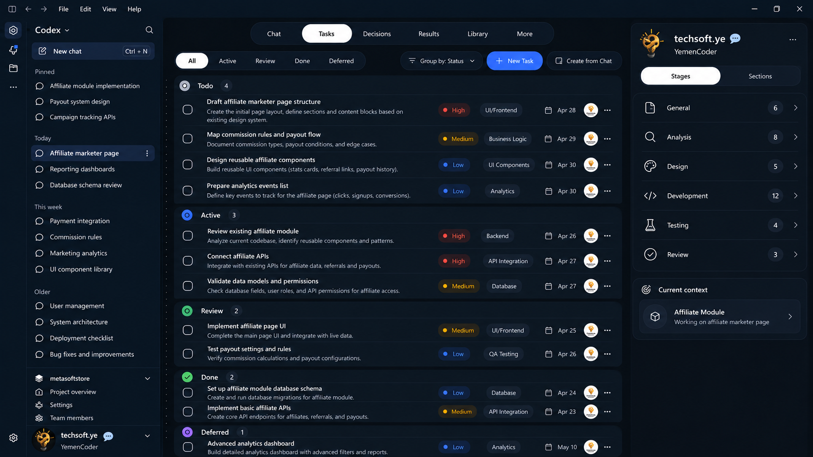
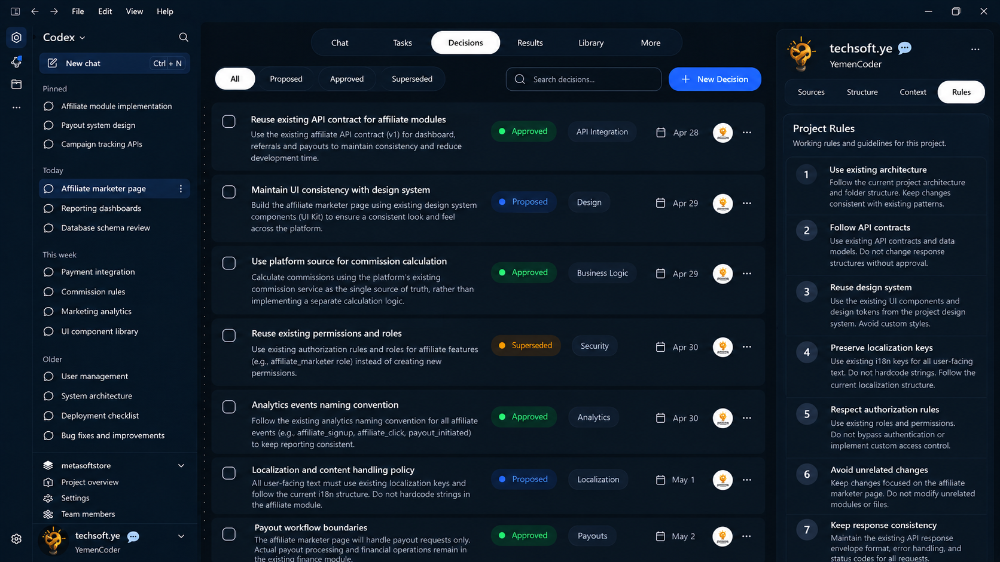
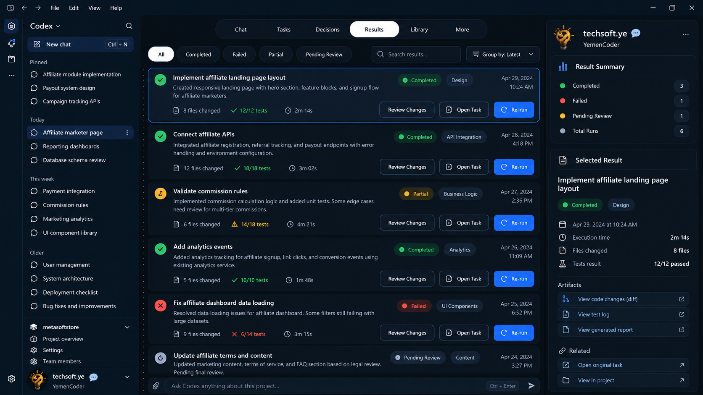

> **Historical source exhibit — not the current publication.** Wording reflects an earlier drafting stage; brand spelling and local image links have been normalized for this repository. For the selected publication, read the [current article](../../../article/Article-EN.md).

# Codex Studio — A Project-Centric Engineering Workspace for Agentic Software Development

*An independent product concept from TechSoft — proposed for discussion, not an announced OpenAI product.*

What happens when an agent finishes a task, but the reasons behind its changes are scattered across conversations? The code may be ready to review; the next session still requires reconstructing the requirement, the approved decision, the test outcome, and what remains unfinished.

I have encountered this friction while using Codex on ongoing software projects. The issue is less about generating code than **maintaining a shared, reliable understanding of a project over time**.

**In this post:**
1. The Idea in Brief
2. Why a Dedicated Codex Studio?
3. The Practical Problem
4. The Proposal
5. Workspace Experience
6. One Connected Development Workflow
7. Expected Value
8. A Practical Product Direction
9. Feedback & Further Details

## 01. The Idea in Brief

**Codex Studio** is a proposed standalone, developer-focused desktop product built around persistent project workspaces. It would connect conversations, tasks, approved decisions, execution results, and files into one coherent engineering record.

It is not a new model, a replacement for the Codex engine, or merely six tabs. It is a way to organize work spanning sessions and agent runs.

## 02. Why a Dedicated Codex Studio?

Codex already supports substantial workflows. The [Codex app announcement](https://openai.com/index/introducing-the-codex-app/) describes parallel agents, worktrees, skills, and change review. The [unified desktop app](https://help.openai.com/en/articles/20001276-moving-to-the-new-chatgpt-desktop-app) now includes Chat, Work, and a distinct Codex view.

This makes the case for a **specialized engineering experience**, not claims about missing capabilities. Sustained development needs clear constraints, reviewable decisions, coordinated tasks, and verified outcomes—not just messages.

Codex Studio could let these workflows evolve without crowding the general ChatGPT experience with specialist controls. It could have a distinct product identity while sharing underlying Codex infrastructure.

## 03. The Practical Problem

In a long-running project, an API constraint may live in one conversation, a UI decision in another, and a test outcome in an agent run. When work resumes, reconstructing that trail competes with making progress.

The questions are practical:

- Which choices were actually approved, and which were only discussed?
- What is still to do, in progress, or awaiting review?
- Which code changes and test results belong to a particular task?
- What should the next agent know without rereading unrelated sessions?

Search helps, but **finding a message is not the same as maintaining structured project state**.

## 04. The Proposal: Make the Project the Home of the Work

Each project would be a persistent workspace. A task could reference its originating request; a decision could explain an implementation constraint; and a result could link to its task, tests, and changed files.

This navigation would appear **inside projects**, not unrelated chats. Codex Studio could work alongside Git, VS Code, and Codex CLI rather than replacing established tools.

## 05. Workspace Experience: Six Connected Views

The interface concept keeps one consistent shell with six primary views:

- **Chat** — Discuss requirements, compare approaches, direct agents, and optionally turn a message or plan into a task.
- **Tasks** — Track `Todo`, `Active`, `Review`, `Done`, and `Deferred` work. Organize it by project **Stages** and **Sections**, with optional parent tasks, priorities, skills, due dates, and attachments.
- **Decisions** — Keep proposed, approved, and superseded technical or functional decisions, including rationale and origin. An agent's suggestion does **not** become an approved decision without the developer's confirmation.
- **Results** — See what each execution produced: a concise outcome, changed files, tests run or not run, review status, and links to supporting evidence. Multiple runs may relate to one task.
- **Library** — Find **Project Files** and **Session Files**, filter by file type or purpose, preview relevant resources, and follow links to inputs or generated artifacts. External sources would depend on supported integrations and permissions.
- **More** — Keep occasional tools, settings, and detailed execution logs accessible without overloading the main navigation.

The right-hand panel follows the active view: sources in Chat; **Stages / Sections** in Tasks; **project rules** in Decisions; execution evidence in Results. Rules should reference existing guidance such as `AGENTS.md`, not compete with it.

**The connections—not the tabs—are the feature.** Durable records require provenance and selective retrieval, not loading every file into every prompt. OpenAI's [guidance on skills and `AGENTS.md`](https://developers.openai.com/blog/rethinking-skills-and-prompts-for-gpt-6-astra) similarly emphasizes task-relevant context.

*Concept 1 — Tasks remain readable while Stages and Sections provide project-level navigation.*

*Concept 2 — Approved decisions are traceable records; applicable project rules remain visible separately.*

## 06. One Connected Development Workflow

*Illustrative scenario, not a claim about functionality already shipped.*

Imagine asking Codex in **Chat** to prepare an affiliate marketer page. It inspects the code and proposes a plan. The developer converts actionable steps into **Tasks**: review existing APIs, design components, validate commission-related data.

Should the page reuse an existing API contract? The developer records an approved **Decision**, including its rationale. Codex executes using its existing tools. **Results** links each run to changed files, available test evidence, and unresolved issues; **Library** keeps those files discoverable.

On returning next week, the developer can retrieve the relevant tasks, decision, and verified result together, without treating an agent's suggestion as an automatic approval.

*Concept 3 — A result is more than a "done" label: it has evidence, review actions, and a path back to the task.*

## 07. Expected Value

This approach could clarify project status, preserve the rationale for technical choices, and make agent output easier to verify. It might reduce repeated explanations when work resumes.

These are **hypotheses to test**, not measured productivity gains or promised token savings. The test is whether developers can resume and supervise work with less uncertainty.

## 08. A Practical Product Direction

An initial version need not recreate Jira, an IDE, or an agent runtime. It could connect project records around one dependable task-to-result workflow. OpenAI's published [Codex harness and App Server](https://openai.com/index/unlocking-the-codex-harness/) offer technical foundations worth evaluating.

A separate desktop product also carries maintenance and integration costs, particularly alongside the unified app. Those trade-offs matter. The proposal prioritizes the **product experience** while leaving implementation and packaging open to review.

## 09. Feedback & Further Details

I'd value feedback from developers and the Codex product and engineering teams:

1. **Where does your project history become hardest to manage today: tasks, decisions, evidence, or context across sessions?**
2. **Would a dedicated project-centric engineering workspace be meaningfully better than extending today's Codex view—and which connected workflow should come first?**

I plan to develop a **Full Product Concept RFC** covering the workflows, interfaces, integrations, and trade-offs; it is not yet complete. Feel free to message me to discuss the idea or request the detailed material when available.

*— TechSoft*
